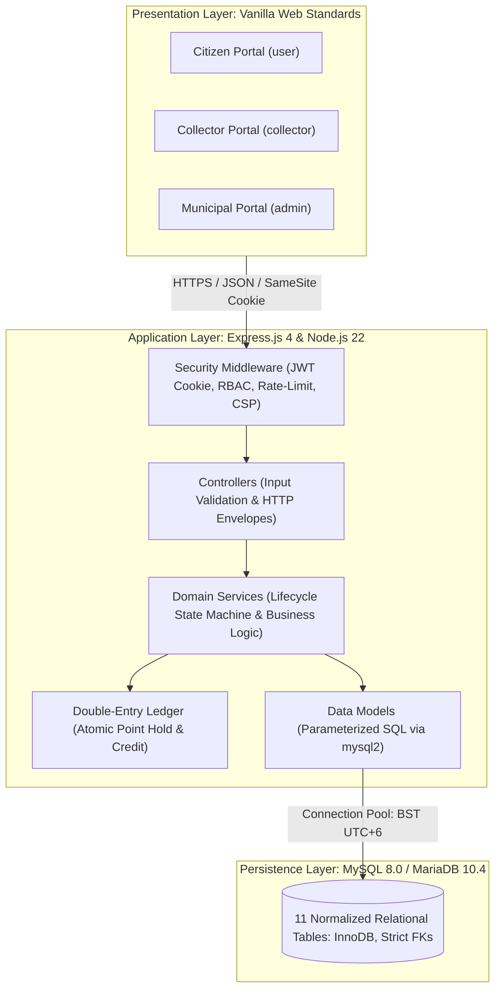
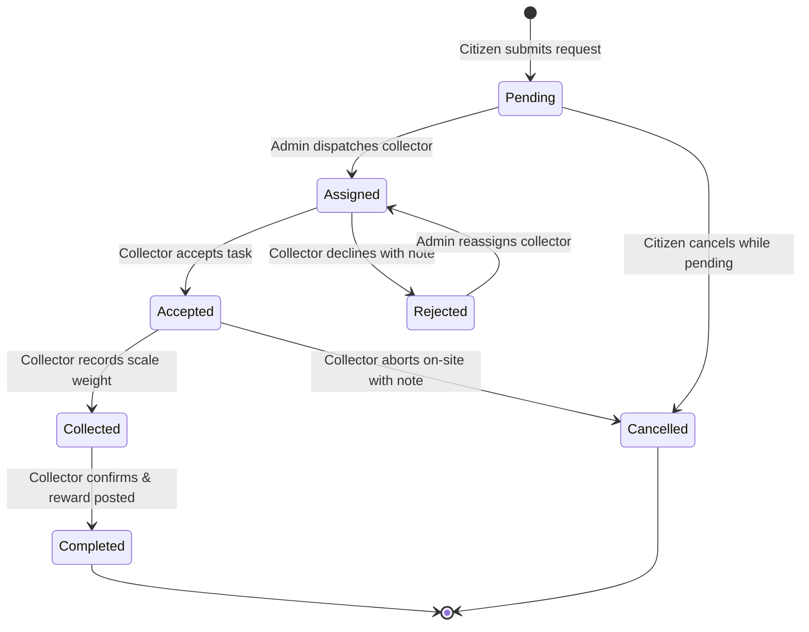

<div align="center">

# ♻️ Waste Resource Recycle (WRR)
### **Smart Municipal Solid Waste Management & Recyclable Reward Platform**

[](https://waste-resource-recycle.up.railway.app)
[](https://github.com/users/elnMohiuddinMolla/projects/2)
[](https://github.com/elnMohiuddinMolla/Waste-Resource-Recycle)
[](https://nodejs.org)
[](https://mariadb.org)
[](LICENSE)

<p align="center">
  <b>Transforming Urban Waste into Household Income through Verified Scale Recycling & Mobile Banking Payouts</b>
</p>

<p align="center">
  <a href="#-live-demo--test-credentials"><b>Explore Live Demo</b></a> •
  <a href="#-key-features-by-role"><b>Key Features</b></a> •
  <a href="#-system-architecture--state-machine"><b>Architecture & State Machine</b></a> •
  <a href="#-quick-start--local-setup"><b>Local Setup</b></a> •
  <a href="#-api-architecture-50-endpoints"><b>API Catalog</b></a> •
  <a href="#-automated-testing--benchmark-compliance"><b>Test Suite</b></a>
</p>

</div>

---

## 📌 Executive Summary

**Waste Resource Recycle (WRR)** is an end-to-end municipal solid waste recycling platform designed to accelerate the urban circular economy. It directly connects city households (**General Users**) with municipal **Waste Collectors** for scheduled, door-to-door collection of segregated recyclables (Plastic, Paper & Cardboard, E-waste, Metal, Glass).

When a collector weighs the segregated items on certified digital scales at the resident's doorstep, the system immediately credits reward points calculated mathematically as `Actual Weight (kg) × Category Point Rate`. Points accumulate in an immutable double-entry ledger that users can redeem for real cash payouts disbursed via **bKash**, **Nagad**, or direct **Bank Transfer**.

> [!NOTE]  
> **Course Context:** CSE-3112 Software Engineering Lab · **Faridpur Engineering College**  
> **Academic Supervisor:** Mohammad Shamsul Islam, Associate Professor & Head, Department of CSE  
> **Engineering Team:** MD Mohiuddin Molla (Reg: 2022254878) & Abdul Al Noman (Reg: 935)  
> **Methodology:** Waterfall SDLC with formal requirements modeling, 3NF normalized relational schema, and 100% automated test coverage.

---

## 💡 Core Value Proposition & Invariants

```
┌────────────────────────────────────────────────────────────────────────────────────────┐
│                                 WRR CORE SYSTEM INVARIANTS                             │
├─────────────────────────┬──────────────────────────────┬───────────────────────────────┤
│ 🛡️ Strict State Machine  │ 💰 Double-Spend Prevention   │ ⚖️ Immutable Rate Snapshots   │
│ 8 verified transitions. │ Signed double-entry points   │ Category rate frozen at       │
│ Out-of-order mutations  │ ledger. User balance locked  │ collection. Future rate       │
│ return HTTP 409 error.  │ via SELECT ... FOR UPDATE.   │ changes never alter past pts. │
├─────────────────────────┼──────────────────────────────┼───────────────────────────────┤
│ 📸 Photo Verification   │ 📊 Administrative Audit Trail│ ⚡ High-Speed Zero Framework  │
│ Compressed client-side  │ Certified scale dispute      │ Vanilla HTML5, CSS3 & ES6+.   │
│ preview ensures waste   │ corrections (FR-18) with     │ Strict Content-Security-Policy│
│ segregation compliance. │ negative-balance guards.     │ with zero inline scripts.     │
└─────────────────────────┴──────────────────────────────┴───────────────────────────────┘
```

---

## 🌐 Live Demo & Test Credentials

The system is deployed and active in cloud production:

> [!TIP]  
> **Live Production Server:** **[https://waste-resource-recycle.up.railway.app](https://waste-resource-recycle.up.railway.app)**  
> *All pre-seeded test accounts use the password:* **`password123`**

| Role | Test Email | Password | Primary Operational Scope |
|:---:|---|:---:|---|
| 🏛️ **Admin** | `admin@wrr.com` | `password123` | Municipal Headquarters: job dispatch, payouts, tariffs & reports |
| 🚚 **Collector** | `collector1@wrr.com` | `password123` | Zone 1 (Baitul Aman): active collection queue with accepted job |
| 🚚 **Collector** | `collector2@wrr.com` | `password123` | Zone 2 (Goalchamot): secondary municipal collection route |
| 🏠 **Resident** | `tanvir@gmail.com` | `password123` | Zone 1 Resident: wallet balance (`55.00 points`), verified history |
| 🏠 **Resident** | `sadia@gmail.com` | `password123` | Zone 3 Resident: active pending collection request |

---

## 🚀 Key Features by Role

### 🏠 1. General User (Citizen / Resident)
- **Doorstep Pickup Dispatch:** Select recyclable category, attach verified waste photo (compressed in-browser to $\le 1280\text{ px}$ JPEG), estimate weight, and choose preferred collection time.
- **Visual Lifecycle Tracking:** Visual progress stepper and chronological audit log tracking request from `Pending` to `Completed`.
- **Cancellation Controls:** Self-service cancellation allowed strictly while request remains `Pending`.
- **Signed Reward Ledger:** Live spendable point balance (`SUM(points)`), chronological credits/debits, and live BDT cashout preview.
- **Multi-Channel Cash Redemptions:** Cash out points to **bKash**, **Nagad**, or Bank accounts with atomic point locking.
- **In-App Notifications & Helpdesk:** Real-time milestone alerts and citizen support ticketing.

### 🚚 2. Waste Collector (Field Operative)
- **Assigned Job Board:** Zone-segregated task dashboard featuring pickup address and customer waste photo.
- **Direct Dial Integration:** Single-tap customer telephone calling for effortless on-site navigation.
- **Field Decision Workflow:** Accept assigned jobs or reject with mandatory explanatory audit remarks.
- **On-Site Cancellation (Abort):** Abort on-site if resident is absent or waste is contaminated.
- **Scale Measurement Recording:** Input certified digital scale weight ($> 0\text{ kg}$) with automatic point preview.
- **Atomic Job Completion:** One-click finalization that atomically archives record, posts points, and alerts resident.
- **Performance Analytics:** Daily and monthly collection metrics for total pickups and cumulative weight (kg).

### 🏛️ 3. Municipal Administrator (Operations & Finance)
- **Job Routing & Reassignment:** Central oversight queue to assign pending or rejected requests to active collectors.
- **Cash Disbursement Processing:** Review withdrawal requests, disburse via MFS merchant portals, record TrxIDs (`Paid`), or reject with automatic point refund.
- **Weight Dispute Auditing (FR-18):** Audit certified scale receipts, modify recorded weight, and atomically balance points.
- **Dynamic Tariff Management:** Configure recyclable commodity prices (`points_per_kg`) and monetary conversion rules (`taka_per_point`).
- **Territory & Account Control:** Configure municipal operational zones, provision collectors, and toggle account activation.
- **5 Executive BI Reports:** SQL analytical reports for Weight by Category, Volume by Status, Collector KPI, Point Liability, and Redemption Summary with CSV export and A4 print layout.

---

## 🏛️ System Architecture & State Machine



### 🔄 Formal 8-Transition Request State Machine (PRD §5.1)



---

## 🛠️ Technology Stack

| Architecture Tier | Technology Component | Version / Specification | Rationale & Standards |
|---|---|:---:|---|
| **Runtime** | [Node.js](https://nodejs.org/) | `v22.x LTS` | High-throughput asynchronous event loop |
| **Backend Framework** | [Express.js](https://expressjs.com/) | `v4.x` | Layered architecture (`routes → controllers → services → models`) |
| **Database Engine** | [MariaDB](https://mariadb.org/) / [MySQL](https://www.mysql.com/) | `10.4+` / `8.0+` | InnoDB storage engine with strict FK constraints & row locks |
| **Authentication** | [JWT](https://jwt.io/) + [bcryptjs](https://github.com/dcodeIO/bcrypt.js) | `256-bit` | Stateless JWT tokens stored in `HttpOnly`, `SameSite=Lax` cookies |
| **Frontend Stack** | Vanilla HTML5 / CSS3 / ES6+ | Modern Standards | Zero external UI frameworks for academic viva transparency |
| **Automated Testing** | Node Native Test Runner | `v22 Native` | 23 Unit Tests, 116 API Integration Tests, 45-step E2E Suite |
| **Cloud Hosting** | [Railway](https://railway.app/) | Nixpacks | Auto-deploy pipeline, managed MySQL, and persistent volume |

---

## 💻 Quick Start & Local Setup

### 1. Prerequisites
- **Node.js**: `v20` or `v22 LTS` installed ([nodejs.org](https://nodejs.org/))
- **XAMPP**: Local MySQL/MariaDB service running ([apachefriends.org](https://www.apachefriends.org/))
- **Git**: Installed on your operating system

### 2. Clone the Repository
```bash
git clone https://github.com/elnMohiuddinMolla/Waste-Resource-Recycle.git
cd Waste-Resource-Recycle
```

### 3. Initialize Database
Start **MySQL** in the XAMPP Control Panel (Port `3306`), then import the schema and seed scripts:
```bash
# Using standard XAMPP CLI path (Git Bash / PowerShell):
/c/xampp/mysql/bin/mysql.exe -u root < database/schema.sql
/c/xampp/mysql/bin/mysql.exe -u root < database/seed.sql
```

### 4. Configure Backend Environment
```bash
cd backend
npm install
cp .env.example .env
```
Generate a secure 64-character JWT secret:
```bash
node -e "console.log(require('crypto').randomBytes(32).toString('hex'))"
```
Configure your `backend/.env` file:
```env
PORT=5000
DB_HOST=localhost
DB_PORT=3306
DB_USER=root
DB_PASSWORD=
DB_NAME=wrr_db
JWT_SECRET=paste_your_generated_64_char_hex_secret_here
```

### 5. Launch Development Server
```bash
npm run dev
```
Open **`http://localhost:5000`** in your browser.

---

## 🔌 API Architecture (50 Endpoints)

All endpoints are mounted under `/api/v1` with standardized JSON response envelopes:

<details>
<summary><b>Click to expand the Full 50-Endpoint API Catalog</b></summary>
<br>

| Module | Method & Route | Auth & Role | Operational Summary |
|---|---|:---:|---|
| **Auth** | `POST /api/v1/auth/register` | Public | Citizen self-registration |
| | `POST /api/v1/auth/login` | Public | Verify credentials; issue HttpOnly cookie |
| | `POST /api/v1/auth/logout` | Public | Invalidate session cookie |
| | `GET /api/v1/auth/me` | Authenticated | Fetch active user profile and role |
| **Catalog** | `GET /api/v1/categories` | Public | List active recyclable categories and rates |
| | `GET /api/v1/zones` | Public | List municipal service zones |
| **Pickups** | `POST /api/v1/pickup-requests` | Resident (`user`) | Create pickup request with waste photo |
| | `GET /api/v1/pickup-requests/mine` | Resident (`user`) | List user's requests with status filter |
| | `GET /api/v1/pickup-requests/:id` | Owner / Collector / Admin | Get request details with audit timeline |
| | `GET /api/v1/pickup-requests/:id/photo` | Authenticated | Stream verified waste photo |
| | `PUT /api/v1/pickup-requests/:id/cancel` | Resident (`user`) | Cancel request strictly while Pending |
| **Collector** | `GET /api/v1/collector/requests` | Collector | Assigned tasks in collector's zone |
| | `PUT /api/v1/collector/requests/:id/accept` | Collector | Accept assigned pickup task |
| | `PUT /api/v1/collector/requests/:id/reject` | Collector | Reject task with mandatory reason |
| | `PUT /api/v1/collector/requests/:id/abort` | Collector | On-site cancellation with reason note |
| | `POST /api/v1/collector/collection-records` | Collector | Record actual weight & snapshot rate |
| | `PUT /api/v1/collector/requests/:id/complete` | Collector | Atomic completion: credit points to ledger |
| | `GET /api/v1/collector/history` | Collector | Paginated historical collection records |
| **Rewards** | `GET /api/v1/rewards/balance` | Resident (`user`) | Calculate live point balance (`SUM(points)`) |
| | `GET /api/v1/rewards/history` | Resident (`user`) | Full ledger transactions (`EARN`, `REDEEM`, etc.) |
| **Redemptions**| `GET /api/v1/redemptions/rules/active` | User / Admin | Active conversion rate & min points |
| | `POST /api/v1/redemptions` | Resident (`user`) | Cash withdrawal request (locks points) |
| | `GET /api/v1/redemptions/mine` | Resident (`user`) | User's cash redemption history |
| **Notifications**| `GET /api/v1/notifications` | Authenticated | List in-app notifications & unread badge count |
| | `PATCH /api/v1/notifications/:id/read` | Authenticated | Mark single notification as read |
| | `PATCH /api/v1/notifications/read-all` | Authenticated | Mark all notifications as read |
| **Support** | `POST /api/v1/support-tickets` | User / Collector | Open support inquiry ticket |
| | `GET /api/v1/support-tickets/mine` | User / Collector | List user's support tickets & replies |
| | `PATCH /api/v1/support-tickets/:id/close` | Owner / Admin | Close resolved support ticket |
| | `GET /api/v1/admin/support-tickets` | Admin | Filter & list municipal support queue |
| | `PUT /api/v1/admin/support-tickets/:id/reply`| Admin | Reply to ticket & notify submitter |
| **Admin Operations** | `GET /api/v1/admin/pickup-requests` | Admin | Filter all pickup jobs across municipality |
| | `PUT /api/v1/admin/pickup-requests/:id/assign` | Admin | Assign active collector to job |
| | `GET /api/v1/admin/redemptions` | Admin | List redemption payout requests |
| | `PATCH /api/v1/admin/redemptions/:id` | Admin | Approve / Pay (with TrxID) / Reject (Refund) |
| | `GET /api/v1/admin/collection-records` | Admin | Audit certified scale receipts |
| | `PUT /api/v1/admin/collection-records/:id` | Admin | Scale dispute correction & balance guard |
| | `GET /api/v1/admin/categories` | Admin | Manage recyclable categories & tariffs |
| | `POST /api/v1/admin/categories` | Admin | Add new recyclable waste category |
| | `PUT /api/v1/admin/categories/:id` | Admin | Update category tariff & active state |
| | `GET /api/v1/admin/zones` | Admin | View operational zones |
| | `POST /api/v1/admin/zones` | Admin | Add new operational zone |
| | `PUT /api/v1/admin/zones/:id` | Admin | Update zone boundaries & active status |
| | `GET /api/v1/admin/redemption-rules` | Admin | List current & archived payout tariffs |
| | `POST /api/v1/admin/redemption-rules` | Admin | Set new active currency conversion rule |
| | `GET /api/v1/admin/users` | Admin | User & collector accounts audit |
| | `POST /api/v1/admin/collectors` | Admin | Provision new collector account |
| | `PATCH /api/v1/admin/users/:id/status` | Admin | Activate / deactivate user account |
| | `PATCH /api/v1/admin/users/:id/zone` | Admin | Reassign collector's operating zone |
| | `GET /api/v1/admin/reports/:type` | Admin | 5 SQL BI reports (weight, volume, KPI, liability, payout) |

</details>

---

## 🧪 Automated Testing & Benchmark Compliance

Test suites are executed from the `backend/` directory:

```bash
cd backend

# 1. Run unit test suite (Validators, state machines, math precision, security rules)
npm test

# 2. Run API integration suite (Runs on isolated test database wrr_test)
npm run test:api

# 3. Run complete lifecycle end-to-end integration walkthrough (45 assertions)
npm run e2e

# 4. Run static frontend compliance check (CSP, no inline JS, no innerHTML)
npm run check:frontend

# 5. Run NFR-02 high-concurrency performance benchmark (50 virtual users, 1,000 queries)
npm run perf
```

### 📊 Benchmark Performance Results (NFR-02 Verification)
- ⚡ **Core Transactional API Response Time:** $\approx 150\text{ ms}$ *(Strict SLA limit: $\le 2.0\text{ s}$)*
- 📈 **Complex Analytical BI Report Generation:** $\approx 110\text{ ms}$ *(Strict SLA limit: $\le 5.0\text{ s}$)*
- 🔒 **Database Integrity:** Test suites automatically rebuild a dedicated `wrr_test` database, preventing any corruption of development or production datasets.

---

## 📂 Directory Structure

<details>
<summary><b>Click to expand full Directory Tree</b></summary>
<br>

```
Waste_Resource_Recycle/
├── backend/
│   ├── src/
│   │   ├── config/          # MySQL connection pool (Bangladesh BST timezone), secrets
│   │   ├── middleware/      # Auth (HttpOnly JWT), RBAC, rate limiter, CSP security headers, error handler
│   │   ├── routes/          # REST route routers mounted under /api/v1
│   │   ├── controllers/     # Request validation, status codes, response serialization
│   │   ├── services/        # Business workflows, state machines, ACID transactions, notifications
│   │   ├── models/          # Prepared parameterized SQL queries only
│   │   ├── utils/           # AppError, transaction wrapper, money & image helpers, photo store
│   │   └── app.js           # Express app setup and static frontend serving
│   ├── test/                # Unit test suites and API integration tests
│   ├── scripts/             # Performance benchmark, E2E walkthrough, frontend checker
│   └── package.json
├── database/
│   ├── schema.sql           # Complete 11-table relational DDL with constraints & indexes
│   ├── seed.sql             # Test users, default zones, waste rates, and sample lifecycle data
│   └── migrations/          # Incremental database migration scripts (photo, support tickets)
├── frontend/
│   ├── index.html           # Public landing page with live category tariffs
│   ├── login.html           # Authentication portal
│   ├── register.html        # Citizen self-registration
│   ├── help.html            # Public FAQ and emergency contact information
│   ├── support.html         # User & collector help desk and ticket submission
│   ├── user/                # Resident portal (Dashboard, New Request, Requests, History, Redeem)
│   ├── collector/           # Field operative portal (Dashboard, Assigned Jobs, Record Weight, History)
│   ├── admin/               # Municipal admin portal (Dashboard, Queues, Redemptions, Governance, Reports)
│   ├── css/style.css        # Responsive mobile-first CSS3 theme
│   └── js/                  # Reusable ES6+ modules (api.js, ui.js, auth.js, notifications.js)
├── docs/                    # Architecture diagrams, test cases, ERD, viva defense notes, Railway deployment guide
├── .github/                 # Issue templates (Bug Report, Feature Request) & PR template
├── LICENSE                  # MIT License
├── CONTRIBUTING.md          # Contribution guidelines and coding conventions
├── AGENTS.md                # Engineering handbook for developers and AI agents
└── README.md                # Primary repository documentation
```

</details>

---

## 📚 Academic Documentation Index

| File | Scope & Technical Focus |
|---|---|
| [`WRR_PRD.md`](WRR_PRD.md) | **Single Source of Truth:** Requirements (FR-01–FR-22, NFR-01–NFR-08), state machine & business rules |
| [`api-spec.md`](api-spec.md) | Comprehensive API manual: routes, payloads, responses, validation, and error envelopes |
| [`database.md`](database.md) | Database architecture: table specifications, indexes, foreign keys, transaction workflows |
| [`architecture.md`](architecture.md) | System architecture: layered monolith design, security boundaries, and middleware integration |
| [`dfd.md`](dfd.md) | Structured analysis: Level 0 Context Diagram, Level 1 DFD, and Level 2 process decomposition |
| [`docs/er-diagram.md`](docs/er-diagram.md) | Up-to-date Entity Relationship Diagram (ERD) matching `schema.sql` |
| [`docs/test-cases.md`](docs/test-cases.md) | 50 academic test cases covering all FRs, edge cases, and non-functional requirements |
| [`docs/viva-notes.md`](docs/viva-notes.md) | Viva examination preparation guide with architectural rationales and 20 sample Q&As |
| [`docs/deploy-railway.md`](docs/deploy-railway.md) | Production cloud deployment runbook (Railway server, MySQL, and persistent volume) |

---

## 👥 Engineering Team & Credits

- **MD Mohiuddin Molla** — Registration: `2022254878`
- **Abdul Al Noman** — Registration: `935`
- **Supervisor:** **Mohammad Shamsul Islam**, Associate Professor & Head, Department of Computer Science and Engineering, Faridpur Engineering College.

---

## 📄 License

This project is licensed under the **MIT License** — see the [LICENSE](LICENSE) file for complete details.

---
