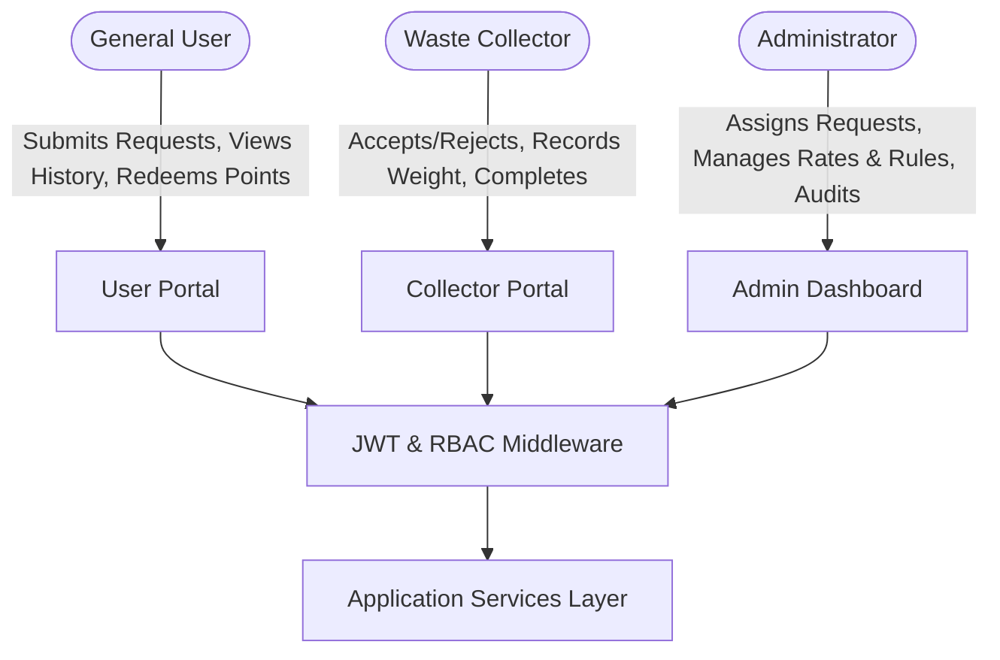
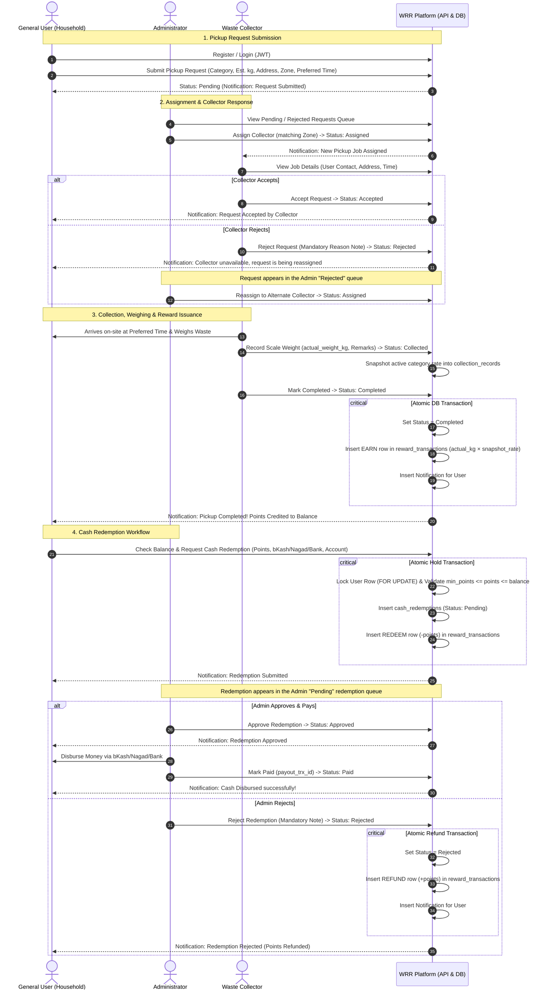
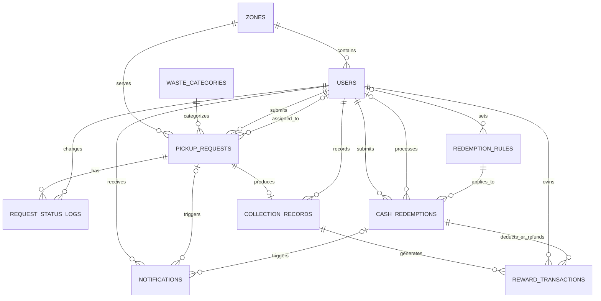
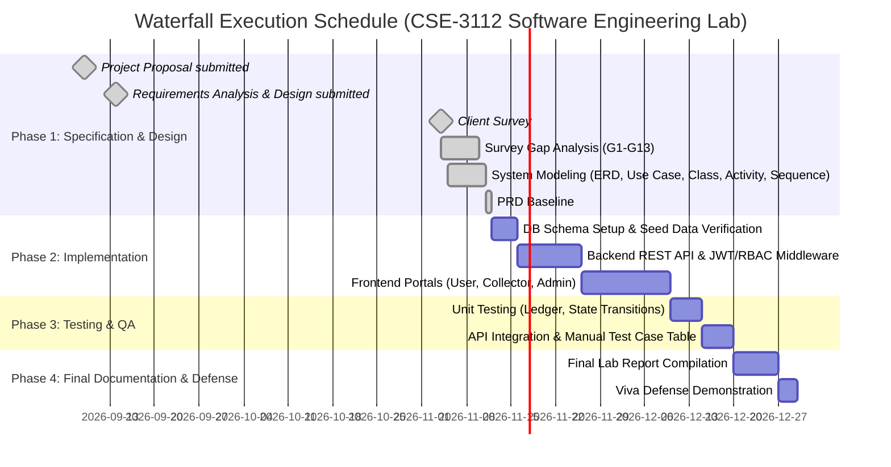

# Product Requirements Document (PRD)
## Waste Resource Recycle (WRR) Management System

| Document Attribute | Specification Details |
|---|---|
| **Project Title** | Waste Resource Recycle (WRR) Management System |
| **Document Version** | 1.3.0 (Consistency pass across all design documents) |
| **Status** | Approved / Baseline for Implementation |
| **Date** | November 11, 2026 |
| **Academic Course** | Software Engineering Lab (CSE-3112) |
| **Academic Department** | Department of Computer Science & Engineering (CSE) |
| **Institution** | Faridpur Engineering College |
| **Course Supervisor** | Mohammad Shamsul Islam, Associate Professor & Head, Dept. of CSE |
| **Project Team** | **MD Mohiuddin Molla** (Reg: 2022254878)<br>**Abdul Al Noman** (Reg: 935) *(spelling to be confirmed, see G12)* |
| **SDLC Methodology** | Waterfall Model (Requirements & Design $\to$ Implementation $\to$ Testing $\to$ Lab Defense) |
| **Architecture** | Three-Tier Architecture (Presentation $\to$ Application $\to$ Data) |
| **Source of Truth** | This PRD is the source of truth for requirements. Detailed contracts: [`api-spec.md`](api-spec.md) (REST API), [`database.md`](database.md) (schema, queries, transactions), [`architecture.md`](architecture.md), [`dfd.md`](dfd.md). The earlier `WRR_Revised_Requirements_and_Design.md` is archived in `docs/archive/`. |

---

## 1. Executive Summary & Product Vision

### 1.1 Product Vision
**Waste Resource Recycle (WRR)** is a web-based, three-tier management platform designed to formalize, digitize, and incentivize the collection of household recyclable waste in Bangladesh. By establishing a direct, transparent connection between residential households (General Users) and organized local waste collectors, WRR turns domestic recyclable waste into a valuable, trackable resource rather than landfill garbage.

### 1.2 Core Value Proposition
- **For Households (General Users):** Digital, on-demand doorstep recyclable pickup requests; flexible preferred scheduling; transparent on-site scale weighing; and a ledger-based reward system offering direct cash redemption through mobile financial services (bKash, Nagad) or bank accounts.
- **For Waste Collectors:** Organized, zone-optimized collection schedules with clear contact and route information, eliminating informal street scouting and guaranteeing verified digital collection records.
- **For System Administrators:** Comprehensive control over user/collector roles, collector routing by zone, dynamic commodity point valuation, redemption approval workflows, dispute resolution/weight correction audits, and operational analytics.
- **For the Environment & Society:** Direct diversion of high-value recyclable solid waste (plastic, paper, e-waste, metals, glass) away from overflowing municipal open dumps, promoting sustainable circular economy practices.

---

## 2. Problem Statement & Client Survey Background

### 2.1 The Environmental & Municipal Problem
1. **Unregulated Waste Disposal:** Rapid urbanization and increased consumption of consumer packaged goods and electronics generate immense amounts of solid waste in urban Bangladesh.
2. **Loss of High-Value Recyclables:** Valuable secondary materials are routinely co-mingled with organic municipal refuse, creating heavy environmental contamination and losing reclaimable raw materials.
3. **Informal & Inefficient Ecosystem:** Traditional recyclable scrap collection relies on unorganized itinerant collectors ("feriwala" / "tokai") with unpredictable collection schedules, inconsistent manual pricing, and zero digital accountability.
4. **Lack of Citizen Motivation:** Without convenient pickup options and tangible economic incentives, households lack the incentive to sort recyclables at the source.

### 2.2 Survey Traceability & Gap-Fix Log (G1–G13)
This PRD incorporates all findings from the client survey (`WRR_REQ_Question_SURVEY.pdf`) and the gap-fix resolutions documented in `WRR_Revised_Requirements_and_Design.md`:

| Gap ID | Defect / Omission in Original Design | Survey Origin | Engineering Resolution & PRD Update |
|---|---|---|---|
| **G1** | Notifications requested by client but missing in spec | Survey Q11 | Added `FR-14` and dedicated `notifications` table; in-website alert system. |
| **G2** | Administrative reporting missing | Survey Q30 & Suggestions | Added `FR-17` specifying 5 concrete management query reports (no extra table needed). |
| **G3** | Preferred pickup date/time in schema but absent from FRs | Survey Q8, Q9 | Added `preferred_at` to `FR-03`; must be strictly in the future. |
| **G4** | Request statuses undefined; "Rejected" status missing | Survey Q22 | Standardized strict 7-state lifecycle (6 survey states + `Cancelled`). |
| **G5** | Reward calculation originally specified as "weight only" | Survey Q14 | Clarified formula: $\text{Points} = \text{weight} \times \text{points\_per\_kg}$; snapshot rate stored in record. |
| **G6** | Missing database storage for point-to-cash conversion rate | Survey Q15, Q29 | Created `redemption_rules` table with audit timestamps and single active rule constraint (`FR-16`). |
| **G7** | Cash redemptions did not atomically deduct points | System consistency | Converted `reward_transactions` into a signed points ledger (`EARN`, `REDEEM`, `REFUND`, `ADJUST`). |
| **G8** | Requester contact number missing from pickup requests | Survey Q8, Q18 | Added `contact_phone` to `pickup_requests`, defaulting to user profile phone. |
| **G9** | Admin lacked capability to correct erroneous scale weights | Project scope | Added `FR-18` for admin weight correction with balancing ledger adjustments. |
| **G10** | Estimated quantity missing from pickup submission | Survey Q8 | Integrated `estimated_weight_kg` into `FR-03`. |
| **G11** | Status logs omitted previous state and rejection reasons | Collector workflow | Added `old_status`, `new_status`, and `note` (mandatory rejection reason) in `request_status_logs`. |
| **G12** | Teammate name discrepancy across earlier documents | Header consistency | Standardized as **Abdul Al Noman** across all deliverables. Earlier documents also say "Roman"; **spelling still to be confirmed.** |
| **G13** | Architectural diagram lacked newly added modules | System architecture | Updated 3-tier diagram to include Notifications, Redemption Rules, and 10 tables. |

---

## 3. Product Roles & Access Control Matrix (RBAC)

WRR enforces strict server-side Role-Based Access Control (`FR-02`):



### 3.1 Role Profiles & Permissions
| Permission / Capability | General User (`user`) | Waste Collector (`collector`) | Administrator (`admin`) |
|---|:---:|:---:|:---:|
| Self-Registration & Login | Yes | Login Only (Created by Admin) | Login Only (Pre-seeded) |
| Submit Recyclable Pickup Request | Yes | No | No |
| Cancel Pickup Request | Yes (Pending status only) | No | No |
| View Assigned Requests & Filter by Zone | No | Yes (Assigned requests only) | Yes (All requests) |
| Accept or Reject Request (with reason) | No | Yes | No (Reassigns) |
| Record Actual Scale Weight (`actual_weight_kg`) | No | Yes | Yes (Weight Correction only) |
| Abort Accepted Request On-Site (with reason) | No | Yes | No |
| Mark Request as Completed | No | Yes | No |
| View Own Collection History & Ledger | Yes | Yes (Collections completed) | Yes (all collection records + points-liability report) |
| Request Cash Redemption | Yes | No | No |
| Approve / Reject / Mark Paid Redemptions | No | No | Yes |
| Manage Zones, Categories, and Conversion Rules | No | No | Yes |
| Generate Analytical Management Reports | No | No | Yes |

---

## 4. End-to-End User Flows & Interaction Journey Maps

WRR coordinates three distinct actors in a cohesive workflow. The sequence diagram below shows how a pickup request progresses from user submission, through admin routing and collector fulfillment, to point reward and final cash disbursement:



---

### 4.1 Detailed Flow: General User (Household Resident)

```
[Register / Login] ──> [User Dashboard] ──> [Submit Request] ──> [Track Status]
                             │                                         │
                             ├── [View History & Points] <─────────────┤ (On Completion)
                             │                                         │
                             └── [Request Cash Redemption] ────────────┘ (When balance >= min_points)
```

1. **Onboarding & Authentication:**
   - Household resident visits the WRR portal, submits self-registration form (Full Name, unique Email, Phone Number, Pickup Address, Zone, Password).
   - Logs in with email/password. The server sets the JWT in an `HttpOnly` cookie (JavaScript cannot read it).
2. **Dashboard Overview:**
   - User sees live stats: Available Point Balance, Total Completed Pickups, Active Requests, and Unread Notifications Badge.
3. **Pickup Request Submission (`FR-03`):**
   - User selects an active Waste Category from dropdown (Plastic, Paper, E-waste, Metal, Glass, Other).
   - If "Other Recyclable Waste" is selected, a descriptive text box is mandatory.
   - Enters Estimated Weight (kg), confirms/edits pickup address and contact phone number.
   - Selects a Preferred Date & Time (`preferred_at`), enforced strictly in the future.
   - Clicks "Submit Request" $\to$ Status initialized to `Pending`.
4. **Request Tracking & Timeline (`FR-05`):**
   - User tracks request progression in real time: `Pending` $\to$ `Assigned` $\to$ `Accepted` $\to$ `Collected` $\to$ `Completed`.
   - Each transition displays timestamp, acting party, and notes.
5. **Cancellation Window (`FR-06`):**
   - While status remains `Pending`, a "Cancel Request" button is available.
   - Once Admin assigns a collector (`Assigned`), cancellation is blocked to protect collector routing.
6. **In-Website Notifications (`FR-14`):**
   - Alerts on every milestone of the user's requests and redemptions (full list in `FR-14`). The page polls for new notifications every 30 seconds.
7. **Collection History & Points Inspection (`FR-11`, `FR-12`):**
   - User inspects past collections, viewing verified actual weight, applied points/kg rate, and points earned.
   - Point balance is calculated dynamically as $\sum \text{reward\_transactions.points}$.
8. **Cash Redemption Request (`FR-15`):**
   - When balance $\ge \text{min\_points}$ (e.g. 100 points), user opens redemption form.
   - System calculates cash payout in BDT based on active `taka_per_point` (e.g. 100 points = 50 BDT).
   - User selects payout channel (`bKash`, `Nagad`, `Bank`) and enters account number.
   - Submitting executes an atomic transaction holding points via a negative `REDEEM` ledger row.

---

### 4.2 Detailed Flow: Waste Collector

```
[Admin Creates Account] ──> [Collector Login] ──> [Assigned Requests Queue]
                                                         │
                                        ┌────────────────┴────────────────┐
                                        ▼                                 ▼
                                  [Accept Job]                   [Reject Job (with Note)]
                                        │                                 │
                                        ▼                                 ▼
                                 [Go to Location]                  (Returns to Admin)
                                        │
                                        ▼
                             [Weigh Waste & Record]
                                        │
                                        ▼
                              [Mark as Completed]
```

1. **Account Provisioning & Login (`FR-01`, `FR-20`):**
   - Waste Collector accounts are created exclusively by the Administrator with pre-allocated zones. Collectors cannot self-register.
   - Collector logs in with credentials provided by management.
2. **Collector Job Queue & Zone Filtering (`FR-07`, `FR-08`):**
   - Collector dashboard displays all requests currently assigned to them by Admin.
   - Can filter assigned tasks by Zone and Status.
   - Each card displays requester name, contact phone number, exact pickup address, material category, estimated weight, and preferred pickup window.
3. **Acceptance / Rejection Decision (`FR-08`):**
   - **Acceptance:** Collector accepts the job $\to$ status moves to `Accepted`. System notifies the household that their collector is scheduled.
   - **Rejection:** If collector cannot fulfill (e.g. vehicle breakdown, overload, out of service area), collector clicks "Reject", enters a **mandatory reason note** $\to$ status shifts to `Rejected`. System immediately returns the request to the Admin assignment queue with the rejection reason logged.
4. **On-Site Physical Collection & Weighing (`FR-09`):**
   - Collector arrives at household location at preferred schedule.
   - Collector inspects recyclables and measures weight on a certified physical scale.
   - Collector opens mobile web portal, enters `actual_weight_kg` ($> 0.00$) and optional operational remarks.
   - Submitting sets status to `Collected` and permanently records snapshot rate `points_per_kg_applied`.
5. **Completion & Reward Trigger (`FR-10`):**
   - Collector taps "Mark as Completed".
   - System closes the job as `Completed`, atomically creates the user's `EARN` reward points in the ledger, and alerts the user.
6. **Collection History Archive (`FR-12`):**
   - Collector can view historical summary of all completed collections, total kilograms collected, and daily fulfillment metrics.

---

### 4.3 Detailed Flow: Administrator (Platform Supervisor)

```
[Admin Login] ──> [Operations Dashboard]
                        │
      ┌─────────────────┼─────────────────────────┬─────────────────────────┐
      ▼                 ▼                         ▼                         ▼
[Manage Requests] [Manage Users/Collectors] [Catalog & Zone Setup] [Redemption & Finance]
 (Assign/Reassign)  (Create/Zone Assign)    (Categories & Rates)    (Approve/Reject/Disburse)
      │                                                                     │
      ▼                                                                     ▼
[Dispute Audit]                                                    [Management Reports]
 (Weight Adjust)                                                    (5 Query Analytics)
```

1. **Administrative Login & Overview Dashboard:**
   - Admin logs into the central control panel.
   - Real-time KPI widgets: Pending Requests, Active Collectors, Unassigned/Rejected Queue, Total Tonnage Collected, Pending Cash Redemptions, and System Points Liability.
2. **User & Collector Management (`FR-20`):**
   - View complete directory of registered general users and field collectors.
   - Create new collector accounts, set passwords, and assign operating zone (`zone_id`).
   - Toggle account status (`active` / `inactive`) to revoke access when necessary.
3. **Request Routing & Collector Assignment (`FR-07`, `FR-08`):**
   - Admin monitors the incoming `Pending` requests and collector-`Rejected` requests.
   - Selects an unassigned request and assigns an active collector operating in the matching zone.
   - System shifts status to `Assigned` and notifies the collector.
4. **Catalog, Rates & Zone Governance (`FR-16`, `FR-19`):**
   - **Zones:** Create and manage operational wards/neighborhoods (e.g. Baitul Aman, Goalchamot, Jhiltuly).
   - **Categories:** Create or modify waste categories, configure active status, and calibrate `points_per_kg` reward values.
5. **Cash Redemption Governance & Disbursement (`FR-16`, `FR-21`):**
   - Set platform conversion rule in `redemption_rules` (`taka_per_point` and `min_points`). Only one rule is active at any time.
   - Review pending redemption queue displaying user name, points redeemed, cash amount in BDT, payout channel (`bKash`, `Nagad`, `Bank`), and account number.
   - **Approve & Pay:** Admin verifies account and sets `Approved`, then sends payment through mobile financial service/bank and sets `Paid`, entering the bKash/Nagad/Bank transaction ID (`payout_trx_id`, mandatory for `Paid`).
   - **Reject:** If account number is invalid or fraudulent (while `Pending` or `Approved`, never after `Paid`), Admin rejects with a mandatory explanation note. System automatically posts a `REFUND` ledger entry, restoring the user's points immediately.
6. **Collection Record Management & Dispute Resolution (`FR-18`):**
   - If a household reports a scale discrepancy or incorrect entry, Admin audits the collection record.
   - Admin updates `actual_weight_kg`.
   - The platform verifies the user balance will remain non-negative, automatically inserts an `ADJUST` ledger row for the differential points, and logs the change.
7. **Analytical Management Reporting (`FR-17`):**
   - Admin generates 5 predefined analytical query reports across customizable date intervals and zones:
     1. Total Weight Collected by Category & Zone.
     2. Pickup Requests Breakdown by Status.
     3. Collector Performance (completed tasks, collected tonnage, rejection rates).
     4. Financial Points Balance: Points issued vs. redeemed vs. outstanding liability.
     5. Cash Redemptions Summary by Status.

---

### 4.4 Role Handoff & Interaction Matrix

| Workflow Phase | Action / Event | Initiated By | Handed Off To | System Validation & Effect |
|---|---|:---:|:---:|---|
| **Phase 1: Request** | Submit Pickup Job | General User | Administrator | Validates future schedule; creates `Pending` job; notifies user. |
| **Phase 2: Routing** | Assign Collector | Administrator | Waste Collector | Validates collector is active; sets `Assigned`; notifies collector. |
| **Phase 3: Decision** | Accept Job | Waste Collector | General User | Sets `Accepted`; notifies user of scheduled collection. |
| **Phase 3 (Alt): Decision** | Reject Job | Waste Collector | Administrator | Requires reason note; sets `Rejected`; re-queues for Admin reassignment. |
| **Phase 4: Field Weighing** | Record Weight | Waste Collector | Platform | Validates `actual_weight_kg > 0`; snapshots rate into `collection_records`; sets `Collected`. |
| **Phase 5: Completion** | Complete Job | Waste Collector | General User | Atomic transaction: sets `Completed`, posts `EARN` ledger entry, updates point balance, notifies user. |
| **Phase 6: Redemption** | Request Cash | General User | Administrator | Atomic transaction: locks user row, validates balance $\ge \text{points}$, creates `REDEEM` ledger entry (holds points). |
| **Phase 7: Disbursement** | Approve / Pay | Administrator | General User | Verifies payout; sets `Approved` $\to$ `Paid`; notifies user. |
| **Phase 7 (Alt): Disbursement** | Reject Redemption | Administrator | General User | Requires admin note; sets `Rejected`; posts `REFUND` ledger entry (restores points); notifies user. |
| **Phase 8: Audit** | Correct Weight | Administrator | General User | Validates balance $\ge 0$; updates record; posts `ADJUST` ledger entry; logs audit history. |

---

## 5. Business Logic & Domain Rules

### 5.1 Strict Pickup Request State Lifecycle
Any transition not in the table below is rejected by the server with **HTTP 409 Conflict**:

```
Pending ──(Admin assigns)──> Assigned ──(Collector accepts)──> Accepted ──(Collector weighs)──> Collected ──(Collector completes)──> Completed
   │                           ▲   │                              │
   │ (User cancels)            │   │ (Collector rejects + note)   │ (Collector aborts on-site + note)
   ▼                           │   ▼                              ▼
Cancelled                      └── Rejected                    Cancelled
                       (Admin reassigns)
```

| # | From | To | Actor | Condition |
|:---:|---|---|---|---|
| T1 | `Pending` | `Assigned` | Admin | Collector is active and has role `collector` |
| T2 | `Rejected` | `Assigned` | Admin | Same as T1 (reassignment) |
| T3 | `Pending` | `Cancelled` | User (owner) | — |
| T4 | `Assigned` | `Accepted` | Assigned collector | — |
| T5 | `Assigned` | `Rejected` | Assigned collector | Mandatory reason note; `collector_id` is cleared |
| T6 | `Accepted` | `Collected` | Assigned collector | `actual_weight_kg > 0`; creates the collection record |
| T7 | `Accepted` | `Cancelled` | Assigned collector | Mandatory reason note (on-site abort) |
| T8 | `Collected` | `Completed` | Assigned collector | Posts the `EARN` ledger row in the same transaction |

1. **Pending:** Initial state upon submission. User can cancel only in this state (`FR-06`).
2. **Assigned:** Admin binds a specific collector (`collector_id`). The system notifies the collector.
3. **Accepted:** Assigned collector agrees to perform the pickup.
4. **Rejected:** Assigned collector declines with a mandatory explanation note before going on-site. The request returns to the Admin assignment queue.
5. **Collected:** Collector arrives on-site, measures actual weight on a verified physical scale, records `actual_weight_kg` ($> 0$), and logs remarks.
6. **Completed:** Collector confirms the transaction. Status shifts to `Completed`, atomically generating an `EARN` transaction in `reward_transactions` and notifying the user.
7. **Cancelled:** Triggered in two scenarios: (a) User withdrew the request while still `Pending`, or (b) Collector aborts on-site from `Accepted` with a mandatory reason note (e.g. resident absent, unreachable after repeated attempts, or waste contaminated/non-recyclable).
8. **Status Audit Logging:** Every single state mutation logs a permanent row in `request_status_logs` containing `old_status`, `new_status`, `changed_by_id`, `note`, and `changed_at`.

### 5.2 Waste Categories & Applied Valuation
- **Initial Supported Categories (seed data; rates are example values for testing and are set by the Admin):**
  1. **Plastic:** `points_per_kg = 10.00`
  2. **Paper & Cardboard:** `points_per_kg = 6.00`
  3. **E-waste:** `points_per_kg = 25.00`
  4. **Metal:** `points_per_kg = 15.00`
  5. **Glass:** `points_per_kg = 4.00`
  6. **Other Recyclable Waste:** `points_per_kg = 5.00` (`is_other = true`; requires user description)
- **Snapshot Pricing Guarantee:** When actual weight is recorded, the current category rate is permanently written into `collection_records.points_per_kg_applied`. Future administrative rate updates never alter historical rewards.

### 5.3 Signed Points Ledger & Double-Spend Prevention
Every change to a user's points is stored as one signed row in `reward_transactions` (positive = credit, negative = debit). Points earned per collection:
$$\text{Points Earned} = \text{ROUND}(\text{actual\_weight\_kg} \times \text{points\_per\_kg\_applied}, 2)$$

- **User Balance Formula:**
  $$\text{User Balance} = \sum \text{reward\_transactions.points} \quad (\text{Constraint: } \text{Balance} \ge 0)$$
- **Ledger Transaction Types (`txn_type`):**
  - `EARN`: Positive points credited upon request completion. Exactly one `EARN` row allowed per collection record.
  - `REDEEM`: Negative points debited upon cash redemption submission.
  - `REFUND`: Positive points returned if Admin rejects a cash redemption.
  - `ADJUST`: Signed differential points created during an Admin weight correction (`FR-18`).
- **Non-negative balance rule:** A downward weight correction (`FR-18`) is refused if the resulting `ADJUST` entry would make the user's balance negative (for example, because the points were already redeemed). The Admin must then resolve the case manually.

### 5.4 Cash Redemption Workflow & Protocol
1. **Validation Checks:**
   - Active conversion rule exists in `redemption_rules`.
   - $\text{min\_points} \le \text{points\_redeemed} \le \text{User Balance}$.
2. **Payout Calculation:**
   $$\text{cash\_amount (BDT)} = \text{points\_redeemed} \times \text{taka\_per\_point}$$
   *(Default seed rule: $\text{taka\_per\_point} = 0.50 \text{ BDT}$, $\text{min\_points} = 100 \text{ points}$)*
3. **Atomic Hold & Release Execution:**
   - **Step 1 (Submission):** In a single database transaction: first lock the user's row (`SELECT user_id FROM users WHERE user_id = ? FOR UPDATE`), then compute the balance and validate, then insert `cash_redemptions` (`status = 'Pending'`) and an immediate negative `REDEEM` entry into `reward_transactions`. The row lock makes concurrent redemptions by the same user run one after another, and the `REDEEM` entry holds the points so they cannot be spent twice.
   - **Step 2A (Rejection):** From `Pending` or `Approved`, Admin rejects redemption with a mandatory note $\to$ status becomes `Rejected`, and a positive `REFUND` ledger entry is posted in the same transaction, restoring the user's point balance.
   - **Step 2B (Approval & Disbursement):** Admin approves (`Pending` $\to$ `Approved`) $\to$ disburses cash via selected payout channel (`bKash`, `Nagad`, `Bank`) $\to$ marks status as `Paid` (`Approved` $\to$ `Paid`) with a mandatory `payout_trx_id`.
   - **Allowed redemption transitions:** `Pending → Approved`, `Pending → Rejected`, `Approved → Paid`, `Approved → Rejected`. `Paid` and `Rejected` are final. Anything else returns HTTP 409.

---

## 6. Detailed Functional Requirements (FR-01 to FR-21)

| Requirement ID | Module | Functional Description & Verification Rules |
|---|---|---|
| **FR-01** | Authentication | **Registration & Login:** General Users self-register with full name, email, phone, password, address, and zone. Collectors are created exclusively by Admin. All roles log in via email and password (minimum 8 characters, hashed with `bcryptjs`, cost $\ge 10$). Sessions use a stateless JWT stored in an `HttpOnly` cookie (7-day expiry); users can log out. |
| **FR-02** | Security | **Role-Based Access Control:** Every API endpoint is restricted by role. Deactivated accounts (`status = 'inactive'`) are rejected at authentication. |
| **FR-03** | Pickup | **Pickup Request Submission:** User submits category, estimated weight (kg, required, $> 0$), pickup address, contact phone, zone, and a preferred date/time. `preferred_at` must be strictly in the future. If `is_other = true`, `other_description` is mandatory. Initial status is `Pending`. |
| **FR-04** | Catalog | **Waste Category Visibility:** Only categories marked `is_active = true` are presented to users in pickup forms. |
| **FR-05** | Tracking | **Request Tracking:** Users can view the current status and the full chronological audit history of each submitted request. |
| **FR-06** | Pickup | **Request Cancellation:** The user may cancel a pickup request strictly while it remains in `Pending` status. Transition to `Cancelled` logs the action and halts further processing. |
| **FR-07** | Operations | **Collector Assignment:** Admin assigns an active collector to a `Pending` or `Rejected` request (preferring matching zone). Request status transitions to `Assigned`. |
| **FR-08** | Operations | **Accept / Reject Workflow:** Assigned collector accepts (`Accepted`) or rejects (`Rejected`). A rejection requires a mandatory explanatory reason in `note` and returns the request to the admin pool. After accepting, the collector may abort on-site (`Accepted` $\to$ `Cancelled`) with a mandatory reason, e.g. resident absent or waste not recyclable. |
| **FR-09** | Collection | **Collection & Weight Recording:** Collector marks request `Collected` and records `actual_weight_kg` ($> 0.00$). The active category point rate is snapshotted into `points_per_kg_applied`. |
| **FR-10** | Rewards | **Request Completion & Reward Trigger:** Collector marks request `Completed`. In a single database transaction the system updates the request status, sets `completed_at` on the collection record (created in FR-09), adds the `EARN` ledger entry, writes the status log, and creates a user notification. |
| **FR-11** | Rewards | **Reward Point Calculation:** $\text{Points} = \text{ROUND}(\text{actual\_weight\_kg} \times \text{points\_per\_kg\_applied}, 2)$. Enforced ledger consistency prevents retroactive rate alterations. |
| **FR-12** | History | **Collection History:** Paginated history with filters. Users filter their requests by status, date range and waste category (`GET /pickup-requests/mine`) and see their full points ledger; collectors filter their completed collections by date range and waste category (`GET /collector/history`). |
| **FR-13** | Audit | **Status Audit Logging:** Every status change is captured in `request_status_logs` recording `old_status`, `new_status`, `changed_by_id`, `note`, and `changed_at`. |
| **FR-14** | Notifications | **In-Website Notifications:** A `notifications` row is created for these 11 events (`type` code → recipient):<br>`PICKUP_SUBMITTED` → user · `PICKUP_ASSIGNED` → collector · `PICKUP_ACCEPTED` → user · `PICKUP_REJECTED` → user · `PICKUP_ABORTED` → user · `PICKUP_COLLECTED` → user · `PICKUP_COMPLETED` (with points) → user · `REDEMPTION_REQUESTED` → user · `REDEMPTION_APPROVED` → user · `REDEMPTION_REJECTED` (points refunded) → user · `REDEMPTION_PAID` (with TrxID) → user.<br>Admins do not receive notification rows; their dashboard shows live queue counts (Pending/Rejected requests, Pending/Approved redemptions). Includes unread count badge, mark-one-read and mark-all-read. |
| **FR-15** | Redemptions | **Cash Redemption Request:** User requests redemption specifying points ($\ge \text{min\_points}$, $\le \text{balance}$), payout channel (`bKash`, `Nagad`, `Bank`), and account number. Points are held immediately via a `REDEEM` ledger entry. |
| **FR-16** | Governance | **Redemption Rules Management:** Admin configures `taka_per_point` and `min_points`. Exactly one rule is active at any time; prior rules are archived for historical audit. |
| **FR-17** | Analytics | **Administrative Reports:** Admin can generate 5 distinct reports (computed via SQL queries):<br>1. Total weight collected by category, zone, and date range.<br>2. Request volume broken down by status.<br>3. Collector performance (completed pickups, total kg, rejection rate).<br>4. Points issued vs. points redeemed vs. outstanding liability.<br>5. Redemption summary by status.<br>Reports can be printed or exported. |
| **FR-18** | Governance | **Collection Record Management & Weight Correction:** Admin can view all collection records and correct erroneous scale weights. In one transaction the system updates `actual_weight_kg`, creates an `ADJUST` ledger row for the point difference, and writes a `request_status_logs` row (`old_status = new_status = 'Completed'`, `changed_by_id` = admin, `note` = "Weight corrected from X kg to Y kg") so the correction records who made it and when. A correction that would make the user's balance negative is refused with HTTP 422 (see §5.3). |
| **FR-19** | Governance | **Zone Management:** Admin can create, modify, activate, and deactivate operational zones. |
| **FR-20** | Governance | **User & Collector Management:** Admin can view, activate, and deactivate user accounts, create collector accounts, and assign collectors' operating zones. |
| **FR-21** | Redemptions | **Redemption Processing:** Admin reviews redemptions to approve, reject (from `Pending` or `Approved`, with mandatory note; creates `REFUND` ledger entry), or mark `Paid` (from `Approved`, with mandatory `payout_trx_id`). See §5.4 for allowed transitions. |

---

## 7. Non-Functional Requirements (NFR-01 to NFR-08)

All three survey performance priorities (Q31–Q33) were ranked as **Very Important**, establishing NFR-01 through NFR-03 as top-level system constraints:

| ID | Quality Attribute | Measurable Engineering Requirement |
|---|---|---|
| **NFR-01** | **Usability** | A user must be able to submit a pickup request within $\le 3$ screen transitions. Form inputs must feature clear semantic labels, input masks, and helpful inline validation. The layout must be visually consistent across all three role portals. |
| **NFR-02** | **Performance** | Core transactional API operations (submission, assignment, weighing, status updates) must respond in $\le 2.0$ seconds. Complex analytical reports must generate in $\le 5.0$ seconds under a simulated load of 50 concurrent active users. |
| **NFR-03** | **Security** | 1. Passwords (minimum 8 characters) hashed using `bcryptjs` (work factor $\ge 10$).<br>2. All traffic between browser and server uses HTTPS in deployment (plain HTTP on `localhost` during development).<br>3. 100% of database interactions must use parameterized queries (via `mysql2`) to eliminate SQL injection.<br>4. All HTML rendering must escape untrusted strings to prevent XSS (use `textContent`, never `innerHTML` with user data).<br>5. Login is rate-limited to **5 failed attempts per 15 minutes** per IP (HTTP 429).<br>6. JWT kept in an `HttpOnly`, `SameSite=Lax` cookie; never returned in a response body or stored in `localStorage`.<br>7. Strict server-side RBAC and ownership checks on every endpoint.<br>8. The server refuses to start with a `JWT_SECRET` shorter than 32 characters or the example value.<br>9. Every response sends a Content-Security-Policy (same-origin scripts and styles only), `X-Content-Type-Options: nosniff`, `X-Frame-Options: DENY` and `Referrer-Policy: same-origin`; the `X-Powered-By` header is removed.<br>10. Login answers an unknown email and a wrong password with the same message and the same response time. |
| **NFR-04** | **Reliability & ACID** | Workflows modifying multiple tables (e.g., Completion + Reward `EARN`; Redemption + Ledger `REDEEM`) must execute inside atomic database transactions (`START TRANSACTION` / `COMMIT` / `ROLLBACK`). User balance must never be negative. |
| **NFR-05** | **Availability** | The system must guarantee $\ge 99\%$ uptime during designated core operating hours (8:00 AM – 10:00 PM BST). |
| **NFR-06** | **Compatibility** | Fully functional and visually responsive across current desktop and mobile versions of Google Chrome, Mozilla Firefox and Microsoft Edge starting from a minimum viewport width of $360\text{ px}$. |
| **NFR-07** | **Maintainability** | Clean layered architectural pattern: `routes` $\to$ `controllers` $\to$ `services` $\to$ `models`. All sensitive configuration stored strictly in environment variables (`.env`, with `.env.example` committed). REST APIs are documented. Code must be clean and easily explainable in an academic viva defense. |
| **NFR-08** | **Auditability** | Full historical audit trails: all status transitions, administrative weight corrections (logged in `request_status_logs`, see FR-18), and redemption decisions (`admin_id`, `processed_at`) must record the initiating user ID and precise server timestamp. |

---

## 8. System Architecture & Technology Stack

The project adheres to a strict Three-Tier Architecture, as specified in the proposal and lab syllabus:

```
[Presentation Tier]        Vanilla HTML5 + CSS3 + Vanilla JavaScript (Fetch API, cookie sent automatically)
         │                 (Role-specific responsive portals: User, Collector, Admin)
         │                 Static files served by the same Express server (same origin, no CORS)
         ▼ HTTPS / JSON  (/api/v1/...)
[Application Tier]         Node.js + Express.js REST API
                           (Layered: routes -> controllers -> services -> models)
                           (Middleware: JWT cookie auth, Role RBAC, Rate Limiting, Error Handling)
         ▼ Parameterized SQL (mysql2)
[Data Persistence Tier]    MySQL 8.0+ or MariaDB 10.4+ (XAMPP) — 10 Normalized Tables, InnoDB
```

### 8.1 Technology Stack Specifications
- **Frontend Layer:** Plain HTML5, CSS3 (responsive grid and flexbox), and Vanilla ES6+ JavaScript. **No external frontend frameworks** (such as React, Next.js, Vue, or Angular), as fixed by the project proposal and for viva explainability. Express serves the `frontend/` folder with `express.static`, so pages and API share one origin.
- **Backend Layer:** Node.js (v18+ LTS) with Express.js for REST routing and middleware architecture.
- **Database Layer:** MySQL 8.0+ or MariaDB 10.4+ (the database bundled with XAMPP), leveraging strict foreign key constraints, `DECIMAL(10,2)` for financial/point figures, `CHECK` constraints, and transactional storage engine (`InnoDB`). The schema uses only features both support.
- **Security & Utilities:** `bcryptjs` for password hashing, `jsonwebtoken` for auth tokens, `cookie-parser`, `dotenv`, and `express-rate-limit`. (`cors` is not needed because frontend and API share one origin.)

---

## 9. Database Schema & Data Dictionary (10 Tables)

The complete, executable SQL DDL is `database/schema.sql`, documented in [`database.md`](database.md) §9. The summary below must stay in sync with it.

> **Note:** The report's ER diagram (`WRR_ER_Diagram_A4.svg`, `WRR_ER_Diagram_Revised.mmd`) still shows the original columns and must be redrawn to match the schema below.



### 9.1 Detailed Table Definitions

#### 1. `zones`
Stores collection territories and municipal wards.
- `zone_id` INT AUTO_INCREMENT PRIMARY KEY
- `name` VARCHAR(100) NOT NULL UNIQUE
- `description` TEXT
- `is_active` BOOLEAN NOT NULL DEFAULT TRUE

#### 2. `users`
Accounts for all three system roles.
- `user_id` INT AUTO_INCREMENT PRIMARY KEY
- `full_name` VARCHAR(100) NOT NULL
- `email` VARCHAR(100) NOT NULL UNIQUE
- `phone` VARCHAR(20) NOT NULL
- `password_hash` VARCHAR(255) NOT NULL
- `role` ENUM('user','collector','admin') NOT NULL DEFAULT 'user'
- `address` VARCHAR(255)
- `zone_id` INT NULL, FOREIGN KEY $\to$ `zones(zone_id)` *(required by the API for collectors; zones are deactivated, never deleted)*
- `status` ENUM('active','inactive') NOT NULL DEFAULT 'active'
- `created_at` DATETIME NOT NULL DEFAULT CURRENT_TIMESTAMP

#### 3. `waste_categories`
Recyclable material definitions and point conversion rates.
- `category_id` INT AUTO_INCREMENT PRIMARY KEY
- `name` VARCHAR(100) NOT NULL UNIQUE
- `points_per_kg` DECIMAL(10,2) NOT NULL CHECK (`points_per_kg` >= 0)
- `is_other` BOOLEAN NOT NULL DEFAULT FALSE
- `is_active` BOOLEAN NOT NULL DEFAULT TRUE

#### 4. `pickup_requests`
Primary lifecycle table for recycling pickup jobs.
- `request_id` INT AUTO_INCREMENT PRIMARY KEY
- `user_id` INT NOT NULL, FOREIGN KEY $\to$ `users(user_id)`
- `category_id` INT NOT NULL, FOREIGN KEY $\to$ `waste_categories(category_id)`
- `zone_id` INT NOT NULL, FOREIGN KEY $\to$ `zones(zone_id)`
- `collector_id` INT NULL, FOREIGN KEY $\to$ `users(user_id)`
- `pickup_address` VARCHAR(255) NOT NULL
- `contact_phone` VARCHAR(20) NOT NULL
- `other_description` TEXT
- `estimated_weight_kg` DECIMAL(10,2) NOT NULL CHECK (`estimated_weight_kg` > 0)
- `preferred_at` DATETIME NOT NULL
- `status` ENUM('Pending','Assigned','Accepted','Rejected','Collected','Completed','Cancelled') NOT NULL DEFAULT 'Pending'
- `created_at` DATETIME NOT NULL DEFAULT CURRENT_TIMESTAMP
- `updated_at` DATETIME NOT NULL DEFAULT CURRENT_TIMESTAMP ON UPDATE CURRENT_TIMESTAMP
- *Indexes:* `idx_req_status (status)`, `idx_req_collector (collector_id, status)`, `idx_req_zone (zone_id, status)`

#### 5. `request_status_logs`
Immutable audit log tracking all status transitions (rows are never updated or deleted).
- `log_id` INT AUTO_INCREMENT PRIMARY KEY
- `request_id` INT NOT NULL, FOREIGN KEY $\to$ `pickup_requests(request_id)` (ON DELETE RESTRICT)
- `changed_by_id` INT NOT NULL, FOREIGN KEY $\to$ `users(user_id)`
- `old_status` VARCHAR(20)
- `new_status` VARCHAR(20) NOT NULL
- `note` VARCHAR(255) *(holds mandatory collector rejection reasons)*
- `changed_at` DATETIME NOT NULL DEFAULT CURRENT_TIMESTAMP

#### 6. `collection_records`
Verified physical scale measurements and applied rates.
- `record_id` INT AUTO_INCREMENT PRIMARY KEY
- `request_id` INT NOT NULL UNIQUE, FOREIGN KEY $\to$ `pickup_requests(request_id)`
- `collector_id` INT NOT NULL, FOREIGN KEY $\to$ `users(user_id)`
- `actual_weight_kg` DECIMAL(10,2) NOT NULL CHECK (`actual_weight_kg` > 0)
- `points_per_kg_applied` DECIMAL(10,2) NOT NULL
- `collected_at` DATETIME NOT NULL
- `completed_at` DATETIME NULL
- `remarks` TEXT

#### 7. `redemption_rules`
Conversion rate and threshold configurations.
- `rule_id` INT AUTO_INCREMENT PRIMARY KEY
- `taka_per_point` DECIMAL(10,4) NOT NULL CHECK (`taka_per_point` > 0)
- `min_points` DECIMAL(10,2) NOT NULL DEFAULT 0 CHECK (`min_points` >= 0)
- `is_active` BOOLEAN NOT NULL DEFAULT TRUE
- `updated_by` INT NOT NULL, FOREIGN KEY $\to$ `users(user_id)`
- `effective_from` DATETIME NOT NULL DEFAULT CURRENT_TIMESTAMP
- `active_key` generated column (`1` when active, else `NULL`) with UNIQUE index `uq_rule_single_active` *(database enforces "only one active rule")*

#### 8. `cash_redemptions`
User withdrawal requests and disbursement tracking.
- `redemption_id` INT AUTO_INCREMENT PRIMARY KEY
- `user_id` INT NOT NULL, FOREIGN KEY $\to$ `users(user_id)`
- `rule_id` INT NOT NULL, FOREIGN KEY $\to$ `redemption_rules(rule_id)`
- `points_redeemed` DECIMAL(10,2) NOT NULL CHECK (`points_redeemed` > 0)
- `cash_amount` DECIMAL(10,2) NOT NULL
- `payout_method` VARCHAR(50) NOT NULL *(bKash, Nagad, Bank)*
- `payout_account` VARCHAR(255) NOT NULL
- `payout_trx_id` VARCHAR(100) NULL *(bKash/Nagad/Bank Transaction Reference ID recorded by Admin on payout)*
- `status` ENUM('Pending','Approved','Rejected','Paid') NOT NULL DEFAULT 'Pending'
- `admin_id` INT NULL, FOREIGN KEY $\to$ `users(user_id)`
- `admin_note` VARCHAR(255)
- `requested_at` DATETIME NOT NULL DEFAULT CURRENT_TIMESTAMP
- `processed_at` DATETIME NULL

#### 9. `reward_transactions`
Signed points ledger (positive = credit, negative = debit); the user balance is SUM(points).
- `transaction_id` INT AUTO_INCREMENT PRIMARY KEY
- `user_id` INT NOT NULL, FOREIGN KEY $\to$ `users(user_id)`
- `txn_type` ENUM('EARN','REDEEM','REFUND','ADJUST') NOT NULL
- `record_id` INT NULL, FOREIGN KEY $\to$ `collection_records(record_id)`
- `redemption_id` INT NULL, FOREIGN KEY $\to$ `cash_redemptions(redemption_id)`
- `points` DECIMAL(10,2) NOT NULL *(positive = credit, negative = debit)*
- `created_at` DATETIME NOT NULL DEFAULT CURRENT_TIMESTAMP
- `earn_record_id` generated column (`record_id` when `txn_type = 'EARN'`, else `NULL`) with UNIQUE index `uq_rt_one_earn` *(database enforces "exactly one EARN per collection record")*
- *Index:* `idx_rt_user (user_id)`

#### 10. `notifications`
In-website user notifications.
- `notification_id` INT AUTO_INCREMENT PRIMARY KEY
- `user_id` INT NOT NULL, FOREIGN KEY $\to$ `users(user_id)`
- `request_id` INT NULL, FOREIGN KEY $\to$ `pickup_requests(request_id)`
- `redemption_id` INT NULL, FOREIGN KEY $\to$ `cash_redemptions(redemption_id)`
- `type` VARCHAR(50) NOT NULL
- `message` VARCHAR(255) NOT NULL
- `is_read` BOOLEAN NOT NULL DEFAULT FALSE
- `created_at` DATETIME NOT NULL DEFAULT CURRENT_TIMESTAMP
- *Index:* `idx_notif_user (user_id, is_read)`

---

## 10. REST API Summary

The complete REST contract (request/response bodies, validation, status codes) lives in **[`api-spec.md`](api-spec.md)**, which is the single source for endpoint names. This section only lists the modules.

- **Base URL:** `/api/v1` (same origin as the frontend).
- **Auth:** JWT in an `HttpOnly` cookie named `token`, set by `POST /api/v1/auth/login` and cleared by `POST /api/v1/auth/logout` (logout works even without a valid session).
- **Status codes:** `400` validation error · `401` not logged in · `403` wrong role or inactive account · `404` not found · `409` invalid state transition or duplicate (e.g. email) · `422` business rule broken (e.g. insufficient balance, negative-balance weight correction) · `429` too many login attempts · `500` server error.

| Module | Endpoints (prefix `/api/v1`) | FRs |
|---|---|---|
| Auth | `POST /auth/register`, `POST /auth/login`, `POST /auth/logout`, `GET /auth/me` | FR-01, FR-02 |
| Public catalog | `GET /categories`, `GET /zones` | FR-03, FR-04 |
| User requests | `POST /pickup-requests`, `GET /pickup-requests/mine`, `GET /pickup-requests/:id`, `PUT /pickup-requests/:id/cancel` | FR-03, FR-05, FR-06 |
| Collector | `GET /collector/requests`, `PUT /collector/requests/:id/accept`, `/reject`, `/abort`, `/complete`, `POST /collector/collection-records`, `GET /collector/history` | FR-08 – FR-10, FR-12 |
| Rewards | `GET /rewards/balance`, `GET /rewards/history` | FR-11, FR-12 |
| Redemptions | `GET /redemptions/rules/active`, `POST /redemptions`, `GET /redemptions/mine` | FR-15 |
| Notifications | `GET /notifications`, `PATCH /notifications/:id/read`, `PATCH /notifications/read-all` | FR-14 |
| Admin operations | `GET /admin/pickup-requests`, `PUT /admin/pickup-requests/:id/assign`, `GET /admin/redemptions`, `PATCH /admin/redemptions/:id`, `GET /admin/collection-records`, `PUT /admin/collection-records/:id` | FR-07, FR-18, FR-21 |
| Admin governance | `/admin/categories`, `/admin/zones`, `/admin/redemption-rules`, `/admin/users`, `POST /admin/collectors`, `PATCH /admin/users/:id/status`, `PATCH /admin/users/:id/zone` | FR-16, FR-19, FR-20 |
| Reports | `GET /admin/reports/:type` (5 types) | FR-17 |

---

## 11. Software Engineering Lab Plan & Milestones

Following the **Waterfall SDLC**:



*Phase 2–4 dates are planned estimates; adjust them to the lab's final submission deadline.*

### 11.1 Planned Codebase Directory Layout
```
Waste_Resource_Recycle/
├── backend/
│   ├── src/
│   │   ├── config/          # db.js (mysql2 connection pool)
│   │   ├── middleware/      # auth.js (JWT cookie), role.js (RBAC), error.js, rateLimiter.js
│   │   ├── routes/          # auth, catalog, pickup, collector, reward, redemption, notification, admin
│   │   ├── controllers/     # Controller handlers per route
│   │   ├── services/        # Business logic (ledger calculation, state machine validation)
│   │   ├── models/          # Data queries / prepared SQL statements
│   │   ├── utils/           # AppError, transaction helper, validators, money
│   │   └── app.js           # Express app: middleware, /api/v1 routes, express.static('../frontend')
│   ├── test/                # unit/ (npm test) and api/ (npm run test:api, uses wrr_test)
│   ├── package.json
│   ├── .env.example
│   └── .env                 # Local credentials (never committed)
├── database/
│   ├── schema.sql           # Complete 10-table MySQL DDL with constraints
│   └── seed.sql             # Default admin, zones, categories, sample rates, test users
├── frontend/
│   ├── index.html           # Landing page
│   ├── login.html           # Authentication portal
│   ├── register.html        # General user self-registration
│   ├── user/                # dashboard, new-request, requests, history, redeem, notifications
│   ├── collector/           # dashboard, requests, record-weight, records
│   ├── admin/               # dashboard, users, collectors, requests, zones, categories,
│   │                        # rules, redemptions, records, reports
│   ├── css/                 # Global styling, responsive layout, modal alerts
│   └── js/                  # api.js (fetch wrapper, credentials: 'same-origin'), portal logic
├── docs/
│   └── archive/             # Superseded documents (kept for the lab report history)
├── AGENTS.md                # Project context and rules for AI agents and teammates
├── prompt.md                # Ready-made task prompts for the remaining steps
├── WRR_Project_Idea.md      # Initial proposal
├── WRR_PRD.md               # Product Requirements Document (source of truth)
├── api-spec.md              # REST API contract
├── database.md              # Schema, constraints, report queries, transactions, seed data
├── architecture.md          # System architecture
├── dfd.md                   # Data Flow Diagrams
├── prd-analysis.md          # Business analysis of the PRD
└── requirement-validation.md  # Requirements validation report
```

---

## 12. Testing & Acceptance Matrix

### 12.1 Automated & Unit Test Coverage
1. **Request State Machine Unit Tests:**
   - Attempting illegal status transitions (e.g., `Pending` $\to$ `Collected` without `Assigned` & `Accepted`) must return HTTP 409.
   - User cancellation must succeed on `Pending` and fail on `Assigned`.
2. **Reward Ledger Formula Unit Tests:**
   - Exact mathematical precision: $\text{points} = \text{ROUND}(\text{actual\_weight\_kg} \times \text{points\_per\_kg\_applied}, 2)$.
   - Balance verification: $\text{Balance} = \sum \text{points} \ge 0$.
3. **Double-Spend Prevention Tests:**
   - Submitting a cash redemption for more than the current available balance must be blocked.
   - Two concurrent redemption attempts on the same balance must result in the second request failing validation: the `SELECT ... FOR UPDATE` lock on the user's row makes it wait until the first `REDEEM` entry is committed, so it sees the reduced balance.
4. **Weight Correction Tests:**
   - A correction creates exactly one `ADJUST` row equal to the point difference and one `request_status_logs` audit row.
   - A downward correction that would make the balance negative is refused (HTTP 422).

### 12.2 Acceptance Criteria for Lab Defense
- [x] Complete PRD and System Design tracing back to client survey priorities.
- [x] Database initialized with all 10 tables and verified foreign keys.
- [ ] End-to-end user request submission $\to$ admin assignment $\to$ collector acceptance and weighing $\to$ automated points crediting.
- [ ] Cash redemption workflow demonstrating point lock on request, refund on rejection, and paid completion.
- [ ] In-website notification delivery across all primary milestones.
- [ ] Clean, layered, framework-free codebase prepared for CSE-3112 viva examination.
