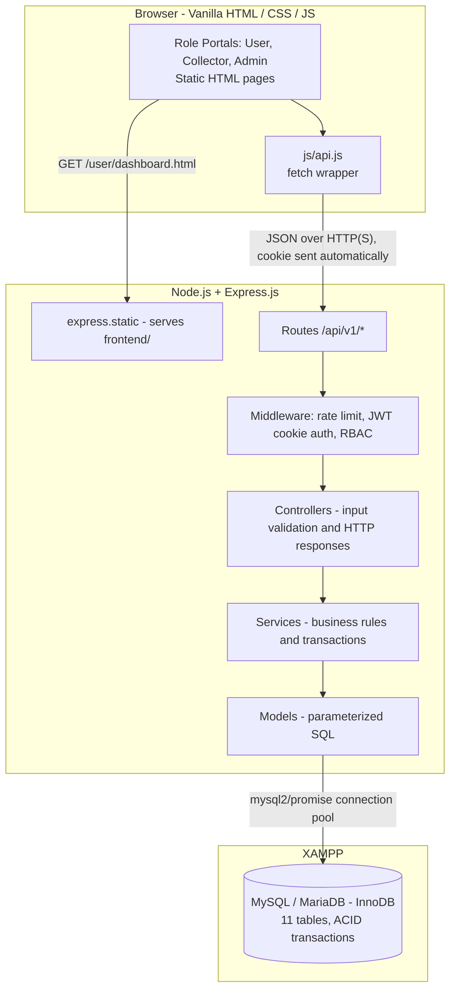

# System Architecture Document
## Waste Resource Recycle (WRR) Management System

**Document Version:** 1.1.0  
**Date:** November 11, 2026  
**Pattern:** Three-Tier Architecture with a layered Express.js backend  
**Technology Stack:** Vanilla HTML/CSS/JavaScript (Frontend) + Node.js/Express.js (Backend) + MySQL/MariaDB via XAMPP (Database)  
**Target Specification:** [`WRR_PRD.md`](WRR_PRD.md) · API contract: [`api-spec.md`](api-spec.md) · Database: [`database.md`](database.md)  
**Academic Context:** CSE-3112 Software Engineering Lab, Faridpur Engineering College  
**Team:** MD Mohiuddin Molla (Reg: 2022254878), Abdul Al Noman (Reg: 935)

---

## 1. High-Level Architectural Overview

WRR follows the **three-tier architecture** fixed in the project proposal. One Express.js server does two jobs: it serves the static frontend files (HTML, CSS, JS) and it exposes the REST API under `/api/v1`. Because pages and API come from the **same origin**, the browser sends the login cookie automatically and no CORS setup is needed.



---

## 2. Layered Architecture Breakdown

### 2.1 Presentation Tier (Vanilla HTML / CSS / JS)
- **No frontend framework** (no React, Next.js, Vue or Angular), as fixed by the proposal (PRD §8.1).
- **Styling:** plain CSS with Flexbox/Grid, mobile-first, working from 360 px width (NFR-06).
- **Data fetching:** `js/api.js` wraps `fetch` with `credentials: 'same-origin'`, parses the standard JSON envelope, and redirects to `login.html` on HTTP 401.
- **Live updates:** the notifications badge and request lists poll the API every 30 seconds (no WebSockets).
- **XSS safety:** user-supplied text is inserted with `textContent`, never `innerHTML` (NFR-03).
- **No inline code:** the server's Content-Security-Policy only allows scripts and styles from separate files on the same server. Pages must load `.js` and `.css` files; inline `<script>` blocks, `onclick="..."` attributes and `style="..."` attributes are blocked by the browser. Attach events with `addEventListener` and style with CSS classes.
- **Role portals:**
  - `login.html`, `register.html` — shared authentication pages.
  - `user/` — dashboard, new request, my requests, history, redeem, notifications.
  - `collector/` — dashboard, assigned requests, record weight, history.
  - `admin/` — dashboard, users, collectors, requests, zones, categories, redemption rules, redemptions, collection records, reports.
- **Frontend helpers** (plain ES modules in `frontend/js/`, loaded with `<script type="module" src=...>`):
  - `api.js` — `api(path, { method, body })` returns `{ ok, status, body }`; on 401 for a protected call it sends the user to `/login.html?next=<this page>`. `query(obj)` builds a query string.
  - `ui.js` — `el()` element builder (text only via `textContent`), `clear`, `$`, `getParam`, `formatDateTime` / `formatDate` (shows the server's Bangladesh time as `10 Nov 2026, 02:05 pm`), `formatPoints`, `formatTaka`, `statusBadge`, `showFieldErrors` / `showApiError` / `showFormAlert` / `clearErrors`, `setLoading`, `toast`, `confirmDialog`, `reasonDialog` (asks for a 5–200 character reason), `formDialog` (a small form in a dialog that stays open with the server's errors), `loadingNode`, `emptyNode`.
  - `auth.js` — `requireRole(...roles)`, `currentUser`, `redirectIfLoggedIn`, `renderHeader(user)` (role menu that folds behind a button on phones, name, logout; from 960 px the menu of all three portals is a left sidebar with an icon per link — `body.has-sidebar` in CSS; collectors' Notifications link jumps to the dashboard section), `safeNext`, `DASHBOARDS`.
  - `notifications.js` — unread badge polling every 30 s (users and collectors), `notificationsChanged()`.
  - `icons.js` — `icon(name)` builds a small line icon with `createElementNS` (no `innerHTML`); `fillIcons()` fills every `<span data-icon="…">`.
  - `pages/<page>.js` — one script per page.
- **Page guard:** each portal page calls `GET /api/v1/auth/me` on load. If the user is not logged in, the page redirects to `login.html`; with the wrong role it goes to the user's own dashboard. If the account was deactivated (`/auth/me` answers 403), the login page says "Your account has been deactivated". This is only for convenience; the real protection is on the server.

### 2.2 Application Tier (Express.js)
The backend keeps a strict four-layer separation (NFR-07):
1. **Routing & Middleware (`routes/`, `middleware/`):** mounts `/api/v1/*`, applies the login rate limiter, reads the JWT from the cookie, and checks the role.
2. **Controller Layer (`controllers/`):** validates request bodies and parameters, calls a service, and formats the standard JSON response.
3. **Service Layer (`services/`):** all business rules — request state machine, ledger accounting, row locks against double-spending, rate snapshots, notifications.
4. **Model Layer (`models/`):** parameterized SQL only (`mysql2/promise`, `?` placeholders).

Each layer only calls the one below it: controllers never touch models or the database, and services never contain SQL. Row locks (e.g. `userModel.lockById`) are model functions too.

### 2.3 Data Tier (XAMPP)
- **DBMS:** XAMPP ships **MariaDB 10.4** (shown as "MySQL" in the XAMPP Control Panel). The schema also runs on MySQL 8.0+.
- **Engine:** `InnoDB` (foreign keys and transaction rollback).
- **Charset / Collation:** `utf8mb4` / `utf8mb4_unicode_ci`.
- **Timezone:** Bangladesh Standard Time (`+06:00`). `config/db.js` runs `SET time_zone = '+06:00'` on every new connection, so `NOW()`, `CURRENT_TIMESTAMP` and `preferred_at` comparisons all use Bangladesh time.

---

## 3. Technology Stack Matrix

| Layer | Technology | Version | Why |
|---|---|---|---|
| **Frontend** | HTML5, CSS3, Vanilla JavaScript (ES6+) | — | Fixed by the proposal; every line can be explained in the viva. |
| **Backend Framework** | Express.js | 4.21+ | Small, unopinionated REST framework. |
| **Runtime** | Node.js | 18+ LTS | — |
| **Database Driver** | `mysql2/promise` | 3.12+ | Connection pool, prepared statements, async/await. |
| **Authentication** | `jsonwebtoken` + `bcryptjs` + `cookie-parser` | — | JWT in an `HttpOnly` cookie, bcrypt cost factor 10. |
| **Rate Limiting** | `express-rate-limit` | 7.x | 5 failed logins per 15 minutes (NFR-03). |
| **Configuration** | `dotenv` | — | Secrets in `.env`; `.env.example` committed. |
| **Database Platform** | XAMPP (MariaDB 10.4) or MySQL 8.0+ | — | Free local stack with phpMyAdmin. |

Input validation is written by hand in the controllers (small helper functions), so there is no extra validation library to explain.

---

## 4. API Design & Communication

### 4.1 REST Conventions
All endpoints live under `/api/v1/` and are listed in [`api-spec.md`](api-spec.md):
- Plural resource nouns (`/api/v1/pickup-requests`, `/api/v1/redemptions`).
- `GET` reads, `POST` creates, `PUT`/`PATCH` change state or fields. Nothing is hard-deleted; records are deactivated instead.

### 4.2 Standard Response Format
**Success:**
```json
{
  "success": true,
  "message": "Pickup request submitted successfully.",
  "data": { "request_id": 42, "status": "Pending" }
}
```

**Error** (same shape as `api-spec.md` §1.2):
```json
{
  "success": false,
  "message": "Validation failed.",
  "errors": [
    { "field": "preferred_at", "message": "Preferred date must be in the future." }
  ]
}
```

Status codes: `400` validation · `401` not logged in · `403` wrong role / inactive · `404` not found · `409` invalid state transition or duplicate · `422` business rule broken · `429` rate limited · `500` server error.

---

## 5. Authentication & Authorization

### 5.1 JWT in an HttpOnly Cookie
The token is kept out of JavaScript's reach (it is never in a response body or in `localStorage`), so an XSS bug cannot steal it.

```mermaid
sequenceDiagram
    autonumber
    actor Browser
    participant Express as Express.js (same origin)
    participant DB as MySQL / MariaDB

    Browser->>Express: POST /api/v1/auth/login { email, password }
    Express->>DB: SELECT user by email
    DB-->>Express: user row + password_hash
    Express->>Express: bcrypt.compare(password, hash)
    Express->>Express: jwt.sign({ user_id, role })
    Express-->>Browser: Set-Cookie: token=JWT; HttpOnly; SameSite=Lax; Path=/

    Note over Browser,Express: Later requests
    Browser->>Express: GET /api/v1/pickup-requests/mine (cookie sent automatically)
    Express->>Express: verify JWT, re-check status = active, check role
    Express-->>Browser: 200 OK + data
```

### 5.2 Server-Side Protection (the only protection that counts)
- `middleware/auth.js` reads `req.cookies.token`, verifies it with `JWT_SECRET`, and re-reads the user's `status` and `role` from the database on every request.
- `middleware/role.js` exposes `requireRole('admin')`, `requireRole('collector')`, etc.
- Services check ownership: a user can only touch their own requests (`WHERE user_id = ?`), a collector only requests assigned to them (`WHERE collector_id = ?`).
- `SameSite=Lax` blocks the cookie on cross-site form posts, which covers CSRF for this project.
- `config/secret.js`: the server refuses to start with a `JWT_SECRET` that is missing, shorter than 32 characters, or the `.env.example` placeholder — a known secret would let anyone sign an admin token.
- `middleware/securityHeaders.js`: Content-Security-Policy (same-origin scripts/styles only, no framing), `X-Content-Type-Options: nosniff`, `X-Frame-Options: DENY`, `Referrer-Policy: same-origin`; `X-Powered-By` is disabled. No extra package is needed.
- Login compares the password against a dummy bcrypt hash when the email is unknown, so the response time does not reveal which emails are registered.

---

## 6. Core Business Logic Services

### 6.1 Request State Machine (`services/requestStateMachine.js`)
Allowed transitions (PRD §5.1, T1–T8):
$$\text{Pending} \to \text{Assigned} \to \text{Accepted} \to \text{Collected} \to \text{Completed}$$
- `Pending → Cancelled` (user)
- `Assigned → Rejected` (collector, reason required) and `Rejected → Assigned` (admin reassigns)
- `Accepted → Cancelled` (collector on-site abort, reason required)
- Any other transition → HTTP 409. Every transition writes a `request_status_logs` row in the same transaction.
- Used by `pickup.service.js` (cancel), `assignment.service.js` (assign) and `collector.service.js` (accept, reject, abort, weigh, complete).

### 6.2 Signed Points Ledger (`models/ledger.model.js`, `services/reward.service.js`)
$$\text{Points} = \text{ROUND}(\text{actual\_weight\_kg} \times \text{points\_per\_kg\_applied}, 2)$$
$$\text{User Balance} = \sum \text{reward\_transactions.points} \ge 0$$
- **`EARN`:** credit when a request is completed (one per collection record, enforced by a UNIQUE index).
- **`REDEEM`:** debit when a redemption is submitted (holds the points).
- **`REFUND`:** credit when an admin rejects a redemption.
- **`ADJUST`:** signed difference after an admin weight correction (refused with 422 if the balance would go negative).

### 6.3 Cash Redemption (`services/redemption.service.js`)
```sql
-- One transaction:
SELECT user_id FROM users WHERE user_id = ? FOR UPDATE;   -- serialize this user's redemptions
-- compute balance, check min_points <= points <= balance (else 422)
-- INSERT cash_redemptions (Pending)
-- INSERT reward_transactions (REDEEM, -points)
-- INSERT notifications (REDEMPTION_REQUESTED)
```
Admin actions (rules in `services/redemptionStateMachine.js`): `approve` (Pending → Approved), `paid` (Approved → Paid, TrxID required), `reject` (Pending/Approved → Rejected + REFUND).

### 6.4 Notifications (`services/notification.service.js`)
Creates the 12 notification types listed in PRD FR-14, always inside the same transaction as the event that causes them. Admins get no notification rows; their dashboard shows queue counts instead.

---

## 7. Project Structure

```
Waste_Resource_Recycle/
├── backend/                        # Express.js server (API + static files)
│   ├── src/
│   │   ├── config/
│   │   │   ├── db.js               # mysql2 connection pool (XAMPP localhost)
│   │   │   └── secret.js           # refuses weak or example JWT secrets
│   │   ├── middleware/
│   │   │   ├── auth.js             # Reads JWT from cookie, re-checks account status
│   │   │   ├── role.js             # requireRole(...) guards
│   │   │   ├── rateLimiter.js      # Login limiter (5 failed / 15 min)
│   │   │   ├── securityHeaders.js  # CSP, nosniff, X-Frame-Options, Referrer-Policy
│   │   │   └── error.js            # 404 + central error handler
│   │   ├── routes/
│   │   │   ├── auth.routes.js
│   │   │   ├── catalog.routes.js   # /categories, /zones
│   │   │   ├── pickup.routes.js
│   │   │   ├── collector.routes.js
│   │   │   ├── reward.routes.js
│   │   │   ├── redemption.routes.js
│   │   │   ├── notification.routes.js
│   │   │   └── admin.routes.js
│   │   ├── controllers/
│   │   ├── services/
│   │   ├── models/
│   │   ├── utils/                  # AppError, transaction helper, validators, money, image (photo check), photoStore
│   │   └── app.js                  # Middleware, /api/v1 routes, express.static('../frontend')
│   ├── test/
│   │   ├── unit/                   # no database needed (npm test)
│   │   └── api/                    # rebuilds the wrr_test database (npm run test:api)
│   ├── uploads/pickups/            # waste photos (gitignored; served only via GET /pickup-requests/:id/photo)
│   ├── scripts/
│   │   ├── perf-check.js           # NFR-02 timings, 50 users (npm run perf)
│   │   ├── e2e-walkthrough.js      # full story through the API (npm run e2e)
│   │   └── frontend-check.js       # static page checks (npm run check:frontend)
│   ├── package.json
│   └── .env.example
│
├── frontend/                       # Served by Express as static files
│   ├── index.html                  # Landing page
│   ├── login.html
│   ├── register.html
│   ├── user/                       # dashboard, new-request, requests, history, redeem, notifications
│   ├── collector/                  # dashboard, requests, record-weight, records
│   ├── admin/                      # dashboard, users, collectors, requests, zones, categories,
│   │                               # rules, redemptions, records, reports
│   ├── css/
│   │   └── style.css               # one shared stylesheet (incl. A4 print rules)
│   └── js/
│       ├── api.js                  # fetch wrapper (same-origin cookie, 401 → login)
│       ├── ui.js                   # element builder, formatting, dialogs, toasts
│       ├── auth.js                 # page guard, header menu, logout
│       ├── notifications.js        # unread badge polling
│       └── pages/                  # one script per page, e.g. admin-reports.js
│
├── database/
│   ├── schema.sql                  # 11-table DDL (same as database.md §9)
│   ├── seed.sql                    # Zones, categories, users, rule, sample data
│   └── migrations/                 # changes for an existing database (001: pickup photo)
│
├── docs/
│   ├── e2e-walkthrough.md          # D1 walkthrough and browser checklist results
│   ├── test-cases.md               # D2 test-case table
│   ├── er-diagram.md               # ER diagram from schema.sql
│   ├── viva-notes.md               # viva preparation
│   └── archive/                    # Superseded documents
└── README.md                       # Overview and setup guide
```

---

## 8. Architectural Decisions

| Decision Area | Selected Standard | Reason |
|---|---|---|
| **1. Frontend** | Vanilla HTML/CSS/JS | Fixed by the proposal; simple to explain in the viva. |
| **2. Hosting model** | One Express server serves pages and API | Same origin, so no CORS and no cross-port cookie problems. |
| **3. Authentication** | JWT in `HttpOnly`, `SameSite=Lax` cookie | Token cannot be read by JavaScript; works with plain `fetch`. |
| **4. Real-time updates** | Polling every 30 s | Simpler than WebSockets and enough for this project. |
| **5. Database** | XAMPP (MariaDB 10.4) locally | Free, offline, phpMyAdmin for inspection. |
| **6. API versioning** | `/api/v1` prefix | Leaves room for changes without breaking clients. |

---

## 9. Integration Snippets

### 9.1 Express App Setup (`backend/src/app.js`)
```javascript
const path = require('path');
const express = require('express');
const cookieParser = require('cookie-parser');

const app = express();
app.use(express.json());
app.use(cookieParser());

// REST API
app.use('/api/v1/auth', require('./routes/auth.routes'));
// ... other /api/v1 routers

// Frontend pages (same origin as the API)
app.use(express.static(path.join(__dirname, '..', '..', 'frontend')));

app.listen(process.env.PORT || 5000);
```

### 9.2 Setting the Cookie on Login
```javascript
res.cookie('token', token, {
  httpOnly: true,
  sameSite: 'lax',
  secure: process.env.NODE_ENV === 'production', // HTTPS only in deployment
  maxAge: 7 * 24 * 60 * 60 * 1000               // 7 days
});
res.json({ success: true, message: 'Login successful.', data: { user } });
```

### 9.3 Frontend Fetch Wrapper (`frontend/js/api.js`)
```javascript
// Returns { ok, status, body } so every page can show the server's message and field errors.
async function api(path, { method = 'GET', body } = {}) {
  const res = await fetch('/api/v1' + path, {
    method,
    credentials: 'same-origin',
    headers: { 'Content-Type': 'application/json' },
    body: body === undefined ? undefined : JSON.stringify(body)
  });
  if (res.status === 401 && !path.startsWith('/auth/')) {
    const next = encodeURIComponent(location.pathname + location.search);
    location.href = '/login.html?next=' + next;
  }
  const json = await res.json().catch(() => null);
  return { ok: res.ok, status: res.status, body: json };
}
```

---

## 10. Local Environment Notes

### 10.1 XAMPP Defaults
- XAMPP's database runs on `localhost:3306` with user `root` and an empty password by default. `.env.example` documents these values.
- Import `database/schema.sql` and then `database/seed.sql` in phpMyAdmin (or the CLI) before starting the server.

### 10.2 Running the App
1. Start **MySQL** from the XAMPP Control Panel.
2. `cd backend && npm install && npm run dev`
3. Open `http://localhost:5000` — the same port serves pages and API.

### 10.3 Deployment (Railway)
The same single server runs on Railway with a Railway MySQL and a volume for `UPLOAD_DIR`; see `docs/deploy-railway.md`. Only environment variables differ: `NODE_ENV=production` (Secure cookie), `TRUST_PROXY=1` (one proxy in front, so the login limit counts per visitor) and `UPLOAD_DIR=/data`. The root `package.json` holds the build/start scripts Railway runs; `npm run db:setup` loads `schema.sql` + `seed.sql` once.
