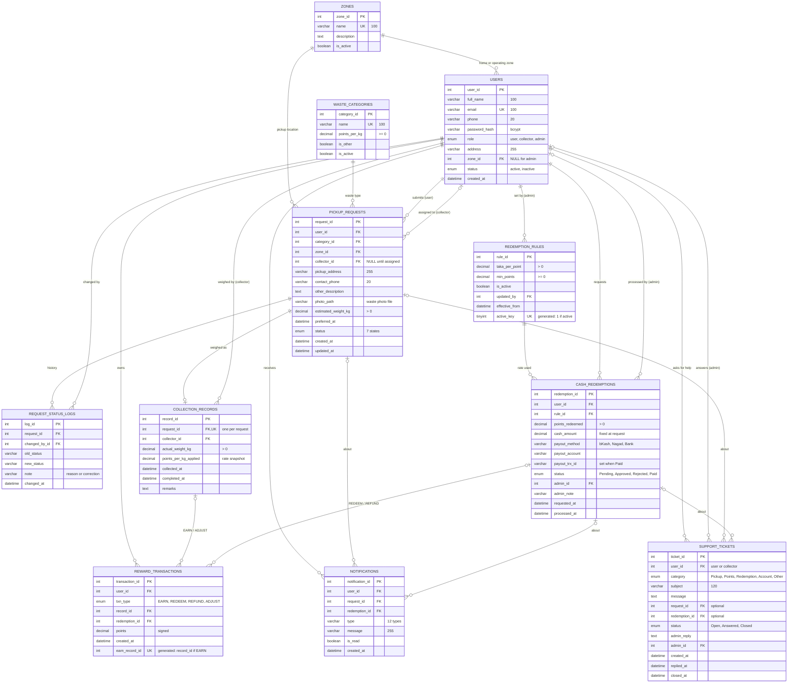

# Database Design & Architecture Document
## Waste Resource Recycle (WRR) Management System

**Document Version:** 1.1.0  
**Date:** November 11, 2026  
**Target DBMS:** MySQL 8.0+ or MariaDB 10.4+ (InnoDB Engine, `utf8mb4_unicode_ci`). XAMPP ships MariaDB 10.4.32, which this schema was tested on.  
**Database Name:** `wrr_db`  
**Host Environment:** Local XAMPP (`localhost:3306`)  
**Related Documents:** [`WRR_PRD.md`](WRR_PRD.md), [`api-spec.md`](api-spec.md), [`dfd.md`](dfd.md), [`architecture.md`](architecture.md). Executable scripts: `database/schema.sql`, `database/seed.sql`. This file replaces the former `database-schema.md`.  
**Course Context:** CSE-3112 Software Engineering Lab, Faridpur Engineering College  
**Team:** MD Mohiuddin Molla (Reg: 2022254878), Abdul Al Noman (Reg: 935)  

---

## 1. Table List

The WRR database contains **11 normalized relational tables** (`3NF`). Tables 1–10 map to Data Stores `D1` through `D10` of the Level 1 DFD; `support_tickets` (PRD v1.5.0) is store `D11`:

| Table # | Table Name | DFD Store | Storage Engine | Purpose & Business Domain |
|:---:|---|:---:|:---:|---|
| **1** | `zones` | `D1` | InnoDB | Defines municipal operational boundaries and geographic collection sectors. |
| **2** | `users` | `D2` | InnoDB | Accounts for all system actors (General Users, Waste Collectors, Administrators). |
| **3** | `waste_categories` | `D3` | InnoDB | Recyclable commodity catalog and baseline unit point valuation rates (`points_per_kg`). |
| **4** | `pickup_requests` | `D4` | InnoDB | Central job lifecycle entity tracking user requests from `Pending` to completion. |
| **5** | `request_status_logs` | `D5` | InnoDB | Append-only chronological audit trail capturing all request status transitions. |
| **6** | `collection_records` | `D6` | InnoDB | Physical on-site scale measurements and permanently frozen snapshot point tariffs. |
| **7** | `redemption_rules` | `D8` | InnoDB | Versioned monetary exchange tariffs (`taka_per_point`) and minimum withdrawal limits. |
| **8** | `cash_redemptions` | `D9` | InnoDB | Cash withdrawal requests, MFS payout channels, disbursement TrxIDs, and review states. |
| **9** | `reward_transactions` | `D7` | InnoDB | Signed points ledger (`EARN`, `REDEEM`, `REFUND`, `ADJUST`) ensuring zero drift. |
| **10** | `notifications` | `D10` | InnoDB | In-website user notifications with read/unread tracking and milestone alerts. |
| **11** | `support_tickets` | `D11` | InnoDB | Help requests from users and collectors and the admin's answer (`Open` → `Answered` → `Closed`). |

---

## 2. Database Schema

### 2.1 Table Specifications & Data Dictionary

#### 1. `zones` (DFD Store: D1)
| Column Name | Data Type | Nullable | Key / Default | Business Description |
|---|---|:---:|:---:|---|
| `zone_id` | `INT` | No | PK, Auto Inc | Unique identifier for operational zone. |
| `name` | `VARCHAR(100)` | No | UNIQUE | Descriptive municipal ward or area name. |
| `description` | `TEXT` | Yes | NULL | Geographic landmarks or coverage boundaries. |
| `is_active` | `BOOLEAN` | No | `TRUE` | Operational availability flag for new pickups. |

#### 2. `users` (DFD Store: D2)
| Column Name | Data Type | Nullable | Key / Default | Business Description |
|---|---|:---:|:---:|---|
| `user_id` | `INT` | No | PK, Auto Inc | Unique identifier for system user. |
| `full_name` | `VARCHAR(100)` | No | - | User's legal or official contact name. |
| `email` | `VARCHAR(100)` | No | UNIQUE | Normalized lowercase email address for authentication. |
| `phone` | `VARCHAR(20)` | No | - | Primary Bangladeshi mobile number (11 digits). |
| `password_hash` | `VARCHAR(255)` | No | - | Cryptographically salted Bcrypt password hash. |
| `role` | `ENUM('user','collector','admin')` | No | `'user'` | Role-based authorization claim. |
| `address` | `VARCHAR(255)` | Yes | NULL | Default household pickup address or operational depot. |
| `zone_id` | `INT` | Yes | FK $\to$ `zones` | Assigned operational zone (mandatory for collectors). |
| `status` | `ENUM('active','inactive')` | No | `'active'` | Account access status (deactivated accounts blocked). |
| `created_at` | `DATETIME` | No | `CURRENT_TIMESTAMP` | Account creation timestamp. |

#### 3. `waste_categories` (DFD Store: D3)
| Column Name | Data Type | Nullable | Key / Default | Business Description |
|---|---|:---:|:---:|---|
| `category_id` | `INT` | No | PK, Auto Inc | Unique material category identifier. |
| `name` | `VARCHAR(100)` | No | UNIQUE | Recyclable commodity name (e.g. Plastic, E-waste). |
| `points_per_kg` | `DECIMAL(10,2)` | No | - | Reward tariff per kilogram (Must be $\ge 0$). |
| `is_other` | `BOOLEAN` | No | `FALSE` | Flag requiring mandatory user description input. |
| `is_active` | `BOOLEAN` | No | `TRUE` | Active visibility flag in user pickup forms. |

#### 4. `pickup_requests` (DFD Store: D4)
| Column Name | Data Type | Nullable | Key / Default | Business Description |
|---|---|:---:|:---:|---|
| `request_id` | `INT` | No | PK, Auto Inc | Primary key for waste collection job. |
| `user_id` | `INT` | No | FK $\to$ `users` | Household resident who submitted request. |
| `category_id` | `INT` | No | FK $\to$ `waste_categories` | Selected material category. |
| `zone_id` | `INT` | No | FK $\to$ `zones` | Geographic zone of pickup address. |
| `collector_id` | `INT` | Yes | FK $\to$ `users`, NULL | Assigned collector (NULL while `Pending`). |
| `pickup_address`| `VARCHAR(255)` | No | - | Specific street/house pickup location. |
| `contact_phone` | `VARCHAR(20)` | No | - | Contact phone for on-site arrival coordination. |
| `other_description` | `TEXT` | Yes | NULL | Mandatory if category has `is_other = TRUE`. |
| `photo_path` | `VARCHAR(64)` | Yes | NULL | File name of the waste photo in `backend/uploads/pickups/` (random, chosen by the server). Required by the API for new requests since PRD v1.4.0; NULL for older rows. Added to an existing database by `database/migrations/001_add_pickup_photo.sql`. |
| `estimated_weight_kg` | `DECIMAL(10,2)` | No | - | Estimated weight input by user ($> 0$). |
| `preferred_at` | `DATETIME` | No | - | Preferred collection date/time (Must be in future). |
| `status` | `ENUM(...)` | No | `'Pending'` | Lifecycle state (one of 7 states; allowed transitions in PRD §5.1). |
| `created_at` | `DATETIME` | No | `CURRENT_TIMESTAMP` | Initial submission timestamp. |
| `updated_at` | `DATETIME` | No | Auto Update | Last modification timestamp. |

*Allowed `status` ENUM values:* `'Pending'`, `'Assigned'`, `'Accepted'`, `'Rejected'`, `'Collected'`, `'Completed'`, `'Cancelled'`.

#### 5. `request_status_logs` (DFD Store: D5)
| Column Name | Data Type | Nullable | Key / Default | Business Description |
|---|---|:---:|:---:|---|
| `log_id` | `INT` | No | PK, Auto Inc | Audit sequence identifier. |
| `request_id` | `INT` | No | FK $\to$ `pickup_requests`| Target request reference. |
| `changed_by_id` | `INT` | No | FK $\to$ `users` | Actor who executed state transition. |
| `old_status` | `VARCHAR(20)` | Yes | NULL | Previous lifecycle state. |
| `new_status` | `VARCHAR(20)` | No | - | Resulting lifecycle state. |
| `note` | `VARCHAR(255)` | Yes | NULL | Reason note (Mandatory on Reject/Abort). |
| `changed_at` | `DATETIME` | No | `CURRENT_TIMESTAMP` | Exact timestamp of state change. |

#### 6. `collection_records` (DFD Store: D6)
| Column Name | Data Type | Nullable | Key / Default | Business Description |
|---|---|:---:|:---:|---|
| `record_id` | `INT` | No | PK, Auto Inc | Certified collection receipt ID. |
| `request_id` | `INT` | No | FK $\to$ `pickup_requests`, UNIQUE | 1-to-1 linkage to pickup job. |
| `collector_id` | `INT` | No | FK $\to$ `users` | Collector who weighed and collected waste. |
| `actual_weight_kg` | `DECIMAL(10,2)` | No | - | Physical certified scale weight ($> 0.00$). |
| `points_per_kg_applied` | `DECIMAL(10,2)` | No | - | Rate frozen at collection time. |
| `collected_at` | `DATETIME` | No | - | Timestamp when scale measurement occurred. |
| `completed_at` | `DATETIME` | Yes | NULL | Timestamp when job transitioned to Completed. |
| `remarks` | `TEXT` | Yes | NULL | Collector on-site notes or scale condition. |

#### 7. `redemption_rules` (DFD Store: D8)
| Column Name | Data Type | Nullable | Key / Default | Business Description |
|---|---|:---:|:---:|---|
| `rule_id` | `INT` | No | PK, Auto Inc | Rule version ID. |
| `taka_per_point`| `DECIMAL(10,4)` | No | - | Currency conversion rate (e.g. 0.5000 BDT). |
| `min_points` | `DECIMAL(10,2)` | No | `0.00` | Minimum points threshold required to redeem (must be 0 or more). |
| `is_active` | `BOOLEAN` | No | `TRUE` | Exactly one rule can be active at a time. |
| `updated_by` | `INT` | No | FK $\to$ `users` | Administrator who set the rule. |
| `effective_from`| `DATETIME` | No | `CURRENT_TIMESTAMP` | Activation timestamp. |
| `active_key` | `TINYINT` (generated, stored) | Yes | `IF(is_active, 1, NULL)` | UNIQUE (`uq_rule_single_active`): the database allows only one active rule. |

#### 8. `cash_redemptions` (DFD Store: D9)
| Column Name | Data Type | Nullable | Key / Default | Business Description |
|---|---|:---:|:---:|---|
| `redemption_id` | `INT` | No | PK, Auto Inc | Cash withdrawal transaction ID. |
| `user_id` | `INT` | No | FK $\to$ `users` | Requester account. |
| `rule_id` | `INT` | No | FK $\to$ `redemption_rules`| Applied conversion tariff snapshot. |
| `points_redeemed`| `DECIMAL(10,2)`| No | - | Debited points ($> 0$). |
| `cash_amount` | `DECIMAL(10,2)` | No | - | Calculated payout: `points * taka_per_point`. |
| `payout_method`| `VARCHAR(50)` | No | - | Payout channel (`bKash`, `Nagad`, `Bank`). |
| `payout_account`| `VARCHAR(255)`| No | - | Account or mobile wallet phone number. |
| `payout_trx_id` | `VARCHAR(100)` | Yes | NULL | Bank / MFS Transaction Reference ID (required by the API when status becomes `Paid`). |
| `status` | `ENUM(...)` | No | `'Pending'` | `'Pending'`, `'Approved'`, `'Rejected'`, `'Paid'`. |
| `admin_id` | `INT` | Yes | FK $\to$ `users`, NULL | Admin who processed payout. |
| `admin_note` | `VARCHAR(255)` | Yes | NULL | Administrative remark or rejection cause. |
| `requested_at` | `DATETIME` | No | `CURRENT_TIMESTAMP` | Withdrawal submission time. |
| `processed_at` | `DATETIME` | Yes | NULL | Payout completion or rejection time. |

#### 9. `reward_transactions` (DFD Store: D7)
| Column Name | Data Type | Nullable | Key / Default | Business Description |
|---|---|:---:|:---:|---|
| `transaction_id`| `INT` | No | PK, Auto Inc | Unique ledger entry ID. |
| `user_id` | `INT` | No | FK $\to$ `users` | Target user account. |
| `txn_type` | `ENUM(...)` | No | - | Ledger action: `'EARN'`, `'REDEEM'`, `'REFUND'`, `'ADJUST'`. |
| `record_id` | `INT` | Yes | FK $\to$ `collection_records`, NULL | Associated collection record. |
| `redemption_id` | `INT` | Yes | FK $\to$ `cash_redemptions`, NULL | Associated cash redemption. |
| `points` | `DECIMAL(10,2)` | No | - | Signed points (+ credit, - debit). |
| `created_at` | `DATETIME` | No | `CURRENT_TIMESTAMP` | Immutable posting timestamp. |
| `earn_record_id` | `INT` (generated, stored) | Yes | `IF(txn_type = 'EARN', record_id, NULL)` | UNIQUE (`uq_rt_one_earn`): at most one `EARN` row per collection record. |

#### 10. `notifications` (DFD Store: D10)
| Column Name | Data Type | Nullable | Key / Default | Business Description |
|---|---|:---:|:---:|---|
| `notification_id`| `INT` | No | PK, Auto Inc | Unique alert sequence ID. |
| `user_id` | `INT` | No | FK $\to$ `users` | Recipient account. |
| `request_id` | `INT` | Yes | FK $\to$ `pickup_requests`, NULL | Related pickup request. |
| `redemption_id` | `INT` | Yes | FK $\to$ `cash_redemptions`, NULL | Related cash redemption. |
| `type` | `VARCHAR(50)` | No | - | Notification classification code. |
| `message` | `VARCHAR(255)` | No | - | User-facing alert text. |
| `is_read` | `BOOLEAN` | No | `FALSE` | Read confirmation flag. |
| `created_at` | `DATETIME` | No | `CURRENT_TIMESTAMP` | Dispatch timestamp. |

#### 11. `support_tickets` (DFD Store: D11, PRD v1.5.0)
| Column Name | Data Type | Nullable | Key / Default | Business Description |
|---|---|:---:|:---:|---|
| `ticket_id` | `INT` | No | PK, Auto Inc | Ticket number. |
| `user_id` | `INT` | No | FK $\to$ `users` | Who opened it (user or collector). |
| `category` | `ENUM` | No | - | `Pickup`, `Points`, `Redemption`, `Account`, `Other`. |
| `subject` | `VARCHAR(120)` | No | - | Short title (5–120 characters). |
| `message` | `TEXT` | No | - | The problem (10–2000 characters). |
| `request_id` | `INT` | Yes | FK $\to$ `pickup_requests`, NULL | Related request the opener can see. |
| `redemption_id` | `INT` | Yes | FK $\to$ `cash_redemptions`, NULL | Related redemption of the opener. |
| `status` | `ENUM` | No | `'Open'` | `Open`, `Answered`, `Closed`. |
| `admin_reply` | `TEXT` | Yes | NULL | The admin's answer. |
| `admin_id` | `INT` | Yes | FK $\to$ `users`, NULL | Admin who answered. |
| `created_at` | `DATETIME` | No | `CURRENT_TIMESTAMP` | Opened at. |
| `replied_at` | `DATETIME` | Yes | NULL | Last answer. |
| `closed_at` | `DATETIME` | Yes | NULL | Closed at. |

---

## 3. Foreign Key Relationships

All foreign keys use `InnoDB` referential integrity rules to prevent orphan records:

```
[ zones ] 1 ──< N [ users ] (ON DELETE RESTRICT ON UPDATE CASCADE)   -- zones are deactivated, never deleted
    │
    └── 1 ──< N [ pickup_requests ] (ON DELETE RESTRICT ON UPDATE CASCADE)

[ users ] 1 ──< N [ pickup_requests (as User) ] (ON DELETE RESTRICT ON UPDATE CASCADE)
    │
    ├── 1 ──< N [ pickup_requests (as Collector) ] (ON DELETE SET NULL ON UPDATE CASCADE)
    ├── 1 ──< N [ collection_records ] (ON DELETE RESTRICT ON UPDATE CASCADE)
    ├── 1 ──< N [ reward_transactions ] (ON DELETE RESTRICT ON UPDATE CASCADE)
    ├── 1 ──< N [ cash_redemptions (as User) ] (ON DELETE RESTRICT ON UPDATE CASCADE)
    ├── 1 ──< N [ cash_redemptions (as Admin) ] (ON DELETE SET NULL ON UPDATE CASCADE)
    ├── 1 ──< N [ request_status_logs (changed_by) ] (ON DELETE RESTRICT ON UPDATE CASCADE)
    ├── 1 ──< N [ redemption_rules ] (ON DELETE RESTRICT ON UPDATE CASCADE)
    ├── 1 ──< N [ notifications ] (ON DELETE CASCADE ON UPDATE CASCADE)
    ├── 1 ──< N [ support_tickets (opener) ] (ON DELETE RESTRICT ON UPDATE CASCADE)
    └── 1 ──< N [ support_tickets (answering admin) ] (ON DELETE SET NULL ON UPDATE CASCADE)

[ waste_categories ] 1 ──< N [ pickup_requests ] (ON DELETE RESTRICT ON UPDATE CASCADE)

[ pickup_requests ] 1 ──< N [ request_status_logs ] (ON DELETE RESTRICT ON UPDATE CASCADE)   -- audit log is never deleted
    │
    ├── 1 ─── 1 [ collection_records ] (UNIQUE, ON DELETE RESTRICT ON UPDATE CASCADE)
    └── 1 ──< N [ notifications ] (ON DELETE SET NULL ON UPDATE CASCADE)

[ collection_records ] 1 ──< N [ reward_transactions ] (ON DELETE RESTRICT ON UPDATE RESTRICT)   -- no CASCADE: record_id feeds a generated column

[ redemption_rules ] 1 ──< N [ cash_redemptions ] (ON DELETE RESTRICT ON UPDATE CASCADE)

[ cash_redemptions ] 1 ──< N [ reward_transactions ] (ON DELETE RESTRICT ON UPDATE CASCADE)
[ cash_redemptions ] 1 ──< N [ notifications ] (ON DELETE SET NULL ON UPDATE CASCADE)
[ pickup_requests ] / [ cash_redemptions ] 1 ──< N [ support_tickets ] (ON DELETE SET NULL ON UPDATE CASCADE)
```

---

## 4. Database Indexes

To meet the response-time targets of NFR-02 (2 s for core operations, 5 s for reports, 50 concurrent users), these indexes are implemented:

| Index Name | Target Table | Indexed Columns | Index Type | Query Optimization Rationale |
|---|---|---|:---:|---|
| `PRIMARY` | All 11 Tables | `*_id` | B-Tree (Clustered) | Primary key random access ($O(1)$). |
| `email` (auto-named) | `users` | `email` | UNIQUE | Login credential lookups. |
| `idx_req_status` | `pickup_requests` | `status` | Non-Unique | Admin dashboard unassigned queue filtering. |
| `idx_req_collector` | `pickup_requests` | `collector_id, status` | Composite | Collector portal assigned tasks retrieval. |
| `idx_req_zone` | `pickup_requests` | `zone_id, status` | Composite | Zone-specific routing and performance aggregations. |
| `idx_log_timeline` | `request_status_logs` | `request_id, changed_at` | Composite | Accelerates chronological timeline retrieval. |
| `idx_rt_user` | `reward_transactions` | `user_id` | Non-Unique | User point balance summation (`SUM(points)`). |
| `idx_notif_user` | `notifications` | `user_id, is_read` | Composite | Fast retrieval of unread notifications and badge counts. |
| `idx_ticket_user` | `support_tickets` | `user_id, status` | Composite | "My tickets" and the 5-open-tickets check. |
| `idx_ticket_status` | `support_tickets` | `status, created_at` | Composite | Admin queue by status, newest first. |
| `request_id` (auto-named) | `collection_records` | `request_id` | UNIQUE | Enforces strictly one collection record per pickup. |
| `uq_rt_one_earn` | `reward_transactions` | `earn_record_id` (generated) | UNIQUE | At most one `EARN` row per collection record. |
| `uq_rule_single_active` | `redemption_rules` | `active_key` (generated) | UNIQUE | Only one active redemption rule. |

---

## 5. Constraints & Business Validations

| Target Table | Constraint Name / Type | SQL Definition | Business Invariant Enforced |
|---|---|---|---|
| `waste_categories` | `CHECK` | `CHECK (points_per_kg >= 0)` | Commodity tariffs can never have negative valuation. |
| `pickup_requests` | `CHECK` | `CHECK (estimated_weight_kg > 0)` | Users cannot submit zero or negative estimated weights. |
| `collection_records` | `CHECK` | `CHECK (actual_weight_kg > 0)` | Collectors cannot record zero or negative scale weights. |
| `redemption_rules` | `CHECK` | `CHECK (taka_per_point > 0)` | Currency conversion rate must be strictly positive. |
| `redemption_rules` | `CHECK` | `CHECK (min_points >= 0)` | Minimum withdrawal threshold cannot be negative. |
| `cash_redemptions` | `CHECK` | `CHECK (points_redeemed > 0)` | Cash withdrawals must deduct positive points. |
| `users` | `UNIQUE` | `UNIQUE (email)` | Guarantees account uniqueness across the platform. |
| `zones` | `UNIQUE` | `UNIQUE (name)` | Prevents duplicate zone creation. |
| `waste_categories` | `UNIQUE` | `UNIQUE (name)` | Prevents duplicate category names. |
| `collection_records`| `UNIQUE` | `UNIQUE (request_id)` | Prevents duplicate physical receipts for the same job. |
| `reward_transactions` | `UNIQUE` on generated column | `UNIQUE KEY uq_rt_one_earn (earn_record_id)` | Exactly one `EARN` per collection record (PRD §5.3). |
| `redemption_rules` | `UNIQUE` on generated column | `UNIQUE KEY uq_rule_single_active (active_key)` | Only one active rule (FR-16). To switch rules: `UPDATE ... SET is_active = FALSE` first, then `INSERT` the new rule, in one transaction. |
| `request_status_logs` | FK `ON DELETE RESTRICT` | — | A pickup request with history cannot be deleted, so the audit log stays complete. |

---

## 6. SQL Aggregate Queries

All report queries take `from`/`to` (and optional `zone_id`/`category_id`) as `?` parameters. In the application, `(? IS NULL OR col = ?)` receives the same value twice. Queries 2–6 implement the five FR-17 reports and were tested on MariaDB 10.4 (XAMPP).

**Whole days:** the API receives dates as `YYYY-MM-DD`. Pass `from` as `YYYY-MM-DD 00:00:00` and `to` as `YYYY-MM-DD 23:59:59` so the last day is included in `BETWEEN`. Report 4 (points liability) is all-time and ignores the dates.

### Query 1: Real-Time User Point Balance Calculation
Calculates the current spendable balance by summing the signed ledger rows:
```sql
SELECT 
  COALESCE(SUM(points), 0.00) AS available_balance
FROM reward_transactions
WHERE user_id = ?;
```

### Query 2: Report 1 — Total Weight Collected by Category, Zone & Date Range (FR-17)
Counts only `Completed` pickups (a `Collected` pickup has not issued points yet).
```sql
SELECT 
  z.name AS zone_name,
  wc.name AS category_name,
  COUNT(cr.record_id) AS total_pickups,
  COALESCE(SUM(cr.actual_weight_kg), 0.00) AS total_weight_kg
FROM collection_records cr
JOIN pickup_requests pr ON cr.request_id = pr.request_id
JOIN zones z ON pr.zone_id = z.zone_id
JOIN waste_categories wc ON pr.category_id = wc.category_id
WHERE pr.status = 'Completed'
  AND cr.completed_at BETWEEN ? AND ?
  AND (? IS NULL OR pr.zone_id = ?)
  AND (? IS NULL OR pr.category_id = ?)
GROUP BY z.zone_id, z.name, wc.category_id, wc.name
ORDER BY z.name, total_weight_kg DESC;
```

### Query 3: Report 2 — Request Volume Breakdown by Status (FR-17)
The percentage is computed over the filtered rows only (window function), so it always adds up to 100%.
```sql
SELECT 
  status,
  COUNT(*) AS request_count,
  ROUND(COUNT(*) * 100.0 / SUM(COUNT(*)) OVER (), 2) AS percentage
FROM pickup_requests
WHERE created_at BETWEEN ? AND ?
  AND (? IS NULL OR zone_id = ?)
GROUP BY status
ORDER BY request_count DESC;
```

### Query 4: Report 3 — Collector Performance Metrics (FR-17)
Rejection rate = rejections ÷ (accepts + rejections), both read from `request_status_logs`. This stays correct even though a rejection clears `pickup_requests.collector_id`.
```sql
SELECT 
  u.user_id AS collector_id,
  u.full_name AS collector_name,
  z.name AS primary_zone,
  COALESCE(coll.completed_pickups, 0) AS completed_pickups,
  COALESCE(coll.total_kg_collected, 0.00) AS total_kg_collected,
  COALESCE(d.rejected_count, 0) AS rejection_count,
  ROUND(COALESCE(d.rejected_count, 0) * 100.0 /
        NULLIF(COALESCE(d.accepted_count, 0) + COALESCE(d.rejected_count, 0), 0), 2) AS rejection_rate_percentage
FROM users u
LEFT JOIN zones z ON u.zone_id = z.zone_id
LEFT JOIN (
  SELECT cr.collector_id, COUNT(*) AS completed_pickups, SUM(cr.actual_weight_kg) AS total_kg_collected
  FROM collection_records cr
  WHERE cr.completed_at BETWEEN ? AND ?
  GROUP BY cr.collector_id
) coll ON u.user_id = coll.collector_id
LEFT JOIN (
  SELECT changed_by_id,
         SUM(new_status = 'Accepted') AS accepted_count,
         SUM(new_status = 'Rejected') AS rejected_count
  FROM request_status_logs
  WHERE old_status = 'Assigned' AND new_status IN ('Accepted', 'Rejected')
    AND changed_at BETWEEN ? AND ?
  GROUP BY changed_by_id
) d ON u.user_id = d.changed_by_id
WHERE u.role = 'collector'
  AND (? IS NULL OR u.zone_id = ?)
ORDER BY total_kg_collected DESC;
```

### Query 5: Report 4 — Financial Liability & Points Balance Sheet (FR-17)
```sql
SELECT 
  COALESCE(SUM(CASE WHEN txn_type = 'EARN' THEN points ELSE 0 END), 0.00) AS total_points_issued,
  COALESCE(SUM(CASE WHEN txn_type = 'REDEEM' THEN -points ELSE 0 END), 0.00) AS total_points_redeemed,
  COALESCE(SUM(CASE WHEN txn_type = 'REFUND' THEN points ELSE 0 END), 0.00) AS total_points_refunded,
  COALESCE(SUM(CASE WHEN txn_type = 'ADJUST' THEN points ELSE 0 END), 0.00) AS total_points_adjusted,
  COALESCE(SUM(points), 0.00) AS net_outstanding_point_liability,
  ROUND(COALESCE(SUM(points), 0.00) * (
    SELECT taka_per_point FROM redemption_rules WHERE is_active = TRUE
  ), 2) AS estimated_cash_liability_bdt
FROM reward_transactions;
```

### Query 6: Report 5 — Cash Redemptions Summary by Status (FR-17)
```sql
SELECT
  status,
  COUNT(*) AS redemption_count,
  COALESCE(SUM(points_redeemed), 0.00) AS total_points,
  COALESCE(SUM(cash_amount), 0.00) AS total_cash_bdt
FROM cash_redemptions
WHERE requested_at BETWEEN ? AND ?
GROUP BY status
ORDER BY FIELD(status, 'Pending', 'Approved', 'Paid', 'Rejected');
```

---

## 7. SQL Transactions (ACID Workflows)

### Transaction 1: Physical Collection Completion & Automated Reward Crediting
```sql
START TRANSACTION;

-- Step 1: Update request status to Completed
-- (Application checks affectedRows = 1; otherwise ROLLBACK and return HTTP 409)
UPDATE pickup_requests 
SET status = 'Completed', updated_at = CURRENT_TIMESTAMP
WHERE request_id = 12 AND status = 'Collected' AND collector_id = 2;

-- Step 2: Mark collection record completed
UPDATE collection_records
SET completed_at = CURRENT_TIMESTAMP
WHERE request_id = 12;

-- Step 3: Insert EARN row in ledger (e.g. 15.5 kg * 10 pts/kg = 155.00 pts)
INSERT INTO reward_transactions (user_id, txn_type, record_id, points, created_at)
VALUES (4, 'EARN', 5, 155.00, CURRENT_TIMESTAMP);

-- Step 4: Dispatch in-app notification
INSERT INTO notifications (user_id, request_id, type, message, is_read, created_at)
VALUES (4, 12, 'PICKUP_COMPLETED', 'Pickup completed! 15.5 kg of Plastic earned you 155.00 points.', FALSE, CURRENT_TIMESTAMP);

-- Step 5: Append status log
INSERT INTO request_status_logs (request_id, changed_by_id, old_status, new_status, note, changed_at)
VALUES (12, 2, 'Collected', 'Completed', 'Collection completed and verified on site', CURRENT_TIMESTAMP);

COMMIT;
```

### Transaction 2: Cash Redemption Submission with Row-Level Anti-Double-Spend Lock
```sql
START TRANSACTION;

-- Step 1: Lock user row to serialize concurrent submissions
SELECT user_id FROM users WHERE user_id = 4 FOR UPDATE;

-- Step 2: Verify spendable balance >= points to redeem
SELECT COALESCE(SUM(points), 0.00) INTO @user_balance 
FROM reward_transactions WHERE user_id = 4;

-- (Application evaluates: @user_balance >= 200.00 AND 200.00 >= 100.00)

-- Step 3: Write pending cash redemption
INSERT INTO cash_redemptions (
  user_id, rule_id, points_redeemed, cash_amount, 
  payout_method, payout_account, status, requested_at
) VALUES (
  4, 1, 200.00, 100.00, 'bKash', '01811000004', 'Pending', CURRENT_TIMESTAMP
);
SET @new_redemption_id = LAST_INSERT_ID();

-- Step 4: Immediately lock points with negative REDEEM ledger entry
INSERT INTO reward_transactions (user_id, txn_type, redemption_id, points, created_at)
VALUES (4, 'REDEEM', @new_redemption_id, -200.00, CURRENT_TIMESTAMP);

-- Step 5: Alert user
INSERT INTO notifications (user_id, redemption_id, type, message, is_read, created_at)
VALUES (4, @new_redemption_id, 'REDEMPTION_REQUESTED', 'Cash redemption of 100.00 BDT via bKash submitted for review.', FALSE, CURRENT_TIMESTAMP);

COMMIT;
```

### Transaction 3: Administrator Rejection & Automatic Ledger Refund
```sql
START TRANSACTION;

-- Step 1: Mark redemption Rejected with admin note (allowed from Pending or Approved)
-- (Application checks affectedRows = 1; otherwise ROLLBACK and return HTTP 409)
UPDATE cash_redemptions
SET status = 'Rejected', admin_id = 1, admin_note = 'Invalid bKash personal wallet number.', processed_at = CURRENT_TIMESTAMP
WHERE redemption_id = 3 AND status IN ('Pending', 'Approved');

-- Step 2: Post positive REFUND row restoring points
INSERT INTO reward_transactions (user_id, txn_type, redemption_id, points, created_at)
VALUES (4, 'REFUND', 3, 200.00, CURRENT_TIMESTAMP);

-- Step 3: Dispatch refund alert
INSERT INTO notifications (user_id, redemption_id, type, message, is_read, created_at)
VALUES (4, 3, 'REDEMPTION_REJECTED', 'Redemption #3 was rejected: Invalid wallet. 200.00 points were refunded.', FALSE, CURRENT_TIMESTAMP);

COMMIT;
```

### Transaction 4: Administrative Scale Weight Dispute Correction (FR-18)
```sql
START TRANSACTION;

-- Step 1: Lock user row to prevent balance racing & verify available balance
SELECT user_id FROM users WHERE user_id = 4 FOR UPDATE;

-- Application Balance Guard: Verify user has enough points to absorb deduction
SELECT COALESCE(SUM(points), 0.00) INTO @current_balance FROM reward_transactions WHERE user_id = 4;
-- Express backend guard: if (@current_balance - 35.00 < 0) { await connection.rollback(); throw new Error('Insufficient points for adjustment'); }

-- Step 2: Update actual weight (15.5 kg -> 12.0 kg). ADJUST = ROUND(12.00 * 10.00, 2) - (points already posted for record 5: 155.00) = -35.00
UPDATE collection_records
SET actual_weight_kg = 12.00, remarks = 'Admin audited scale ticket: adjusted from 15.5kg to 12.0kg'
WHERE record_id = 5;

-- Step 3: Insert balancing ADJUST ledger entry
INSERT INTO reward_transactions (user_id, txn_type, record_id, points, created_at)
VALUES (4, 'ADJUST', 5, -35.00, CURRENT_TIMESTAMP);

-- Step 4: Log audit trail
INSERT INTO request_status_logs (request_id, changed_by_id, old_status, new_status, note, changed_at)
VALUES (12, 1, 'Completed', 'Completed', 'Weight corrected from 15.50 kg to 12.00 kg', CURRENT_TIMESTAMP);

COMMIT;
```

---

## 8. Sample Seed Data

Same content as `database/seed.sql` (all seed passwords: `password123`).

```sql
-- ==============================================================================
-- Waste Resource Recycle (WRR) Management System
-- Database Seed Data: seed.sql
-- Target DBMS: MySQL 8.0+ or MariaDB 10.4+ (XAMPP)
-- Course: CSE-3112 Software Engineering Lab, Faridpur Engineering College
-- Team: MD Mohiuddin Molla (2022254878), Abdul Al Noman (935)
-- ==============================================================================

USE wrr_db;

-- ------------------------------------------------------------------------------
-- 1. Seed Zones (Faridpur Municipal Area Example Zones)
-- ------------------------------------------------------------------------------
INSERT INTO zones (zone_id, name, description, is_active) VALUES
(1, 'Zone 1 - Baitul Aman', 'Covers Baitul Aman, Engineering College, and surrounding residential areas', TRUE),
(2, 'Zone 2 - Goalchamot', 'Covers Goalchamot, Old Bus Stand, and commercial hubs', TRUE),
(3, 'Zone 3 - Jhiltuly', 'Covers Jhiltuly, Court Area, and central residential neighborhoods', TRUE),
(4, 'Zone 4 - Aliabad', 'Covers Aliabad and peripheral residential/suburban areas', TRUE);

-- ------------------------------------------------------------------------------
-- 2. Seed Waste Categories (Per Proposal & Specification)
-- ------------------------------------------------------------------------------
INSERT INTO waste_categories (category_id, name, points_per_kg, is_other, is_active) VALUES
(1, 'Plastic', 10.00, FALSE, TRUE),
(2, 'Paper & Cardboard', 6.00, FALSE, TRUE),
(3, 'E-waste', 25.00, FALSE, TRUE),
(4, 'Metal', 15.00, FALSE, TRUE),
(5, 'Glass', 4.00, FALSE, TRUE),
(6, 'Other Recyclable Waste', 5.00, TRUE, TRUE);

-- ------------------------------------------------------------------------------
-- 3. Seed Users
-- Password for all seed accounts is: "password123"
-- Verified Bcrypt Hash (cost factor 10): $2a$10$avkNZrMj9vCRN098yEawa.vABOB4ZLk0Q9Bqz/LCfZj/qhojigwgG
-- ------------------------------------------------------------------------------
INSERT INTO users (user_id, full_name, email, phone, password_hash, role, address, zone_id, status) VALUES
(1, 'System Administrator', 'admin@wrr.com', '01711000001', '$2a$10$avkNZrMj9vCRN098yEawa.vABOB4ZLk0Q9Bqz/LCfZj/qhojigwgG', 'admin', 'WRR Operations Center, Faridpur', 3, 'active'),
(2, 'Rafiqul Islam', 'collector1@wrr.com', '01711000002', '$2a$10$avkNZrMj9vCRN098yEawa.vABOB4ZLk0Q9Bqz/LCfZj/qhojigwgG', 'collector', 'Baitul Aman, Faridpur', 1, 'active'),
(3, 'Kamal Hossain', 'collector2@wrr.com', '01711000003', '$2a$10$avkNZrMj9vCRN098yEawa.vABOB4ZLk0Q9Bqz/LCfZj/qhojigwgG', 'collector', 'Goalchamot, Faridpur', 2, 'active'),
(4, 'Tanvir Ahmed', 'tanvir@gmail.com', '01811000004', '$2a$10$avkNZrMj9vCRN098yEawa.vABOB4ZLk0Q9Bqz/LCfZj/qhojigwgG', 'user', 'House 14, Road 2, Baitul Aman', 1, 'active'),
(5, 'Sadia Sultana', 'sadia@gmail.com', '01811000005', '$2a$10$avkNZrMj9vCRN098yEawa.vABOB4ZLk0Q9Bqz/LCfZj/qhojigwgG', 'user', 'Apartment 4B, Green View, Jhiltuly', 3, 'active');

-- ------------------------------------------------------------------------------
-- 4. Seed Redemption Rules (Active Rule)
-- Rate: 1 Point = 0.50 BDT, Min Points for Redemption = 100 Points (50 BDT)
-- ------------------------------------------------------------------------------
INSERT INTO redemption_rules (rule_id, taka_per_point, min_points, is_active, updated_by, effective_from) VALUES
(1, 0.5000, 100.00, TRUE, 1, CURRENT_TIMESTAMP);

-- ------------------------------------------------------------------------------
-- 5. Seed Pickup Requests (Demonstrating Full Lifecycle States)
-- ------------------------------------------------------------------------------
INSERT INTO pickup_requests (request_id, user_id, category_id, zone_id, collector_id, pickup_address, contact_phone, other_description, estimated_weight_kg, preferred_at, status, created_at) VALUES
(1, 4, 1, 1, 2, 'House 14, Road 2, Baitul Aman', '01811000004', NULL, 15.00, '2026-11-10 11:00:00', 'Completed', '2026-11-10 09:00:00'),
(2, 4, 2, 1, 2, 'House 14, Road 2, Baitul Aman', '01811000004', NULL, 20.00, '2026-11-13 14:00:00', 'Accepted', '2026-11-11 08:30:00'),
(3, 5, 3, 3, NULL, 'Apartment 4B, Green View, Jhiltuly', '01811000005', NULL, 5.00, '2026-11-14 11:00:00', 'Pending', '2026-11-11 12:00:00');

-- ------------------------------------------------------------------------------
-- 6. Seed Request Status Logs
-- ------------------------------------------------------------------------------
INSERT INTO request_status_logs (log_id, request_id, changed_by_id, old_status, new_status, note, changed_at) VALUES
(1, 1, 4, NULL, 'Pending', 'User submitted request', '2026-11-10 09:00:00'),
(2, 1, 1, 'Pending', 'Assigned', 'Assigned to Rafiqul Islam', '2026-11-10 09:30:00'),
(3, 1, 2, 'Assigned', 'Accepted', 'Accepted by collector', '2026-11-10 09:45:00'),
(4, 1, 2, 'Accepted', 'Collected', 'Weighed 15.5 kg on certified scale', '2026-11-10 11:00:00'),
(5, 1, 2, 'Collected', 'Completed', 'Collection completed and reward points posted', '2026-11-10 11:05:00'),
(6, 2, 4, NULL, 'Pending', 'User submitted request', '2026-11-11 08:30:00'),
(7, 2, 1, 'Pending', 'Assigned', 'Assigned to Rafiqul Islam', '2026-11-11 09:00:00'),
(8, 2, 2, 'Assigned', 'Accepted', 'Accepted by collector', '2026-11-11 09:20:00'),
(9, 3, 5, NULL, 'Pending', 'User submitted request', '2026-11-11 12:00:00');

-- ------------------------------------------------------------------------------
-- 7. Seed Collection Records
-- ------------------------------------------------------------------------------
INSERT INTO collection_records (record_id, request_id, collector_id, actual_weight_kg, points_per_kg_applied, collected_at, completed_at, remarks) VALUES
(1, 1, 2, 15.50, 10.00, '2026-11-10 11:00:00', '2026-11-10 11:05:00', 'Clean PET bottles, verified scale');

-- ------------------------------------------------------------------------------
-- 8. Seed Reward Transactions Ledger
-- ------------------------------------------------------------------------------
INSERT INTO reward_transactions (transaction_id, user_id, txn_type, record_id, redemption_id, points, created_at) VALUES
(1, 4, 'EARN', 1, NULL, 155.00, '2026-11-10 11:05:00');

-- ------------------------------------------------------------------------------
-- 9. Seed Cash Redemptions
-- ------------------------------------------------------------------------------
INSERT INTO cash_redemptions (redemption_id, user_id, rule_id, points_redeemed, cash_amount, payout_method, payout_account, payout_trx_id, status, admin_id, admin_note, requested_at, processed_at) VALUES
(1, 4, 1, 100.00, 50.00, 'bKash', '01811000004', 'BK99X8877A', 'Paid', 1, 'Disbursed via bKash merchant payout', '2026-11-10 14:00:00', '2026-11-10 15:30:00');

-- Additional Ledger entry locking the 100 points
INSERT INTO reward_transactions (transaction_id, user_id, txn_type, record_id, redemption_id, points, created_at) VALUES
(2, 4, 'REDEEM', NULL, 1, -100.00, '2026-11-10 14:00:00');

-- ------------------------------------------------------------------------------
-- 10. Seed Notifications
-- ------------------------------------------------------------------------------
INSERT INTO notifications (notification_id, user_id, request_id, redemption_id, type, message, is_read, created_at) VALUES
(1, 4, 1, NULL, 'PICKUP_COMPLETED', 'Pickup #1 completed! 15.50 kg Plastic earned you 155.00 points.', TRUE, '2026-11-10 11:05:00'),
(2, 4, NULL, 1, 'REDEMPTION_PAID', 'Your redemption of 50.00 BDT via bKash has been paid! TrxID: BK99X8877A', FALSE, '2026-11-10 15:30:00');
```

---

## 9. Table Definitions (CREATE TABLE DDL)

Same content as `database/schema.sql`. Tested on MariaDB 10.4.32 (XAMPP); it uses only features MySQL 8.0 also supports. Run it in phpMyAdmin or the MySQL/MariaDB CLI.

```sql
-- ==============================================================================
-- Waste Resource Recycle (WRR) Management System
-- Database Schema: schema.sql
-- Target DBMS: MySQL 8.0+ or MariaDB 10.4+ (XAMPP)
-- Course: CSE-3112 Software Engineering Lab, Faridpur Engineering College
-- Team: MD Mohiuddin Molla (2022254878), Abdul Al Noman (935)
-- ==============================================================================

CREATE DATABASE IF NOT EXISTS wrr_db CHARACTER SET utf8mb4 COLLATE utf8mb4_unicode_ci;
USE wrr_db;

-- Drop tables in reverse order of foreign key dependencies if re-running
DROP TABLE IF EXISTS support_tickets;
DROP TABLE IF EXISTS notifications;
DROP TABLE IF EXISTS reward_transactions;
DROP TABLE IF EXISTS cash_redemptions;
DROP TABLE IF EXISTS redemption_rules;
DROP TABLE IF EXISTS collection_records;
DROP TABLE IF EXISTS request_status_logs;
DROP TABLE IF EXISTS pickup_requests;
DROP TABLE IF EXISTS waste_categories;
DROP TABLE IF EXISTS users;
DROP TABLE IF EXISTS zones;

-- ------------------------------------------------------------------------------
-- 1. Table: zones
-- ------------------------------------------------------------------------------
CREATE TABLE zones (
  zone_id INT AUTO_INCREMENT PRIMARY KEY,
  name VARCHAR(100) NOT NULL UNIQUE,
  description TEXT,
  is_active BOOLEAN NOT NULL DEFAULT TRUE
) ENGINE=InnoDB DEFAULT CHARSET=utf8mb4 COLLATE=utf8mb4_unicode_ci;

-- ------------------------------------------------------------------------------
-- 2. Table: users
-- ------------------------------------------------------------------------------
CREATE TABLE users (
  user_id INT AUTO_INCREMENT PRIMARY KEY,
  full_name VARCHAR(100) NOT NULL,
  email VARCHAR(100) NOT NULL UNIQUE,
  phone VARCHAR(20) NOT NULL,
  password_hash VARCHAR(255) NOT NULL,
  role ENUM('user','collector','admin') NOT NULL DEFAULT 'user',
  address VARCHAR(255),
  zone_id INT NULL,
  status ENUM('active','inactive') NOT NULL DEFAULT 'active',
  created_at DATETIME NOT NULL DEFAULT CURRENT_TIMESTAMP,
  FOREIGN KEY (zone_id) REFERENCES zones(zone_id) ON DELETE RESTRICT ON UPDATE CASCADE
) ENGINE=InnoDB DEFAULT CHARSET=utf8mb4 COLLATE=utf8mb4_unicode_ci;

-- ------------------------------------------------------------------------------
-- 3. Table: waste_categories
-- ------------------------------------------------------------------------------
CREATE TABLE waste_categories (
  category_id INT AUTO_INCREMENT PRIMARY KEY,
  name VARCHAR(100) NOT NULL UNIQUE,
  points_per_kg DECIMAL(10,2) NOT NULL CHECK (points_per_kg >= 0),
  is_other BOOLEAN NOT NULL DEFAULT FALSE,
  is_active BOOLEAN NOT NULL DEFAULT TRUE
) ENGINE=InnoDB DEFAULT CHARSET=utf8mb4 COLLATE=utf8mb4_unicode_ci;

-- ------------------------------------------------------------------------------
-- 4. Table: pickup_requests
-- ------------------------------------------------------------------------------
CREATE TABLE pickup_requests (
  request_id INT AUTO_INCREMENT PRIMARY KEY,
  user_id INT NOT NULL,
  category_id INT NOT NULL,
  zone_id INT NOT NULL,
  collector_id INT NULL,
  pickup_address VARCHAR(255) NOT NULL,
  contact_phone VARCHAR(20) NOT NULL,
  other_description TEXT,
  photo_path VARCHAR(64) NULL, -- file name in backend/uploads/pickups (required for new requests)
  estimated_weight_kg DECIMAL(10,2) NOT NULL CHECK (estimated_weight_kg > 0),
  preferred_at DATETIME NOT NULL,
  status ENUM('Pending','Assigned','Accepted','Rejected','Collected','Completed','Cancelled')
         NOT NULL DEFAULT 'Pending',
  created_at DATETIME NOT NULL DEFAULT CURRENT_TIMESTAMP,
  updated_at DATETIME NOT NULL DEFAULT CURRENT_TIMESTAMP ON UPDATE CURRENT_TIMESTAMP,
  FOREIGN KEY (user_id) REFERENCES users(user_id) ON DELETE RESTRICT ON UPDATE CASCADE,
  FOREIGN KEY (category_id) REFERENCES waste_categories(category_id) ON DELETE RESTRICT ON UPDATE CASCADE,
  FOREIGN KEY (zone_id) REFERENCES zones(zone_id) ON DELETE RESTRICT ON UPDATE CASCADE,
  FOREIGN KEY (collector_id) REFERENCES users(user_id) ON DELETE SET NULL ON UPDATE CASCADE,
  INDEX idx_req_status (status),
  INDEX idx_req_collector (collector_id, status),
  INDEX idx_req_zone (zone_id, status)
) ENGINE=InnoDB DEFAULT CHARSET=utf8mb4 COLLATE=utf8mb4_unicode_ci;

-- ------------------------------------------------------------------------------
-- 5. Table: request_status_logs
-- ------------------------------------------------------------------------------
CREATE TABLE request_status_logs (
  log_id INT AUTO_INCREMENT PRIMARY KEY,
  request_id INT NOT NULL,
  changed_by_id INT NOT NULL,
  old_status VARCHAR(20),
  new_status VARCHAR(20) NOT NULL,
  note VARCHAR(255),
  changed_at DATETIME NOT NULL DEFAULT CURRENT_TIMESTAMP,
  FOREIGN KEY (request_id) REFERENCES pickup_requests(request_id) ON DELETE RESTRICT ON UPDATE CASCADE, -- audit rows are never deleted
  FOREIGN KEY (changed_by_id) REFERENCES users(user_id) ON DELETE RESTRICT ON UPDATE CASCADE,
  INDEX idx_log_timeline (request_id, changed_at)
) ENGINE=InnoDB DEFAULT CHARSET=utf8mb4 COLLATE=utf8mb4_unicode_ci;

-- ------------------------------------------------------------------------------
-- 6. Table: collection_records
-- ------------------------------------------------------------------------------
CREATE TABLE collection_records (
  record_id INT AUTO_INCREMENT PRIMARY KEY,
  request_id INT NOT NULL UNIQUE,
  collector_id INT NOT NULL,
  actual_weight_kg DECIMAL(10,2) NOT NULL CHECK (actual_weight_kg > 0),
  points_per_kg_applied DECIMAL(10,2) NOT NULL,
  collected_at DATETIME NOT NULL,
  completed_at DATETIME NULL,
  remarks TEXT,
  FOREIGN KEY (request_id) REFERENCES pickup_requests(request_id) ON DELETE RESTRICT ON UPDATE CASCADE,
  FOREIGN KEY (collector_id) REFERENCES users(user_id) ON DELETE RESTRICT ON UPDATE CASCADE
) ENGINE=InnoDB DEFAULT CHARSET=utf8mb4 COLLATE=utf8mb4_unicode_ci;

-- ------------------------------------------------------------------------------
-- 7. Table: redemption_rules
-- ------------------------------------------------------------------------------
CREATE TABLE redemption_rules (
  rule_id INT AUTO_INCREMENT PRIMARY KEY,
  taka_per_point DECIMAL(10,4) NOT NULL CHECK (taka_per_point > 0),
  min_points DECIMAL(10,2) NOT NULL DEFAULT 0 CHECK (min_points >= 0),
  is_active BOOLEAN NOT NULL DEFAULT TRUE,
  updated_by INT NOT NULL,
  effective_from DATETIME NOT NULL DEFAULT CURRENT_TIMESTAMP,
  -- 1 for the active rule, NULL otherwise. UNIQUE allows many NULLs but only one 1,
  -- so the database itself guarantees a single active rule.
  active_key TINYINT GENERATED ALWAYS AS (IF(is_active, 1, NULL)) STORED,
  UNIQUE KEY uq_rule_single_active (active_key),
  FOREIGN KEY (updated_by) REFERENCES users(user_id) ON DELETE RESTRICT ON UPDATE CASCADE
) ENGINE=InnoDB DEFAULT CHARSET=utf8mb4 COLLATE=utf8mb4_unicode_ci;

-- ------------------------------------------------------------------------------
-- 8. Table: cash_redemptions
-- ------------------------------------------------------------------------------
CREATE TABLE cash_redemptions (
  redemption_id INT AUTO_INCREMENT PRIMARY KEY,
  user_id INT NOT NULL,
  rule_id INT NOT NULL,
  points_redeemed DECIMAL(10,2) NOT NULL CHECK (points_redeemed > 0),
  cash_amount DECIMAL(10,2) NOT NULL,
  payout_method VARCHAR(50) NOT NULL,
  payout_account VARCHAR(255) NOT NULL,
  payout_trx_id VARCHAR(100) NULL,
  status ENUM('Pending','Approved','Rejected','Paid') NOT NULL DEFAULT 'Pending',
  admin_id INT NULL,
  admin_note VARCHAR(255),
  requested_at DATETIME NOT NULL DEFAULT CURRENT_TIMESTAMP,
  processed_at DATETIME NULL,
  FOREIGN KEY (user_id) REFERENCES users(user_id) ON DELETE RESTRICT ON UPDATE CASCADE,
  FOREIGN KEY (rule_id) REFERENCES redemption_rules(rule_id) ON DELETE RESTRICT ON UPDATE CASCADE,
  FOREIGN KEY (admin_id) REFERENCES users(user_id) ON DELETE SET NULL ON UPDATE CASCADE
) ENGINE=InnoDB DEFAULT CHARSET=utf8mb4 COLLATE=utf8mb4_unicode_ci;

-- ------------------------------------------------------------------------------
-- 9. Table: reward_transactions
-- ------------------------------------------------------------------------------
CREATE TABLE reward_transactions (
  transaction_id INT AUTO_INCREMENT PRIMARY KEY,
  user_id INT NOT NULL,
  txn_type ENUM('EARN','REDEEM','REFUND','ADJUST') NOT NULL,
  record_id INT NULL,
  redemption_id INT NULL,
  points DECIMAL(10,2) NOT NULL, -- positive = credit, negative = debit
  created_at DATETIME NOT NULL DEFAULT CURRENT_TIMESTAMP,
  -- record_id for EARN rows, NULL otherwise. UNIQUE = at most one EARN per collection record.
  earn_record_id INT GENERATED ALWAYS AS (IF(txn_type = 'EARN', record_id, NULL)) STORED,
  UNIQUE KEY uq_rt_one_earn (earn_record_id),
  FOREIGN KEY (user_id) REFERENCES users(user_id) ON DELETE RESTRICT ON UPDATE CASCADE,
  FOREIGN KEY (record_id) REFERENCES collection_records(record_id) ON DELETE RESTRICT ON UPDATE RESTRICT, -- no CASCADE: record_id feeds a generated column
  FOREIGN KEY (redemption_id) REFERENCES cash_redemptions(redemption_id) ON DELETE RESTRICT ON UPDATE CASCADE,
  INDEX idx_rt_user (user_id)
) ENGINE=InnoDB DEFAULT CHARSET=utf8mb4 COLLATE=utf8mb4_unicode_ci;

-- ------------------------------------------------------------------------------
-- 10. Table: notifications
-- ------------------------------------------------------------------------------
CREATE TABLE notifications (
  notification_id INT AUTO_INCREMENT PRIMARY KEY,
  user_id INT NOT NULL,
  request_id INT NULL,
  redemption_id INT NULL,
  type VARCHAR(50) NOT NULL,
  message VARCHAR(255) NOT NULL,
  is_read BOOLEAN NOT NULL DEFAULT FALSE,
  created_at DATETIME NOT NULL DEFAULT CURRENT_TIMESTAMP,
  FOREIGN KEY (user_id) REFERENCES users(user_id) ON DELETE CASCADE ON UPDATE CASCADE,
  FOREIGN KEY (request_id) REFERENCES pickup_requests(request_id) ON DELETE SET NULL ON UPDATE CASCADE,
  FOREIGN KEY (redemption_id) REFERENCES cash_redemptions(redemption_id) ON DELETE SET NULL ON UPDATE CASCADE,
  INDEX idx_notif_user (user_id, is_read)
) ENGINE=InnoDB DEFAULT CHARSET=utf8mb4 COLLATE=utf8mb4_unicode_ci;

-- ------------------------------------------------------------------------------
-- 11. Table: support_tickets (PRD v1.5.0, FR-22)
-- A user or collector asks for help; an admin answers. Open -> Answered -> Closed.
-- ------------------------------------------------------------------------------
CREATE TABLE support_tickets (
  ticket_id INT AUTO_INCREMENT PRIMARY KEY,
  user_id INT NOT NULL,
  category ENUM('Pickup','Points','Redemption','Account','Other') NOT NULL,
  subject VARCHAR(120) NOT NULL,
  message TEXT NOT NULL,
  request_id INT NULL,
  redemption_id INT NULL,
  status ENUM('Open','Answered','Closed') NOT NULL DEFAULT 'Open',
  admin_reply TEXT NULL,
  admin_id INT NULL,
  created_at DATETIME NOT NULL DEFAULT CURRENT_TIMESTAMP,
  replied_at DATETIME NULL,
  closed_at DATETIME NULL,
  FOREIGN KEY (user_id) REFERENCES users(user_id) ON DELETE RESTRICT ON UPDATE CASCADE,
  FOREIGN KEY (request_id) REFERENCES pickup_requests(request_id) ON DELETE SET NULL ON UPDATE CASCADE,
  FOREIGN KEY (redemption_id) REFERENCES cash_redemptions(redemption_id) ON DELETE SET NULL ON UPDATE CASCADE,
  FOREIGN KEY (admin_id) REFERENCES users(user_id) ON DELETE SET NULL ON UPDATE CASCADE,
  INDEX idx_ticket_user (user_id, status),
  INDEX idx_ticket_status (status, created_at)
) ENGINE=InnoDB DEFAULT CHARSET=utf8mb4 COLLATE=utf8mb4_unicode_ci;
```

---

## 10. Entity Relationship Diagram (ERD)

Same diagram as [`docs/er-diagram.md`](docs/er-diagram.md), which also lists the rules the diagram cannot show. `active_key` and `earn_record_id` are generated columns (see §9).



