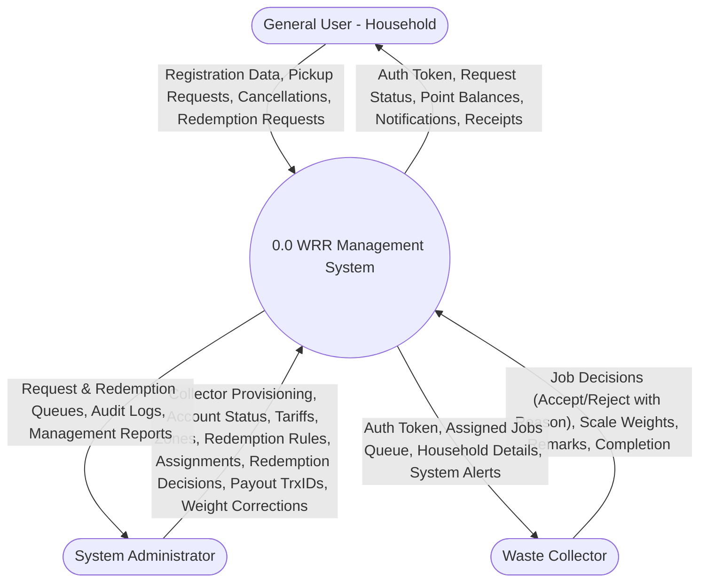
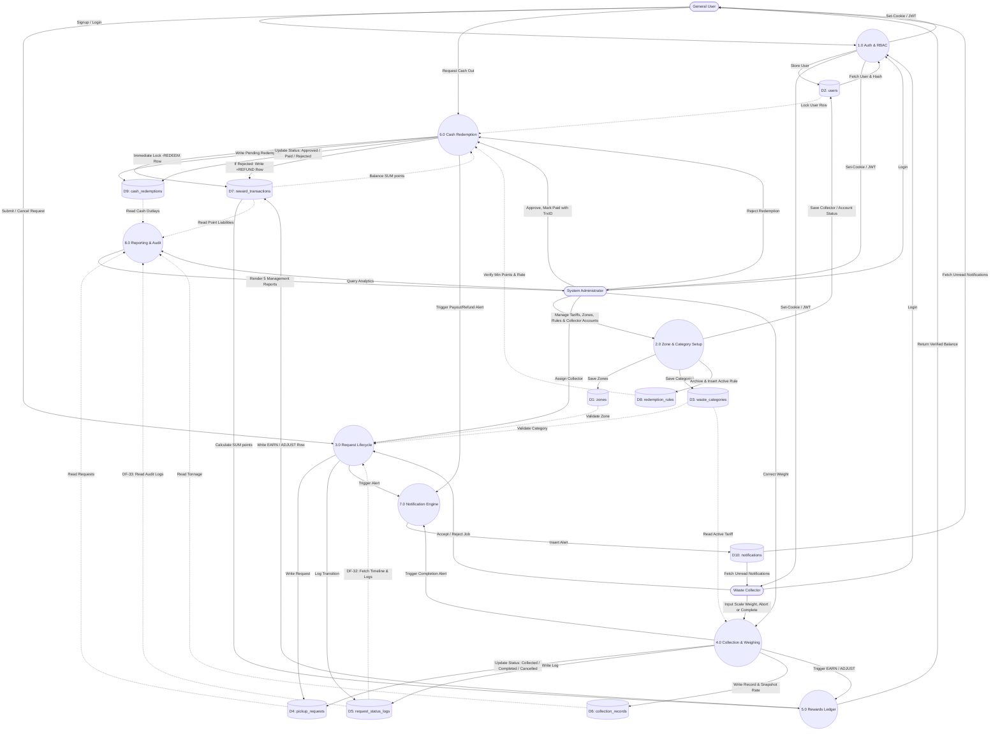
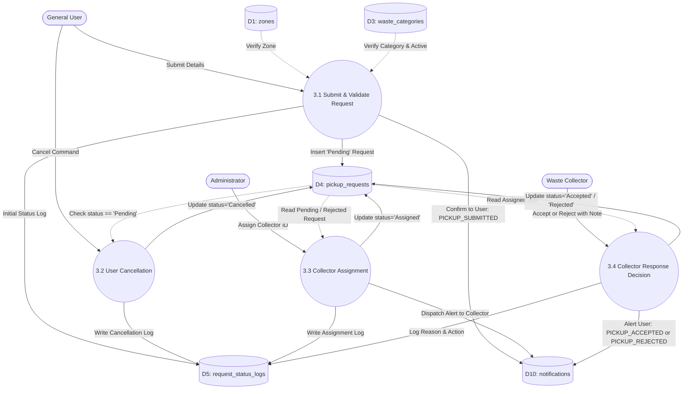

# Data Flow Diagram (DFD) Specification
## Waste Resource Recycle (WRR) Management System

**Document Version:** 1.1.0  
**Date:** November 11, 2026  
**Methodology:** Structured Systems Analysis (Gane & Sarson / DeMarco Notation)  
**System Architecture:** Three-Tier (Vanilla HTML/CSS/JS + Express.js + MySQL/MariaDB via XAMPP)  
**Target Specification:** [`WRR_PRD.md`](WRR_PRD.md), [`architecture.md`](architecture.md), [`database.md`](database.md)  
**Course Context:** CSE-3112 Software Engineering Lab, Faridpur Engineering College  
**Team:** MD Mohiuddin Molla (Reg: 2022254878), Abdul Al Noman (Reg: 935)  

---

## 1. Context Diagram (Level 0 DFD)

The Context Diagram defines the formal system boundary of the Waste Resource Recycle (WRR) platform, its primary external entities, and the net high-level information exchanges entering and leaving the platform.

### 1.1 External Entities
1. **General User (Household Resident):** Submits recycling pickup requests, manages profile data, inspects collection history and point rewards, receives operational alerts, and submits cash redemption requests.
2. **Waste Collector (Field Agent):** Receives zone-specific collection assignments, accepts or rejects jobs with reason notes, logs verified scale measurements on-site, records collection remarks, and marks jobs completed.
3. **System Administrator (Operations & Finance):** Provisions collector accounts, governs operational zones and category point tariffs, routes unassigned requests, processes cash disbursements with MFS/Bank transaction IDs, conducts scale weight audit corrections, and generates analytical reports.

### 1.2 Boundary Context Representation
```
                    [ GENERAL USER ]
                      ▲         │
  Pickup Receipts,    │         │ Registration Info, Pickup Requests,
  Balance, Cash Alerts│         │ Cancellations, Redemption Requests
                      │         ▼
         ┌──────────────────────────────────────┐
         │                0.0                   │
         │   WASTE RESOURCE RECYCLE (WRR)       │
         │         MANAGEMENT SYSTEM            │
         └──────────────────────────────────────┘
             ▲       │              ▲       │
Job Details, │       │ Assigned     │       │ User/Zone Admin,
Status,      │       │ Jobs,        │       │ Tariffs, Rules,
Audit Alerts │       │ Alerts       │Reports│ Disbursed Payouts,
             │       │              │       │ Weight Corrections
             │       ▼              │       ▼
       [ WASTE COLLECTOR ]     [ ADMINISTRATOR ]
```

---

## 2. Level 1 DFD (Subsystem Decomposition)

Level 1 decomposes the main system (0.0) into eight core logical processes, ten relational data stores (`D1` through `D10`), and explicit bidirectional data pipelines.

### 2.1 Core Functional Processes
- **1.0 User Authentication & Profile Management:** Manages self-registration, bcrypt hashing, JWT issuance, HTTP-Only cookie sessions, logout, and role authorization.
- **2.0 Master Data & Account Governance:** Manages zones, waste categories and tariffs (`points_per_kg`), redemption rules (`taka_per_point`, `min_points`), collector account creation, collector zones, and account activation/deactivation.
- **3.0 Pickup Request Lifecycle Management:** Validates future schedules, handles user cancellations, coordinates admin assignments, and collector accept/reject responses.
- **4.0 Waste Collection & Physical Weighing:** Handles on-site certified scale weight inputs, applies rate snapshotting, manages on-site cancellations, completes jobs, and processes admin weight corrections (FR-18).
- **5.0 Reward Points Ledger & Balance Service:** Manages the signed points ledger (`EARN`, `ADJUST` here; `REDEEM`, `REFUND` written by 6.0), ensures non-negative balances, and calculates active points.
- **6.0 Cash Redemption & Disbursement Processing:** Manages atomic balance holds, admin approvals, MFS/Bank payouts (`payout_trx_id`), and rejection refunds.
- **7.0 In-Website Notification Dispatching:** Creates the 11 notification types of PRD FR-14, maintains unread counter badges, and handles read confirmations.
- **8.0 Analytical Reporting & Audit Logging:** Compiles 5 query-based administrative reports and tracks chronological status changes in `request_status_logs`.

---

## 3. Level 2 DFD (Detailed Process Decomposition)

### 3.1 Decomposition of Process 3.0 (Pickup Request Lifecycle)
- **3.1 Submit & Validate Request:** Validates category selection, future date (`preferred_at > NOW()`), mandatory description if `is_other = true`, stores `Pending` request into `D4: pickup_requests`, and confirms to the user (`PICKUP_SUBMITTED`).
- **3.2 User Cancellation:** Checks status is `Pending`; transitions request to `Cancelled` in `D4`, logging audit event into `D5: request_status_logs`.
- **3.3 Admin Assignment:** Routes unassigned or rejected requests to active collectors matching `zone_id`; updates status to `Assigned` in `D4`.
- **3.4 Collector Decision:** Collector submits decision. If accepted, status $\to$ `Accepted` and the user is notified; if rejected, collector enters mandatory reason in `note`, status $\to$ `Rejected`, `collector_id` is cleared, the request reappears in the Admin queue, and the user is told it is being reassigned.

### 3.2 Decomposition of Process 4.0 (Collection & Weighing)
- **4.1 On-Site Scale Weighing:** Collector measures physical weight; validates `actual_weight_kg > 0.00`; copies active rate into `points_per_kg_applied`; updates `D4` to `Collected` and writes to `D6: collection_records`.
- **4.2 On-Site Collection Abort:** If resident is unreachable or waste is contaminated, collector logs mandatory reason, updates `D4` status $\to$ `Cancelled`, and writes to `D5`.
- **4.3 Confirm Completion:** Collector clicks complete; updates `D4` status $\to$ `Completed`, sets `completed_at` in `D6`, triggers Process 5.0 for the `EARN` row, and writes to `D5`.
- **4.4 Admin Weight Correction (FR-18):** Admin enters the corrected weight for a `Completed` record; updates `actual_weight_kg` in `D6`, triggers Process 5.0 to write a signed `ADJUST` row (refused if the balance would go negative), and writes an audit row to `D5` (`Completed → Completed`, "Weight corrected from X kg to Y kg").

### 3.3 Decomposition of Process 6.0 (Cash Redemption & Disbursement)
- **6.1 Redemption Submission & Atomic Hold:** Acquires row lock on user record; validates $\text{min\_points} \le \text{points} \le \text{balance}$; writes `Pending` record to `D9: cash_redemptions`; inserts negative `REDEEM` row in `D7: reward_transactions`.
- **6.2 Admin Approval & Disbursement:** Admin validates payout details and sets `D9` status $\to$ `Approved`; then executes payment via bKash/Nagad/Bank, enters `payout_trx_id`, and sets status $\to$ `Paid`. The user is notified at each step.
- **6.3 Redemption Rejection & Refund:** From `Pending` or `Approved`, admin rejects with note; updates `D9` status $\to$ `Rejected`; posts positive `REFUND` row in `D7` restoring user point balance.

---

## 4. Data Dictionary

### 4.1 External Entity Definitions
| Entity Name | Description | Inbound Data Flows | Outbound Data Flows |
|---|---|---|---|
| **General User** | Household resident creating recyclable waste. | Auth Token, Request Status, Point Balance, Notifications, Receipts. | Credentials, Pickup Request, Cancel Command, Redemption Request. |
| **Waste Collector** | Field worker executing scheduled zone collections. | Auth Token, Assigned Jobs, Household Address/Phone, System Alerts. | Accept/Reject Decision, Scale Weight, Remarks, Completion Signal. |
| **Administrator** | Operations and finance supervisor. | Pending Queues (requests and redemptions), Reports, Audit Logs. | Collector Setup, Account Status, Tariff & Rule Updates, Zone Allocations, Assignments, Payout Decisions (TrxID), Weight Corrections. |

### 4.2 Data Store Data Dictionary (MySQL / MariaDB via XAMPP)
| Store ID | Relational Table Name | Composition / Data Structure | Primary Key | Foreign Keys |
|---|---|---|---|---|
| **D1** | `zones` | `{zone_id, name, description, is_active}` | `zone_id` | None |
| **D2** | `users` | `{user_id, full_name, email, phone, password_hash, role, address, zone_id, status, created_at}` | `user_id` | `zone_id -> D1` |
| **D3** | `waste_categories` | `{category_id, name, points_per_kg, is_other, is_active}` | `category_id` | None |
| **D4** | `pickup_requests` | `{request_id, user_id, category_id, zone_id, collector_id, pickup_address, contact_phone, other_description, estimated_weight_kg, preferred_at, status, created_at, updated_at}` | `request_id` | `user_id -> D2`, `category_id -> D3`, `zone_id -> D1`, `collector_id -> D2` |
| **D5** | `request_status_logs` | `{log_id, request_id, changed_by_id, old_status, new_status, note, changed_at}` | `log_id` | `request_id -> D4`, `changed_by_id -> D2` |
| **D6** | `collection_records` | `{record_id, request_id, collector_id, actual_weight_kg, points_per_kg_applied, collected_at, completed_at, remarks}` | `record_id` | `request_id -> D4` (UK), `collector_id -> D2` |
| **D7** | `reward_transactions` | `{transaction_id, user_id, txn_type, record_id, redemption_id, points, created_at}` | `transaction_id` | `user_id -> D2`, `record_id -> D6`, `redemption_id -> D9` |
| **D8** | `redemption_rules` | `{rule_id, taka_per_point, min_points, is_active, updated_by, effective_from}` | `rule_id` | `updated_by -> D2` |
| **D9** | `cash_redemptions` | `{redemption_id, user_id, rule_id, points_redeemed, cash_amount, payout_method, payout_account, payout_trx_id, status, admin_id, admin_note, requested_at, processed_at}` | `redemption_id` | `user_id -> D2`, `rule_id -> D8`, `admin_id -> D2` |
| **D10** | `notifications` | `{notification_id, user_id, request_id, redemption_id, type, message, is_read, created_at}` | `notification_id` | `user_id -> D2`, `request_id -> D4`, `redemption_id -> D9` |

### 4.3 Data Flow Elements & Formulas
1. **`Points Calculation`** = $\text{ROUND}(\text{actual\_weight\_kg} \times \text{points\_per\_kg\_applied}, 2)$
2. **`User Point Balance`** = $\sum \text{D7.points}$ (where `user_id = target_user`)
3. **`Cash Redemption Payout (BDT)`** = $\text{points\_redeemed} \times \text{D8.taka\_per\_point}$

---

## 5. Data Flow Table

| Flow ID | Source | Destination | Data Content Description | Data Elements Transferred |
|:---:|---|---|---|---|
| **DF-01** | General User | Process 1.0 | Registration Form Data | Full name, email, phone, password, address, zone_id |
| **DF-02** | Process 1.0 | D2 (users) | Insert New User Record | User entity details with bcrypt hash |
| **DF-03** | User/Collector/Admin | Process 1.0 | Login Credentials | Email, plaintext password |
| **DF-04** | D2 (users) | Process 1.0 | User Verification Data | User record, role, status, password_hash |
| **DF-05** | Process 1.0 | User/Collector/Admin | Session Token | HTTP-Only Secure Cookie (JWT payload) |
| **DF-06** | Administrator | Process 2.0 | Tariff & Zone Configuration | Category name, points_per_kg, zone name, active flag |
| **DF-07** | Process 2.0 | D1 (zones) / D3 (categories) | Persist Catalog Updates | Normalized zone and material tariff records |
| **DF-08** | General User | Process 3.0 | Pickup Request Submission | Category ID, zone ID, address, phone, est_kg, preferred_at |
| **DF-09** | Process 3.0 | D4 (pickup_requests) | Insert New Job / Update Status | New `Pending` record; status changes to `Cancelled`, `Assigned`, `Accepted`, `Rejected` |
| **DF-10** | General User | Process 3.0 | Cancel Command | Request ID, User ID (validated `status = Pending`) |
| **DF-11** | Administrator | Process 3.0 | Assignment Command | Request ID, Collector ID (sets `status = Assigned`) |
| **DF-12** | Waste Collector | Process 3.0 | Job Response (Accept/Reject) | Request ID, Decision, mandatory Reason Note |
| **DF-13** | Process 3.0 | D5 (status_logs) | State Transition Audit Row | `old_status`, `new_status`, `changed_by_id`, `note` |
| **DF-14** | Waste Collector | Process 4.0 | Scale Measurement Payload | Request ID, `actual_weight_kg`, scale remarks |
| **DF-15** | D3 (categories) | Process 4.0 | Rate Snapshot Lookup | Active `points_per_kg` tariff |
| **DF-16** | Process 4.0 | D6 (collection_records) | Insert Collection Record | Actual weight, snapshot rate, collector ID, timestamps |
| **DF-17** | Process 4.0 | Process 5.0 | Point Crediting Trigger | User ID, Record ID, Calculated Reward Points |
| **DF-18** | Process 5.0 | D7 (reward_transactions) | Write Signed Ledger Row | User ID, record ID, `txn_type = 'EARN'` (+value) or `'ADJUST'` (signed value) |
| **DF-19** | D7 (reward_transactions) | Process 5.0 | Balance Computation Query | Summation of signed points |
| **DF-20** | General User | Process 6.0 | Cash Redemption Request | Points to redeem, payout method, payout account |
| **DF-21** | D8 (redemption_rules) | Process 6.0 | Active Rule Verification | Active `taka_per_point`, `min_points` threshold |
| **DF-22** | Process 6.0 | D9 (cash_redemptions) | Write Redemption Job | User ID, points, cash amount, status = `Pending` |
| **DF-23** | Process 6.0 | D7 (reward_transactions) | Immediate Point Lock | `txn_type = 'REDEEM'`, points (-value) |
| **DF-24** | Administrator | Process 6.0 | Payout Decision / Execution | Redemption ID, Action (`approve` / `paid` / `reject`), `payout_trx_id`, `admin_note` |
| **DF-25** | Process 6.0 | D7 (reward_transactions) | Refund Execution | If Rejected: `txn_type = 'REFUND'`, points (+value) |
| **DF-26** | Processes 3, 4, 6 | Process 7.0 | Notification Event Trigger | Recipient User ID, Event Type, Message Body |
| **DF-27** | Process 7.0 | D10 (notifications) | Persist Notification | User ID, message, type, is_read = FALSE |
| **DF-28** | D10 (notifications) | General User / Collector | Notification Stream | Alerts polled every 30 s and unread count badge |
| **DF-29** | Administrator | Process 8.0 | Report Generation Query | Filter params (Date Range, Zone ID, Category ID) |
| **DF-30** | D4, D6, D7, D9 | Process 8.0 | Aggregated Operational Data | Completed tonnage, requests count, points balance |
| **DF-31** | Process 8.0 | Administrator | Rendered Report Datasets | 5 analytical management tables and export files |
| **DF-32** | D5 (status_logs) | Process 3.0 | Request Timeline & Status History | `old_status`, `new_status`, `note`, `changed_at` (User view) |
| **DF-33** | D5 (status_logs) | Process 8.0 | Operational Audit & Rejection Query | Chronological transition logs for collector KPI & audits |
| **DF-34** | Administrator | Process 2.0 | Account Administration | New collector (name, email, phone, password, zone_id); account status; collector zone |
| **DF-35** | Process 2.0 | D2 (users) | Persist Account Changes | Collector record with bcrypt hash; `status`; `zone_id` |
| **DF-36** | Administrator | Process 2.0 | Redemption Rule Update | `taka_per_point`, `min_points` |
| **DF-37** | Process 2.0 | D8 (redemption_rules) | Archive Old Rule & Insert Active Rule | Old rule `is_active = FALSE`; new rule row |
| **DF-38** | Administrator | Process 4.0 | Weight Correction | Record ID, corrected `actual_weight_kg`, remarks |
| **DF-39** | Process 4.0 | Process 5.0 | Adjustment Trigger | User ID, Record ID, signed point difference |
| **DF-40** | Process 4.0 | D4 (pickup_requests) | Status Update | `Collected`, `Completed`, or `Cancelled` (on-site abort) |
| **DF-41** | Process 4.0 | D5 (status_logs) | Collection Audit Row | `old_status`, `new_status`, `changed_by_id`, `note` |
| **DF-42** | Process 6.0 | D9 (cash_redemptions) | Redemption Status Update | `Approved`, `Paid` (+ `payout_trx_id`), or `Rejected` (+ `admin_note`), `admin_id`, `processed_at` |
| **DF-43** | D2 (users) | Process 6.0 | User Row Lock | `SELECT ... FOR UPDATE` on the user's row during submission |
| **DF-44** | D9 (cash_redemptions) | Process 6.0 | Pending Redemption Lookup | Current status, points, user ID |

---

## 6. Process Table

| Process ID | Process Name | Description | Inbound Data Flows | Outbound Data Flows | Responsible Role(s) |
|:---:|---|---|---|---|---|
| **1.0** | Authentication & RBAC | Handles signup, password hashing, JWT generation, session cookie setting, and route access validation. | DF-01, DF-03, DF-04 | DF-02, DF-05 | Public, User, Collector, Admin |
| **2.0** | Master Data & Account Governance | Manages zones, categories and tariffs, redemption rules, collector accounts and account status. | DF-06, DF-34, DF-36 | DF-07, DF-35, DF-37 | Administrator |
| **3.0** | Request Lifecycle Control | Manages request validation, cancellation, admin collector assignment, and accept/reject decision routing. | DF-08, DF-10, DF-11, DF-12, DF-32 | DF-09, DF-13, DF-26 | User, Collector, Admin |
| **4.0** | Field Weighing & Pickup | Records certified scale measurements, freezes applied rates, handles on-site aborts, closes jobs, and applies admin weight corrections. | DF-14, DF-15, DF-38 | DF-16, DF-17, DF-26, DF-39, DF-40, DF-41 | Waste Collector, Administrator |
| **5.0** | Rewards Ledger Engine | Writes signed `EARN` and `ADJUST` rows, enforces the non-negative balance rule, and computes balances. | DF-17, DF-19, DF-39 | DF-18 | System Internal Service |
| **6.0** | Cash Redemption Engine | Locks points on withdrawal, handles admin approval and payout with TrxID, and executes refunds on rejection. | DF-19, DF-20, DF-21, DF-24, DF-43, DF-44 | DF-22, DF-23, DF-25, DF-26, DF-42 | General User, Administrator |
| **7.0** | Notification Dispatcher | Persists the 11 notification types of FR-14 and feeds unread badges to web clients via 30-second polling. | DF-26 | DF-27, DF-28 | System Internal Service |
| **8.0** | Reporting & Audit Engine | Aggregates collection tonnage, financial liabilities, and collector KPIs into 5 management query reports. | DF-29, DF-30, DF-33 | DF-31 | Administrator |

---

## 7. Data Store Table

| Store ID | Data Store Name | Correlating Database Table | Primary Purpose & Business Function | Critical Columns & Constraints |
|:---:|---|---|---|---|
| **D1** | Zones Store | `zones` | Stores authorized municipal operational boundaries. | `zone_id (PK)`, `name (UK)`, `is_active` |
| **D2** | Users Store | `users` | Stores credentials, profile data, roles, and zones. | `user_id (PK)`, `email (UK)`, `password_hash`, `role` |
| **D3** | Categories Store | `waste_categories` | Catalogs recyclable materials and unit point values. | `category_id (PK)`, `name (UK)`, `points_per_kg >= 0` |
| **D4** | Pickup Requests Store | `pickup_requests` | Core lifecycle table for waste collection jobs. | `request_id (PK)`, `user_id (FK)`, `status (ENUM)`, `preferred_at` |
| **D5** | Status Audit Store | `request_status_logs` | Immutable audit trail for every status mutation. | `log_id (PK)`, `request_id (FK)`, `old_status`, `new_status`, `note` |
| **D6** | Collection Store | `collection_records` | Physical scale measurements and frozen tariff rates. | `record_id (PK)`, `request_id (FK UK)`, `actual_weight_kg > 0` |
| **D7** | Reward Ledger Store | `reward_transactions` | Signed ledger of reward points (one row per change). | `transaction_id (PK)`, `user_id (FK)`, `txn_type (ENUM)`, `points` |
| **D8** | Redemption Rules Store | `redemption_rules` | Versioned currency conversion rates and thresholds. | `rule_id (PK)`, `taka_per_point > 0`, `min_points`, `is_active` |
| **D9** | Redemptions Store | `cash_redemptions` | Cash withdrawal requests, MFS info, and TrxID. | `redemption_id (PK)`, `payout_trx_id`, `status (ENUM)` |
| **D10**| Notifications Store | `notifications` | Targeted user alerts with read/unread tracking. | `notification_id (PK)`, `user_id (FK)`, `is_read (BOOLEAN)` |

---

## 8. Mermaid Diagrams

### 8.1 Context Diagram (Level 0) Mermaid


### 8.2 Level 1 DFD Mermaid


### 8.3 Level 2 DFD: Process 3.0 (Pickup Request Lifecycle Management)


### 8.4 Level 2 DFD: Process 6.0 (Cash Redemption Engine)
```mermaid
flowchart TD
    User([General User])
    Admin([Administrator])

    P61((6.1 Validate & Lock Balance))
    P62((6.2 Approve, Disburse & Mark Paid))
    P63((6.3 Reject & Refund Points))

    D7[("D7: reward_transactions")]
    D8[("D8: redemption_rules")]
    D9[("D9: cash_redemptions")]
    D10[("D10: notifications")]

    %% 6.1 Submit & Lock
    User -->|Redemption Request| P61
    D7 -.->|Compute Balance SUM(points)| P61
    D8 -.->|Read Active Min Points & Rate| P61
    P61 -->|Insert 'Pending' Redemption| D9
    P61 -->|Atomic Hold: Insert -REDEEM Row| D7
    P61 -->|Alert User: REDEMPTION_REQUESTED| D10

    %% 6.2 Approve & Pay
    Admin -->|Approve, then Confirm Payout + payout_trx_id| P62
    D9 -.->|Read Pending / Approved Request| P62
    P62 -->|status='Approved', then 'Paid' + payout_trx_id| D9
    P62 -->|Alert User: REDEMPTION_APPROVED, REDEMPTION_PAID| D10

    %% 6.3 Reject & Refund
    Admin -->|Reject with Reason Note| P63
    D9 -.->|Read Pending / Approved Request| P63
    P63 -->|Update status='Rejected'| D9
    P63 -->|Restore Balance: Insert +REFUND Row| D7
    P63 -->|Alert User: REDEMPTION_REJECTED| D10
```

---

## 9. Draw.io XML (Standard mxGraph Format)

You can copy the raw XML block below and paste it directly into **[draw.io](https://app.diagrams.net)** via `Arrange > Insert > Advanced > XML` to render the diagram for academic presentations. It is a simplified Level 1 layout (main flows only); the Mermaid diagram in §8.2 is the complete version:

```xml
<mxfile host="app.diagrams.net" modified="2026-11-11T17:35:00.000Z" version="22.1.0" type="device">
  <diagram id="wrr-dfd-level1" name="WRR DFD Level 1">
    <mxGraphModel dx="1420" dy="860" grid="1" gridSize="10" guides="1" tooltips="1" connect="1" arrows="1" fold="1" page="1" pageScale="1" pageWidth="1169" pageHeight="827" background="#ffffff">
      <root>
        <mxCell id="0"/>
        <mxCell id="1" parent="0"/>
        
        <!-- External Entities -->
        <mxCell id="E1" value="GENERAL USER&#xa;(Household Resident)" style="rounded=0;whiteSpace=wrap;html=1;fillColor=#dae8fc;strokeColor=#6c8ebf;fontStyle=1;" vertex="1" parent="1">
          <mxGeometry x="60" y="80" width="160" height="70" as="geometry"/>
        </mxCell>
        <mxCell id="E2" value="WASTE COLLECTOR&#xa;(Field Agent)" style="rounded=0;whiteSpace=wrap;html=1;fillColor=#d5e8d4;strokeColor=#82b366;fontStyle=1;" vertex="1" parent="1">
          <mxGeometry x="60" y="380" width="160" height="70" as="geometry"/>
        </mxCell>
        <mxCell id="E3" value="ADMINISTRATOR&#xa;(Operations &amp; Finance)" style="rounded=0;whiteSpace=wrap;html=1;fillColor=#ffe6cc;strokeColor=#d79b00;fontStyle=1;" vertex="1" parent="1">
          <mxGeometry x="960" y="240" width="160" height="70" as="geometry"/>
        </mxCell>
        
        <!-- Processes -->
        <mxCell id="P1" value="1.0&#xa;Auth &amp; RBAC&#xa;Service" style="ellipse;whiteSpace=wrap;html=1;fillColor=#e1d5e7;strokeColor=#9673a6;fontStyle=1;" vertex="1" parent="1">
          <mxGeometry x="320" y="60" width="120" height="90" as="geometry"/>
        </mxCell>
        <mxCell id="P2" value="2.0&#xa;Zone &amp; Tariff&#xa;Governance" style="ellipse;whiteSpace=wrap;html=1;fillColor=#e1d5e7;strokeColor=#9673a6;fontStyle=1;" vertex="1" parent="1">
          <mxGeometry x="740" y="60" width="120" height="90" as="geometry"/>
        </mxCell>
        <mxCell id="P3" value="3.0&#xa;Pickup Request&#xa;Lifecycle" style="ellipse;whiteSpace=wrap;html=1;fillColor=#e1d5e7;strokeColor=#9673a6;fontStyle=1;" vertex="1" parent="1">
          <mxGeometry x="320" y="230" width="130" height="90" as="geometry"/>
        </mxCell>
        <mxCell id="P4" value="4.0&#xa;Weighing &amp;&#xa;Collection" style="ellipse;whiteSpace=wrap;html=1;fillColor=#e1d5e7;strokeColor=#9673a6;fontStyle=1;" vertex="1" parent="1">
          <mxGeometry x="320" y="380" width="120" height="90" as="geometry"/>
        </mxCell>
        <mxCell id="P5" value="5.0&#xa;Rewards Ledger&#xa;Service" style="ellipse;whiteSpace=wrap;html=1;fillColor=#e1d5e7;strokeColor=#9673a6;fontStyle=1;" vertex="1" parent="1">
          <mxGeometry x="530" y="380" width="130" height="90" as="geometry"/>
        </mxCell>
        <mxCell id="P6" value="6.0&#xa;Cash Redemption&#xa;Service" style="ellipse;whiteSpace=wrap;html=1;fillColor=#e1d5e7;strokeColor=#9673a6;fontStyle=1;" vertex="1" parent="1">
          <mxGeometry x="730" y="230" width="140" height="90" as="geometry"/>
        </mxCell>
        <mxCell id="P7" value="7.0&#xa;Notification&#xa;Dispatcher" style="ellipse;whiteSpace=wrap;html=1;fillColor=#e1d5e7;strokeColor=#9673a6;fontStyle=1;" vertex="1" parent="1">
          <mxGeometry x="535" y="230" width="120" height="90" as="geometry"/>
        </mxCell>
        <mxCell id="P8" value="8.0&#xa;Analytics &amp;&#xa;Audit Reports" style="ellipse;whiteSpace=wrap;html=1;fillColor=#e1d5e7;strokeColor=#9673a6;fontStyle=1;" vertex="1" parent="1">
          <mxGeometry x="740" y="380" width="120" height="90" as="geometry"/>
        </mxCell>

        <!-- Data Stores -->
        <mxCell id="D1" value="D1: zones" style="shape=partialRectangle;top=0;bottom=0;fillColor=#f5f5f5;strokeColor=#666666;fontStyle=1;" vertex="1" parent="1">
          <mxGeometry x="530" y="60" width="130" height="30" as="geometry"/>
        </mxCell>
        <mxCell id="D2" value="D2: users" style="shape=partialRectangle;top=0;bottom=0;fillColor=#f5f5f5;strokeColor=#666666;fontStyle=1;" vertex="1" parent="1">
          <mxGeometry x="530" y="105" width="130" height="30" as="geometry"/>
        </mxCell>
        <mxCell id="D3" value="D3: waste_categories" style="shape=partialRectangle;top=0;bottom=0;fillColor=#f5f5f5;strokeColor=#666666;fontStyle=1;" vertex="1" parent="1">
          <mxGeometry x="530" y="150" width="130" height="30" as="geometry"/>
        </mxCell>
        <mxCell id="D4" value="D4: pickup_requests" style="shape=partialRectangle;top=0;bottom=0;fillColor=#f5f5f5;strokeColor=#666666;fontStyle=1;" vertex="1" parent="1">
          <mxGeometry x="320" y="340" width="130" height="30" as="geometry"/>
        </mxCell>
        <mxCell id="D5" value="D5: request_status_logs" style="shape=partialRectangle;top=0;bottom=0;fillColor=#f5f5f5;strokeColor=#666666;fontStyle=1;" vertex="1" parent="1">
          <mxGeometry x="320" y="200" width="140" height="30" as="geometry"/>
        </mxCell>
        <mxCell id="D6" value="D6: collection_records" style="shape=partialRectangle;top=0;bottom=0;fillColor=#f5f5f5;strokeColor=#666666;fontStyle=1;" vertex="1" parent="1">
          <mxGeometry x="320" y="490" width="130" height="30" as="geometry"/>
        </mxCell>
        <mxCell id="D7" value="D7: reward_transactions" style="shape=partialRectangle;top=0;bottom=0;fillColor=#f5f5f5;strokeColor=#666666;fontStyle=1;" vertex="1" parent="1">
          <mxGeometry x="525" y="490" width="140" height="30" as="geometry"/>
        </mxCell>
        <mxCell id="D8" value="D8: redemption_rules" style="shape=partialRectangle;top=0;bottom=0;fillColor=#f5f5f5;strokeColor=#666666;fontStyle=1;" vertex="1" parent="1">
          <mxGeometry x="735" y="170" width="130" height="30" as="geometry"/>
        </mxCell>
        <mxCell id="D9" value="D9: cash_redemptions" style="shape=partialRectangle;top=0;bottom=0;fillColor=#f5f5f5;strokeColor=#666666;fontStyle=1;" vertex="1" parent="1">
          <mxGeometry x="735" y="340" width="130" height="30" as="geometry"/>
        </mxCell>
        <mxCell id="D10" value="D10: notifications" style="shape=partialRectangle;top=0;bottom=0;fillColor=#f5f5f5;strokeColor=#666666;fontStyle=1;" vertex="1" parent="1">
          <mxGeometry x="530" y="340" width="130" height="30" as="geometry"/>
        </mxCell>

        <!-- Connectors / Flows -->
        <mxCell id="C1" value="Signup / Login" edge="1" parent="1" source="E1" target="P1">
          <mxGeometry relative="1" as="geometry"/>
        </mxCell>
        <mxCell id="C2" value="Save User Data" edge="1" parent="1" source="P1" target="D2">
          <mxGeometry relative="1" as="geometry"/>
        </mxCell>
        <mxCell id="C3" value="Submit / Cancel Request" edge="1" parent="1" source="E1" target="P3">
          <mxGeometry relative="1" as="geometry"/>
        </mxCell>
        <mxCell id="C4" value="Write Request" edge="1" parent="1" source="P3" target="D4">
          <mxGeometry relative="1" as="geometry"/>
        </mxCell>
        <mxCell id="C4b" value="Write Status Log" edge="1" parent="1" source="P3" target="D5">
          <mxGeometry relative="1" as="geometry"/>
        </mxCell>
        <mxCell id="C5" value="Weigh &amp; Complete" edge="1" parent="1" source="E2" target="P4">
          <mxGeometry relative="1" as="geometry"/>
        </mxCell>
        <mxCell id="C6" value="Save Record" edge="1" parent="1" source="P4" target="D6">
          <mxGeometry relative="1" as="geometry"/>
        </mxCell>
        <mxCell id="C7" value="Trigger Points" edge="1" parent="1" source="P4" target="P5">
          <mxGeometry relative="1" as="geometry"/>
        </mxCell>
        <mxCell id="C8" value="Write EARN Row" edge="1" parent="1" source="P5" target="D7">
          <mxGeometry relative="1" as="geometry"/>
        </mxCell>
        <mxCell id="C9" value="Request Cash Out" edge="1" parent="1" source="E1" target="P6">
          <mxGeometry relative="1" as="geometry"/>
        </mxCell>
        <mxCell id="C10" value="Lock -REDEEM Row" edge="1" parent="1" source="P6" target="D7">
          <mxGeometry relative="1" as="geometry"/>
        </mxCell>
        <mxCell id="C11" value="Save Redemption" edge="1" parent="1" source="P6" target="D9">
          <mxGeometry relative="1" as="geometry"/>
        </mxCell>
        <mxCell id="C12" value="Approve / Disburse Payout" edge="1" parent="1" source="E3" target="P6">
          <mxGeometry relative="1" as="geometry"/>
        </mxCell>
        <mxCell id="C13" value="Dispatch Alert" edge="1" parent="1" source="P7" target="D10">
          <mxGeometry relative="1" as="geometry"/>
        </mxCell>
        <mxCell id="C14" value="Query Analytics" edge="1" parent="1" source="E3" target="P8">
          <mxGeometry relative="1" as="geometry"/>
        </mxCell>
        <mxCell id="C15" value="Manage Zones &amp; Tariffs" edge="1" parent="1" source="E3" target="P2">
          <mxGeometry relative="1" as="geometry"/>
        </mxCell>
        <mxCell id="C16" value="Assign Collector" edge="1" parent="1" source="E3" target="P3">
          <mxGeometry relative="1" as="geometry"/>
        </mxCell>
        <mxCell id="C17" value="Accept / Reject Job" edge="1" parent="1" source="E2" target="P3">
          <mxGeometry relative="1" as="geometry"/>
        </mxCell>
        <mxCell id="C18" value="Correct Weight" edge="1" parent="1" source="E3" target="P4">
          <mxGeometry relative="1" as="geometry"/>
        </mxCell>
        <mxCell id="C19" value="Save Active Rule" edge="1" parent="1" source="P2" target="D8">
          <mxGeometry relative="1" as="geometry"/>
        </mxCell>
        <mxCell id="C20" value="Save Collector Accounts" edge="1" parent="1" source="P2" target="D2">
          <mxGeometry relative="1" as="geometry"/>
        </mxCell>
        <mxCell id="C21" value="Trigger Alerts" edge="1" parent="1" source="P3" target="P7">
          <mxGeometry relative="1" as="geometry"/>
        </mxCell>
        <mxCell id="C22" value="Save Collection Record" edge="1" parent="1" source="P4" target="D6">
          <mxGeometry relative="1" as="geometry"/>
        </mxCell>
      </root>
    </mxGraphModel>
  </diagram>
</mxfile>
```

---

## 10. DFD Validation & Verification Report

The DFD was checked against the usual Structured Analysis rules (Gane & Sarson, DeMarco):

| DFD Quality Rule | Evaluated Rule Criterion | System Audit Result | Verification Details |
|---|---|:---:|---|
| **No Black Holes** | A process must never accept inputs without generating corresponding outputs. | **PASS** | All 8 processes produce outward data flows, status mutations, or persisted store records. |
| **No Miracles** | A process must never generate outputs without receiving sufficient inputs. | **PASS** | All calculations (e.g. Process 5.0 Reward Points) require inbound payloads (`actual_weight_kg`, snapshot tariff) and user identities. |
| **No Gray Holes** | Outputs must logically derive from the inputs provided. | **PASS** | Data flows correlate directly with input DTO fields and relational MySQL schemas. |
| **Data Store Independence & No Sinks** | Data stores cannot communicate directly with each other or directly with external entities. All stores must have both write and read flows. | **PASS** | All stores are accessed only through processes. Every store has a write and a read flow: e.g. `D5` is written by P3/P4 and read by P3 (`DF-32`) and P8 (`DF-33`); `D8` is written by P2 (`DF-37`) and read by P6 (`DF-21`); `D2` is written by P1/P2 and read by P1/P6. |
| **Leveling Balance Consistency** | Net data inflows and outflows at Level 0 must balance at Level 1 and Level 2. | **PASS** | Entity inputs (Registration, Pickup, Cancellation, Redemption, Decisions, Weight, Weight Corrections, Accounts, Rules, Payouts) and outputs (Tokens, Status, Balance, Alerts, Queues, Reports) appear at every level. Level 2 is drawn for processes 3.0 and 6.0 only. |
| **Synchronous Process Triggers** | Event flows directly between processes (e.g. P4 $\to$ P5, P3/P4/P6 $\to$ P7). | **Accepted deviation** | Modeled per Real-Time DFD standards (Ward & Mellor notation) reflecting synchronous multi-table database transactions in the Express backend. Classic DeMarco DFDs avoid process-to-process flows; mention this in the viva. |
| **Naming Consistency** | Processes must be named with active verb-phrases; data stores with nouns matching database tables. | **PASS** | Stores D1–D10 map to the 10 tables defined in [`database.md`](database.md). |

