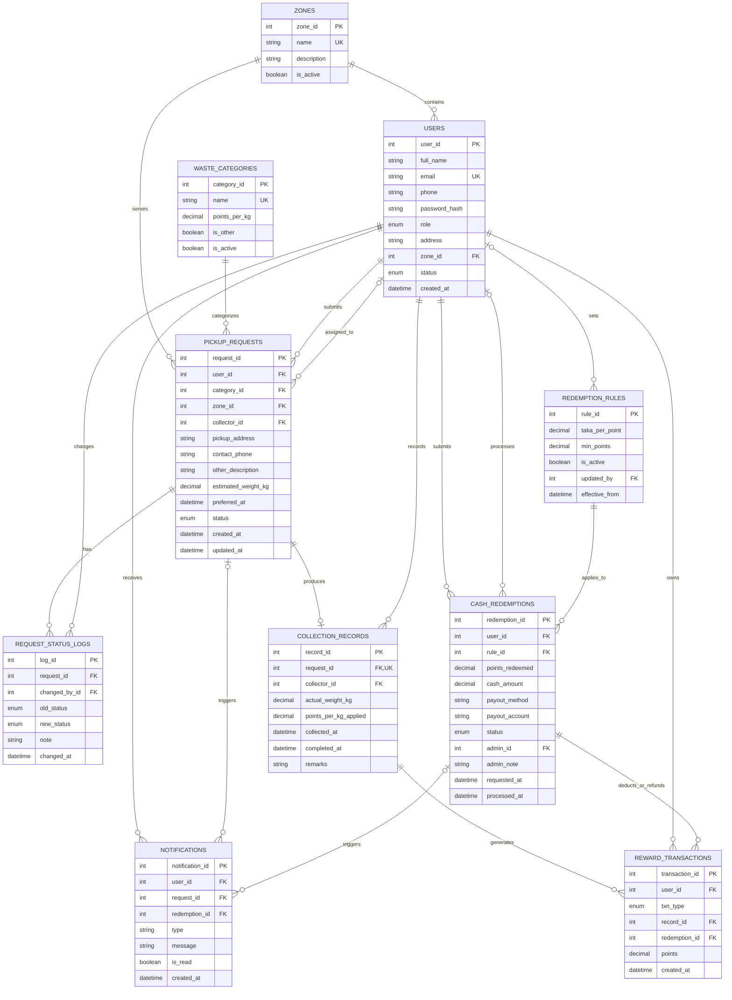

# WRR — Revised Requirements & System Design (Gap-Fixed)

**Project:** Waste Resource Recycle (WRR) Management System
**Course:** CSE-3112 Software Engineering Lab, Faridpur Engineering College
**Supervisor:** Mohammad Shamsul Islam, Associate Professor & Head, Dept. of CSE
**Team:** MD Mohiuddin Molla (2022254878), Abdul Al Noman (935)
**Model / Architecture:** Waterfall SDLC, three-tier (Presentation, Application, Data)
**Tech stack:** HTML, CSS, JavaScript; Node.js + Express.js; MySQL
**Revision date:** 10/11/2026. This version supersedes the requirements and design in `WRR_REQ_DESIGN.pdf`.
**Update 11/11/2026:** FR-15 (row lock for redemptions), FR-18 (correction audit and negative-balance rule), NFR-08, §4, and a new §9 REST API list, aligned with `WRR_PRD.md` v1.2.0. The schema is unchanged.

---

## 0. Gap-Fix Log

These are the changes from `WRR_REQ_DESIGN.pdf` (14/09/2026), traced to the client survey (`WRR_REQ_Question_SURVEY.pdf`, 04/11/2026).

| # | Gap found | Source | Fix applied |
|---|---|---|---|
| G1 | Notifications requested but not specified | Survey Q11 | FR-14 added, plus a `NOTIFICATIONS` table and an architecture module |
| G2 | Admin reports requested but not specified | Survey Q30 and Additional Suggestions | FR-17 added (report types listed). Reports are computed by queries, so no new table |
| G3 | Preferred pickup date/time in the schema but missing from the FRs | Survey Q8, Q9 | FR-03 now covers it. `preferred_at` must be in the future |
| G4 | Request statuses never defined; "Rejected" missing | Survey Q22 | §3 defines the survey's 6 statuses plus Cancelled, and every allowed transition |
| G5 | Reward text said "weight only" | Survey Q14 (weight **and** type) | Formula is points = actual_weight_kg × category.points_per_kg. The applied rate is stored in the record |
| G6 | No storage for the point-to-cash rule | Survey Q15, Q29 | New `REDEMPTION_RULES` table and FR-16 |
| G7 | Redemptions never deducted points from the balance | Design consistency | `REWARD_TRANSACTIONS` is now a ledger with EARN, REDEEM and REFUND entries. Balance = SUM(points) |
| G8 | Contact information missing from the request | Survey Q8, Q18 | `contact_phone` added to `PICKUP_REQUESTS`, defaulting to the user's phone |
| G9 | Admin could not manage collection records | Project scope | FR-18 added (view and correct records, with audit) |
| G10 | Estimated quantity missing from the FRs | Survey Q8 | Included in FR-03 |
| G11 | Status log kept only the new status and no reason | Reject flow | `old_status`, `new_status` and `note` columns added (note holds the reject reason) |
| G12 | Teammate's name spelled two ways (Noman / Roman) | Document headers | **Abdul Al Noman** used here, as in 3 of the 5 documents. **Please confirm the spelling.** |
| G13 | Architecture diagram lacked the new modules and tables | Diagram review | Diagram redrawn: notification service, redemption rules, reports, 10 tables |

---

## 1. User Requirements

### 1.1 General User
- Register and log in.
- Submit a pickup request with: waste category, estimated weight, pickup address, contact phone, preferred pickup date and time, and a description (required when the category is "Other Recyclable Waste").
- Select a category: Plastic, Paper & Cardboard, E-waste, Metal, Glass, or Other Recyclable Waste.
- Track request status and cancel a request while it is still Pending.
- Receive in-website notifications when request or redemption status changes.
- View collection history, actual collected weight, points earned per collection, and the current point balance.
- Request cash redemption of points and track its status.

### 1.2 Waste Collector
- Log in and view assigned requests, with user name, contact, location, category, estimated weight and preferred time.
- View and filter requests by zone.
- Accept or reject an assigned request (a reason is required to reject).
- Update status to Collected, record the actual weight, and mark the request Completed.
- View previous collection records.

### 1.3 Administrator
- Manage users and collectors (create, activate, deactivate).
- Manage pickup requests and assign or reassign collectors.
- Manage waste categories and their points-per-kg rates.
- Manage zones.
- Manage redemption rules (point-to-cash rate and minimum points).
- Review, approve, reject and mark cash redemptions as paid.
- Monitor and correct collection records.
- Generate reports.

---

## 2. System Requirements

### 2.1 Functional Requirements

| ID | Requirement |
|---|---|
| FR-01 | **Registration & login:** users self-register. The admin creates collector accounts. All roles log in with email and password (hashed with bcrypt), and sessions use JWT. |
| FR-02 | **Role-based access:** each endpoint is restricted to its role(s). Deactivated accounts cannot log in. |
| FR-03 | **Pickup request:** the user submits category, estimated weight (kg), pickup address, contact phone, zone and a preferred date/time (must be in the future). A description is required when the category `is_other = true`. The new request's status is **Pending**. |
| FR-04 | **Waste categories:** only active categories are shown to users. |
| FR-05 | **Request tracking:** the user sees the current status and the full status history of each request. |
| FR-06 | **Request cancellation:** the user may cancel only while the request is Pending. |
| FR-07 | **Collector assignment:** the admin assigns an active collector, preferably one in the same zone. Status becomes **Assigned**. |
| FR-08 | **Accept/reject:** the collector accepts (status **Accepted**) or rejects with a reason (status **Rejected**). A rejected request goes back to the admin's queue for reassignment. |
| FR-09 | **Collection & weight:** the collector marks the request **Collected** and records `actual_weight_kg` (> 0). |
| FR-10 | **Completion:** the collector marks the request **Completed**. The system then creates the reward transaction automatically. |
| FR-11 | **Reward calculation:** points = actual_weight_kg × the category's points_per_kg at the time of collection. The rate is stored in the collection record so later rate changes don't alter past rewards. |
| FR-12 | **Collection history:** users and collectors can view past records, filtered by date and category. |
| FR-13 | **Status audit:** every status change is logged with old status, new status, who made it, when, and an optional note. |
| FR-14 | **Notifications:** an in-website notification is created on Assigned, Accepted, Rejected, Collected, Completed (with points earned) and on redemption Approved, Rejected or Paid. The user sees an unread count and can mark notifications read. |
| FR-15 | **Cash redemption:** the user requests a redemption of at least `min_points` and no more than their balance, with a payout method (bKash, Nagad or bank) and account. Cash = points × the active `taka_per_point`. In one DB transaction the system locks the user's row (`SELECT ... FOR UPDATE`), checks the balance, inserts the redemption and holds the points as a REDEEM ledger entry. The lock makes concurrent redemptions by the same user run one after another, so points can't be spent twice. |
| FR-16 | **Redemption rules:** the admin sets `taka_per_point` and `min_points`. Only one rule is active at a time, and old rules are kept for audit. |
| FR-17 | **Reports:** the admin can generate (a) weight collected by category, zone and date range; (b) requests by status; (c) collector performance (completed count, total kg, rejection rate); (d) points issued vs. redeemed; (e) redemption summary by status. Reports can be printed or exported. |
| FR-18 | **Collection record management:** the admin can view all records and correct a wrong weight. In one DB transaction the system updates the weight, adds a balancing ADJUST ledger entry for the point difference, and writes a `request_status_logs` row (`old_status = new_status = Completed`, `changed_by_id` = admin, `note` = "Weight corrected from X kg to Y kg") as the audit record. A downward correction that would make the user's balance negative is refused. |
| FR-19 | **Zone management:** the admin creates, edits and deactivates zones. |
| FR-20 | **User/collector management:** the admin views, activates and deactivates accounts and sets each collector's zone. |
| FR-21 | **Redemption processing:** the admin approves, rejects (with a note) or marks a redemption Paid. Rejection creates a REFUND ledger entry that returns the points. |

### 2.2 Non-Functional Requirements

| ID | Category | Requirement (measurable) |
|---|---|---|
| NFR-01 | Usability | A user can submit a pickup request in at most 3 screens. The UI uses plain labels and a consistent layout per role. |
| NFR-02 | Performance | Normal operations respond in ≤ 2 s and reports in ≤ 5 s, with up to 50 concurrent users. |
| NFR-03 | Security | Passwords are hashed with bcrypt, HTTPS is used, role checks happen on the server, queries are parameterized (SQL injection), output is escaped (XSS), and login attempts are rate-limited. |
| NFR-04 | Reliability | Completion plus reward creation, redemption plus ledger entry, and weight correction plus ADJUST entry each run in a single DB transaction. A point balance can never go negative. |
| NFR-05 | Availability | The system is available during operating hours (8 AM–10 PM) with 99% uptime. |
| NFR-06 | Compatibility | Works in current Chrome, Firefox and Edge, on screens from 360 px wide upward. |
| NFR-07 | Maintainability | Layered code (routes → controllers → services → models), configuration in `.env`, and documented APIs (§9). |
| NFR-08 | Auditability | Status changes and record corrections (both in `request_status_logs`) and redemption decisions (`admin_id`, `processed_at`) keep who did them and when. |

All three survey priorities (Q31–Q33) were rated **Very Important**, so NFR-01 to NFR-03 are the top priorities.

### 2.3 Domain Requirements
- Waste is categorized as Plastic, Paper & Cardboard, E-waste, Metal, Glass, or Other Recyclable Waste.
- Rewards are based on the **actual** collected weight, never the estimate.
- Points depend on **both** weight and waste category.
- Requests are organized by collection zone.
- Only the assigned collector can act on a request. Only admins assign collectors or set rates and rules.
- Points convert to cash (BDT) only under the active redemption rule, and only after admin approval.

---

## 3. Request Status Lifecycle

| Status | Meaning | Set by |
|---|---|---|
| Pending | Submitted and waiting for assignment | System (on submit) or admin (after a reject) |
| Assigned | A collector has been assigned | Admin |
| Accepted | The collector has accepted | Collector |
| Rejected | The collector declined, with a reason | Collector |
| Collected | Waste picked up and actual weight recorded | Collector |
| Completed | Request closed and points credited | Collector |
| Cancelled | Withdrawn by the user while Pending | User |

**Allowed transitions:**
Pending → Assigned → Accepted → Collected → Completed
Assigned → Rejected → (admin reassigns) → Assigned
Pending → Cancelled

Any other transition is refused by the server.

> Cancelled was not in the survey's list. It is added to support FR-06. If you'd rather keep strictly to the survey's 6 statuses, drop it.

**Redemption statuses:** Pending → Approved → Paid, or Pending → Rejected (points refunded).

**Overall process:**
Request → Assign → Accept → Collect & Record Weight → Complete → Reward Points → (optional) Redeem for Cash

---

## 4. Reward & Redemption Rules

- **Earning:** `points = actual_weight_kg × points_per_kg_applied`, rounded to 2 decimals.
- **Balance:** `SUM(points)` over the user's `REWARD_TRANSACTIONS`. EARN and REFUND entries are positive, REDEEM entries are negative, and ADJUST entries are signed.
- **Redeeming:** `cash_amount = points_redeemed × taka_per_point`. This requires `points_redeemed ≥ min_points` and `points_redeemed ≤ balance`. The user's row is locked with `SELECT ... FOR UPDATE` while the balance is checked (FR-15).
- **Weight correction:** the ADJUST entry equals (new weight − old weight) × `points_per_kg_applied`. A correction that would make the balance negative is refused (FR-18).
- Rates are set by the admin. The values below are **examples only**, to seed the test database:

| Category | points_per_kg (example) |
|---|---|
| Plastic | 10 |
| Paper & Cardboard | 6 |
| E-waste | 25 |
| Metal | 15 |
| Glass | 4 |
| Other Recyclable Waste | 5 |

Example rule: `taka_per_point = 0.50`, `min_points = 100`.

---

## 5. System Architecture (Three-Tier)

- **Presentation layer:** a responsive web interface with role-specific dashboards for General User, Waste Collector and Administrator.
- **Application layer (Node.js + Express REST API):**
  - *Accounts & Setup:* authentication and RBAC, user and collector management, zone management, waste category and rate management.
  - *Pickup Workflow:* request management → collector assignment and status management (accept, reject, reassign) → weight recording and completion.
  - *Rewards, Notifications & Reports:* reward calculation, redemption rule management, cash redemption management, the notification service, and history and report generation.
- **Data layer (MySQL):** 10 tables (see §6).
- **Communication:** browser ⇄ API over HTTPS/JSON. API ⇄ database through parameterized SQL.

Diagram file: `WRR_Architecture_Revised.png`

---

## 6. Database Design (10 tables)

Changes from the original 8 tables are marked **[NEW]** or **[CHANGED]**.

1. **USERS [CHANGED]:** user_id PK; full_name; email UK; phone; password_hash; role ENUM(user, collector, admin); address; zone_id FK→ZONES; status ENUM(active, inactive); created_at *(added)*
2. **ZONES:** zone_id PK; name UK; description; is_active
3. **WASTE_CATEGORIES:** category_id PK; name UK; points_per_kg; is_other; is_active
4. **PICKUP_REQUESTS [CHANGED]:** request_id PK; user_id FK; category_id FK; zone_id FK; collector_id FK→USERS (nullable); pickup_address; contact_phone *(added)*; other_description; estimated_weight_kg; preferred_at; status ENUM *(the 7 statuses)*; created_at; updated_at *(added)*
5. **REQUEST_STATUS_LOGS [CHANGED]:** log_id PK; request_id FK; changed_by_id FK→USERS; old_status *(added)*; new_status; note *(added)*; changed_at
6. **COLLECTION_RECORDS [CHANGED]:** record_id PK; request_id FK UK; collector_id FK; actual_weight_kg; points_per_kg_applied *(added)*; collected_at; completed_at; remarks
7. **REWARD_TRANSACTIONS [CHANGED → ledger]:** transaction_id PK; user_id FK; txn_type ENUM(EARN, REDEEM, REFUND, ADJUST) *(added)*; record_id FK (nullable); redemption_id FK (nullable) *(added)*; points (signed); created_at
8. **REDEMPTION_RULES [NEW]:** rule_id PK; taka_per_point; min_points; is_active; updated_by FK→USERS; effective_from
9. **CASH_REDEMPTIONS [CHANGED]:** redemption_id PK; user_id FK; rule_id FK *(added)*; points_redeemed; cash_amount; payout_method; payout_account; status ENUM(Pending, Approved, Rejected, Paid); admin_id FK (nullable); admin_note *(added)*; requested_at; processed_at
10. **NOTIFICATIONS [NEW]:** notification_id PK; user_id FK; request_id FK (nullable); redemption_id FK (nullable); type; message; is_read; created_at

> The `UNIQUE` on `record_id` was dropped from REWARD_TRANSACTIONS, because an admin weight correction (FR-18) adds a second ADJUST entry for the same record. One EARN per record is enforced in the service code.

**Relationships:**
- ZONES 1–N USERS, and ZONES 1–N PICKUP_REQUESTS
- WASTE_CATEGORIES 1–N PICKUP_REQUESTS
- USERS 1–N PICKUP_REQUESTS (submits), and USERS 0..1–N PICKUP_REQUESTS (assigned collector)
- PICKUP_REQUESTS 1–N REQUEST_STATUS_LOGS, and PICKUP_REQUESTS 1–0..1 COLLECTION_RECORDS
- COLLECTION_RECORDS 1–N REWARD_TRANSACTIONS
- USERS 1–N CASH_REDEMPTIONS (submits), and USERS 0..1–N CASH_REDEMPTIONS (processes)
- CASH_REDEMPTIONS 1–N REWARD_TRANSACTIONS (deduct or refund)
- REDEMPTION_RULES 1–N CASH_REDEMPTIONS
- USERS 1–N NOTIFICATIONS

Diagram file: `WRR_ER_Diagram_Revised.png`

> **Note (11/11/2026):** `WRR_ER_Diagram_A4.svg` and `WRR_ER_Diagram_Revised.mmd` in the project still show the original columns. Redraw them from the Mermaid source in §8, which matches this schema.

### 6.1 MySQL DDL

```sql
CREATE TABLE zones (
  zone_id INT AUTO_INCREMENT PRIMARY KEY,
  name VARCHAR(100) NOT NULL UNIQUE,
  description TEXT,
  is_active BOOLEAN NOT NULL DEFAULT TRUE
);

CREATE TABLE users (
  user_id INT AUTO_INCREMENT PRIMARY KEY,
  full_name VARCHAR(100) NOT NULL,
  email VARCHAR(100) NOT NULL UNIQUE,
  phone VARCHAR(20) NOT NULL,
  password_hash VARCHAR(255) NOT NULL,
  role ENUM('user','collector','admin') NOT NULL DEFAULT 'user',
  address VARCHAR(255),
  zone_id INT NULL,
  status ENUM('active','inactive') NOT NULL DEFAULT 'active',
  created_at DATETIME NOT NULL DEFAULT CURRENT_TIMESTAMP,
  FOREIGN KEY (zone_id) REFERENCES zones(zone_id)
);

CREATE TABLE waste_categories (
  category_id INT AUTO_INCREMENT PRIMARY KEY,
  name VARCHAR(100) NOT NULL UNIQUE,
  points_per_kg DECIMAL(10,2) NOT NULL CHECK (points_per_kg >= 0),
  is_other BOOLEAN NOT NULL DEFAULT FALSE,
  is_active BOOLEAN NOT NULL DEFAULT TRUE
);

CREATE TABLE pickup_requests (
  request_id INT AUTO_INCREMENT PRIMARY KEY,
  user_id INT NOT NULL,
  category_id INT NOT NULL,
  zone_id INT NOT NULL,
  collector_id INT NULL,
  pickup_address VARCHAR(255) NOT NULL,
  contact_phone VARCHAR(20) NOT NULL,
  other_description TEXT,
  estimated_weight_kg DECIMAL(10,2) CHECK (estimated_weight_kg > 0),
  preferred_at DATETIME NOT NULL,
  status ENUM('Pending','Assigned','Accepted','Rejected','Collected','Completed','Cancelled')
         NOT NULL DEFAULT 'Pending',
  created_at DATETIME NOT NULL DEFAULT CURRENT_TIMESTAMP,
  updated_at DATETIME NOT NULL DEFAULT CURRENT_TIMESTAMP ON UPDATE CURRENT_TIMESTAMP,
  FOREIGN KEY (user_id) REFERENCES users(user_id),
  FOREIGN KEY (category_id) REFERENCES waste_categories(category_id),
  FOREIGN KEY (zone_id) REFERENCES zones(zone_id),
  FOREIGN KEY (collector_id) REFERENCES users(user_id),
  INDEX idx_req_status (status),
  INDEX idx_req_collector (collector_id, status),
  INDEX idx_req_zone (zone_id, status)
);

CREATE TABLE request_status_logs (
  log_id INT AUTO_INCREMENT PRIMARY KEY,
  request_id INT NOT NULL,
  changed_by_id INT NOT NULL,
  old_status VARCHAR(20),
  new_status VARCHAR(20) NOT NULL,
  note VARCHAR(255),
  changed_at DATETIME NOT NULL DEFAULT CURRENT_TIMESTAMP,
  FOREIGN KEY (request_id) REFERENCES pickup_requests(request_id),
  FOREIGN KEY (changed_by_id) REFERENCES users(user_id)
);

CREATE TABLE collection_records (
  record_id INT AUTO_INCREMENT PRIMARY KEY,
  request_id INT NOT NULL UNIQUE,
  collector_id INT NOT NULL,
  actual_weight_kg DECIMAL(10,2) NOT NULL CHECK (actual_weight_kg > 0),
  points_per_kg_applied DECIMAL(10,2) NOT NULL,
  collected_at DATETIME NOT NULL,
  completed_at DATETIME NULL,
  remarks TEXT,
  FOREIGN KEY (request_id) REFERENCES pickup_requests(request_id),
  FOREIGN KEY (collector_id) REFERENCES users(user_id)
);

CREATE TABLE redemption_rules (
  rule_id INT AUTO_INCREMENT PRIMARY KEY,
  taka_per_point DECIMAL(10,4) NOT NULL CHECK (taka_per_point > 0),
  min_points DECIMAL(10,2) NOT NULL DEFAULT 0,
  is_active BOOLEAN NOT NULL DEFAULT TRUE,
  updated_by INT NOT NULL,
  effective_from DATETIME NOT NULL DEFAULT CURRENT_TIMESTAMP,
  FOREIGN KEY (updated_by) REFERENCES users(user_id)
);

CREATE TABLE cash_redemptions (
  redemption_id INT AUTO_INCREMENT PRIMARY KEY,
  user_id INT NOT NULL,
  rule_id INT NOT NULL,
  points_redeemed DECIMAL(10,2) NOT NULL CHECK (points_redeemed > 0),
  cash_amount DECIMAL(10,2) NOT NULL,
  payout_method VARCHAR(50) NOT NULL,
  payout_account VARCHAR(255) NOT NULL,
  status ENUM('Pending','Approved','Rejected','Paid') NOT NULL DEFAULT 'Pending',
  admin_id INT NULL,
  admin_note VARCHAR(255),
  requested_at DATETIME NOT NULL DEFAULT CURRENT_TIMESTAMP,
  processed_at DATETIME NULL,
  FOREIGN KEY (user_id) REFERENCES users(user_id),
  FOREIGN KEY (rule_id) REFERENCES redemption_rules(rule_id),
  FOREIGN KEY (admin_id) REFERENCES users(user_id)
);

CREATE TABLE reward_transactions (
  transaction_id INT AUTO_INCREMENT PRIMARY KEY,
  user_id INT NOT NULL,
  txn_type ENUM('EARN','REDEEM','REFUND','ADJUST') NOT NULL,
  record_id INT NULL,
  redemption_id INT NULL,
  points DECIMAL(10,2) NOT NULL,          -- positive = credit, negative = debit
  created_at DATETIME NOT NULL DEFAULT CURRENT_TIMESTAMP,
  FOREIGN KEY (user_id) REFERENCES users(user_id),
  FOREIGN KEY (record_id) REFERENCES collection_records(record_id),
  FOREIGN KEY (redemption_id) REFERENCES cash_redemptions(redemption_id),
  INDEX idx_rt_user (user_id)
);

CREATE TABLE notifications (
  notification_id INT AUTO_INCREMENT PRIMARY KEY,
  user_id INT NOT NULL,
  request_id INT NULL,
  redemption_id INT NULL,
  type VARCHAR(50) NOT NULL,
  message VARCHAR(255) NOT NULL,
  is_read BOOLEAN NOT NULL DEFAULT FALSE,
  created_at DATETIME NOT NULL DEFAULT CURRENT_TIMESTAMP,
  FOREIGN KEY (user_id) REFERENCES users(user_id),
  FOREIGN KEY (request_id) REFERENCES pickup_requests(request_id),
  FOREIGN KEY (redemption_id) REFERENCES cash_redemptions(redemption_id),
  INDEX idx_notif_user (user_id, is_read)
);

-- Point balance of a user
-- SELECT COALESCE(SUM(points),0) AS balance FROM reward_transactions WHERE user_id = ?;
```

---

## 7. Requirements Traceability (Survey → Requirement → Table)

| Survey item | Requirement | Table(s) |
|---|---|---|
| Q5, Q6 online pickup | FR-03 | pickup_requests |
| Q7 categories | FR-04, Domain | waste_categories |
| Q8 request info | FR-03 | pickup_requests |
| Q9 preferred date/time | FR-03 | pickup_requests.preferred_at |
| Q10 tracking | FR-05, FR-13 | request_status_logs |
| Q11 notifications | FR-14 | notifications |
| Q12 history | FR-12 | collection_records |
| Q13, Q14 rewards (weight + type) | FR-11 | collection_records, reward_transactions |
| Q15 cash conversion | FR-15, FR-21 | cash_redemptions, reward_transactions |
| Q18 collector sees details | FR-08 | pickup_requests, users |
| Q19 admin assigns | FR-07 | pickup_requests.collector_id |
| Q20 accept/reject | FR-08 | request_status_logs |
| Q22 statuses | §3 | pickup_requests.status |
| Q23 actual weight | FR-09 | collection_records |
| Q24 zones | FR-19, Domain | zones |
| Q26 admin manages all | FR-07, FR-16 to FR-21 | all |
| Q29 conversion rules | FR-16 | redemption_rules |
| Q30 reports | FR-17 | (queries) |
| Q31–Q33 usability, security, speed | NFR-01 to NFR-03 | — |

---

## 8. Diagram Sources (Mermaid ER)

Paste this into mermaid.live to edit the ER diagram.



---

## 9. REST API Endpoints

All endpoints return JSON. "Auth" means any logged-in role. Details (payloads, effects) are in `WRR_PRD.md` §9.

| Method | Endpoint | Role | Purpose (FR) |
|---|---|---|---|
| POST | `/api/auth/register` | Public | Self-register a General User (FR-01) |
| POST | `/api/auth/login` | Public | Log in, returns JWT (FR-01) |
| GET | `/api/categories` | Auth | Active categories (FR-04) |
| POST | `/api/pickup-requests` | user | Submit request (FR-03) |
| GET | `/api/pickup-requests/mine` | user | Own requests + status history (FR-05) |
| PUT | `/api/pickup-requests/:id/cancel` | user | Cancel while Pending (FR-06) |
| GET | `/api/admin/pickup-requests` | admin | All requests / assignment queue (FR-07) |
| PUT | `/api/pickup-requests/:id/assign` | admin | Assign collector (FR-07) |
| GET | `/api/collector/requests` | collector | Assigned requests, filter by zone (FR-08) |
| PUT | `/api/pickup-requests/:id/accept` | collector | Accept (FR-08) |
| PUT | `/api/pickup-requests/:id/reject` | collector | Reject with reason (FR-08) |
| POST | `/api/collection-records` | collector | Record weight → Collected (FR-09) |
| PUT | `/api/pickup-requests/:id/complete` | collector | Complete → EARN + notification (FR-10, FR-11) |
| GET | `/api/collector/history` | collector | Own collection records (FR-12) |
| GET | `/api/rewards/balance` | user | Point balance (FR-11) |
| GET | `/api/rewards/history` | user | Ledger history (FR-12) |
| POST | `/api/redemptions` | user | Request redemption (FR-15) |
| GET | `/api/redemptions/mine` | user | Own redemptions (FR-15) |
| GET | `/api/admin/redemptions` | admin | Redemptions to review (FR-21) |
| PUT | `/api/redemptions/:id` | admin | Approve / reject / paid (FR-21) |
| GET | `/api/notifications` | Auth | Notifications + unread count (FR-14) |
| PUT | `/api/notifications/:id/read` | Auth | Mark read (FR-14) |
| GET / PUT | `/api/admin/users`, `/api/admin/users/:id` | admin | List users; set status and collector zone (FR-20) |
| POST | `/api/admin/collectors` | admin | Create collector (FR-20) |
| GET / POST / PUT | `/api/admin/zones`, `/api/admin/zones/:id` | admin | Zone management (FR-19) |
| GET / POST / PUT | `/api/admin/categories`, `/api/admin/categories/:id` | admin | Categories and rates (FR-04, FR-11) |
| GET / POST | `/api/admin/redemption-rules` | admin | Redemption rules (FR-16) |
| GET / PUT | `/api/admin/collection-records`, `/api/admin/collection-records/:id` | admin | View records; weight correction (FR-18) |
| GET | `/api/admin/reports/:type` | admin | The 5 reports (FR-17) |
