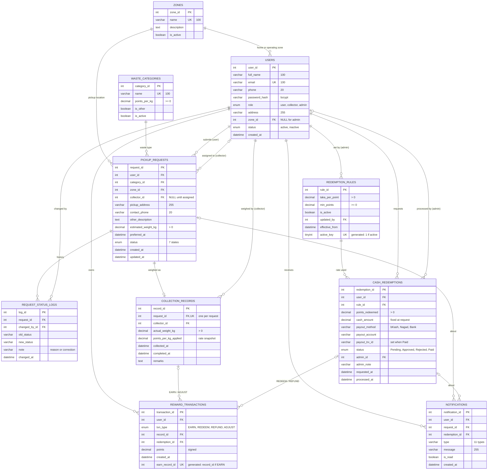

# ER Diagram — Waste Resource Recycle (WRR)

Drawn from `database/schema.sql` (10 tables, InnoDB, utf8mb4). It replaces the old report images `WRR_ER_Diagram_A4.svg` and `WRR_ER_Diagram_Revised.mmd`, which showed the original columns.

GitHub and VS Code (with a Mermaid extension) draw the diagram below. For the printed report, paste the code block into https://mermaid.live and export it as SVG or PNG.

**Keys:** `PK` primary key · `FK` foreign key · `UK` unique.

## Rules the diagram cannot show

| Rule | How the database enforces it |
|---|---|
| Only one active redemption rule | `active_key` is 1 for the active rule and NULL otherwise; `UNIQUE` allows many NULLs but only one 1 |
| At most one `EARN` per collection record | `earn_record_id` copies `record_id` only for `EARN` rows; `UNIQUE` on it |
| One collection record per request | `collection_records.request_id` is `UNIQUE` |
| Weights and rates are positive | `CHECK (actual_weight_kg > 0)`, `CHECK (estimated_weight_kg > 0)`, `CHECK (points_per_kg >= 0)`, `CHECK (taka_per_point > 0)`, `CHECK (points_redeemed > 0)` |
| Balance never below zero | Not a column: balance = `SUM(reward_transactions.points)`; checked inside the transaction while the user row is locked (`SELECT … FOR UPDATE`) |
| Audit rows are kept | `request_status_logs` → `pickup_requests` is `ON DELETE RESTRICT` |
| Rejecting clears the collector | Done by the service (T5), not by a foreign key; `collector_id` becomes NULL |
