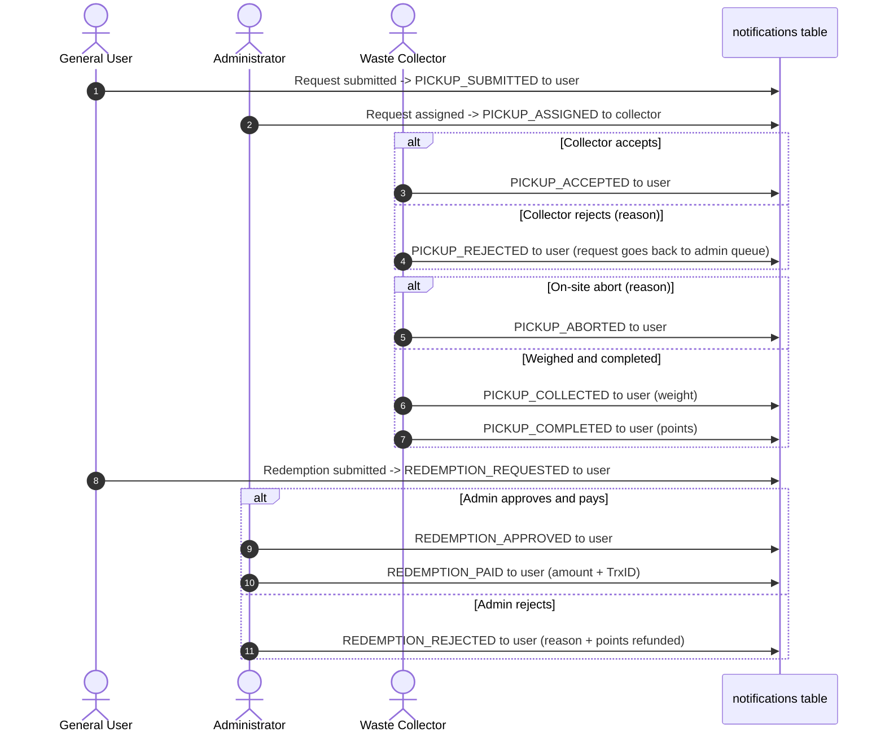

# Requirements Validation & Gap Analysis Report
## Cross-Audit of `WRR_PRD.md` (v1.3.0)
**Audit Role:** Product Analyst & QA Lead  
**Document Version:** 1.2.0  
**Date:** November 11, 2026  
**Target Specification:** [`WRR_PRD.md`](WRR_PRD.md), [`api-spec.md`](api-spec.md), [`database.md`](database.md)  
**Course Context:** CSE-3112 Software Engineering Lab, Faridpur Engineering College  
**Team:** MD Mohiuddin Molla (Reg: 2022254878), Abdul Al Noman (Reg: 935)  

---

## Executive Summary

This report checks `WRR_PRD.md` v1.3.0 across 8 dimensions. Each item is marked:

- **In scope** — specified in the PRD / API spec / schema and must be implemented.
- **Future work** — a sensible improvement that is **not** in the v1 scope; mention it in the lab report's "Future Work" section.

| Dimension | Result | Notes |
|---|---|---|
| 1. Missing Flows | 1 in scope, 4 future work | On-site abort is in scope (PRD §5.1 T7). |
| 2. Edge Cases | 6 cases covered | All handled by existing rules. |
| 3. Error Handling | Covered | Status codes fixed in PRD §10 and `api-spec.md` §1.4. |
| 4. Security | Covered | NFR-03. |
| 5. Validation | Covered | Field rules below match `api-spec.md`. |
| 6. Permissions (RBAC) | Covered | 44 endpoints in `api-spec.md` §2. |
| 7. Notifications | Covered | 11 types in FR-14. |
| 8. Exception Resilience | Covered | 6 fail-safes. |

---

## 1. Missing Flow Analysis
*Cross-referenced with PRD §4 (User Flows), §5.1 (State Lifecycle) and §6 (FR-01 to FR-21).*

| ID | Workflow | Gap | Decision |
|---|---|---|---|
| **MF-01** | Repeated rejections | A request rejected by several collectors can wait in `Rejected`. | **Future work:** show an "Escalated" badge when a request has ≥ 2 `Rejected` log rows. In v1 the admin sees all `Rejected` requests in the assignment queue. |
| **MF-02** | Collector deactivated with active jobs | Jobs in `Assigned`/`Accepted` would be stuck. | **Future work:** auto-return such jobs to `Pending`. In v1 the admin must reassign the collector's open jobs before deactivating them (shown as a warning in the admin UI). |
| **MF-03** | User cancels a pending redemption | No path to withdraw a redemption. | **Future work:** would need a new `Cancelled` redemption status. In v1 the user asks the admin, who rejects it (points are refunded). |
| **MF-04** | Password recovery | No reset flow. | **Future work:** admin-assisted reset endpoint. Not in v1. |
| **MF-05** | Collector on-site abort | Resident absent, unreachable, or waste contaminated. | **In scope:** `Accepted → Cancelled` with mandatory reason (PRD §5.1 T7, `PUT /api/v1/collector/requests/:id/abort`). |

---

## 2. Edge Case Analysis
*Cross-referenced with PRD §5.3, §5.4 and §9.*

| ID | Scenario | Severity | Rule |
|---|---|:---:|---|
| **EC-01** | **Downward weight correction would make balance negative** | Critical | Collector records 50 kg (500 pts); the user redeems 500 pts (balance 0). Admin corrects to 10 kg → `ADJUST` −400. The API refuses with **HTTP 422**: *"Weight correction denied: the user's balance would drop below 0.00."* |
| **EC-02** | **Two redemptions at the same time** | Critical | `SELECT user_id FROM users WHERE user_id = ? FOR UPDATE` inside the transaction makes the second request wait until the first `REDEEM` row is committed; it then sees the lower balance and fails with **HTTP 422**. |
| **EC-03** | **Category deactivated while pickups are in progress** | Medium | `is_active = FALSE` only hides the category from new requests. In-progress requests continue; the rate is snapshotted from the category row when the weight is recorded. |
| **EC-04** | **Large weight difference** | Medium | The collector records what was actually collected. If some waste is left, the user submits a new request. |
| **EC-05** | **Zero or negative weight** | High | Blocked in the controller (`actual_weight_kg > 0`) and by `CHECK (actual_weight_kg > 0)` in the database. |
| **EC-06** | **Rate changes while a redemption is pending** | High | `cash_amount` and `rule_id` are stored at submission, so later rule changes do not affect it. |

---

## 3. Error Handling
*Cross-referenced with PRD §10 and `api-spec.md` §1.4 / §4.*

### 3.1 HTTP Status Codes

| Code | When | Example message |
|:---:|---|---|
| **400** | Validation failure (missing field, bad format, past `preferred_at`) | `{"success": false, "message": "Validation failed.", "errors": [{"field": "preferred_at", "message": "Preferred date must be in the future."}]}` |
| **401** | Missing or expired login cookie | `{"success": false, "message": "Authentication required. Please log in."}` |
| **403** | Wrong role, or account inactive | `{"success": false, "message": "Access denied. Insufficient permissions for role: user."}` |
| **404** | Record does not exist | `{"success": false, "message": "Pickup request #999 not found."}` |
| **409** | Invalid state transition, or duplicate unique value (email, zone name) | `{"success": false, "message": "Invalid state transition from 'Completed' to 'Cancelled'."}` |
| **422** | Business rule broken (insufficient balance, below `min_points`, negative-balance correction) | `{"success": false, "message": "Insufficient points balance. Available: 55.00, Requested: 100.00."}` |
| **429** | More than 5 failed logins in 15 minutes | `{"success": false, "message": "Too many failed login attempts. Please try again in 15 minutes."}` |
| **500** | Unexpected server or database error | `{"success": false, "message": "An internal server error occurred."}` |

### 3.2 Transaction Rollback Pattern
All multi-table writes (completion + `EARN`; redemption + `REDEEM`; rejection + `REFUND`; weight correction + `ADJUST`) use:
```javascript
const connection = await pool.getConnection();
try {
  await connection.beginTransaction();
  // 1. Lock / check current state
  // 2. Update the main row (request, redemption or collection record)
  // 3. Insert the ledger row
  // 4. Insert the status log and notification
  await connection.commit();
} catch (err) {
  await connection.rollback();
  throw err;
} finally {
  connection.release();
}
```

---

## 4. Security & Threat Prevention
*Cross-referenced with PRD NFR-03.*

| Threat | Exposure | Countermeasure |
|---|---|---|
| **SQL Injection** | Filters, route params, login | Only parameterized queries (`mysql2` `?` placeholders). No string-built SQL. |
| **XSS** | `other_description`, `pickup_address`, `remarks`, `note` | User text inserted with `textContent`, never `innerHTML`. The JWT is in an `HttpOnly` cookie, so script cannot read it. |
| **CSRF** | Cookie-based auth | Cookie is `SameSite=Lax`; all state changes use `POST`/`PUT`/`PATCH` with a JSON body. |
| **IDOR** | Changing IDs in URLs | Ownership checks: `WHERE request_id = ? AND user_id = ?` for users, `WHERE collector_id = ?` for collectors. |
| **Brute-force login** | `/api/v1/auth/login` | `express-rate-limit`: 5 failed attempts per 15 minutes per IP. |
| **Password leak** | Database dump | bcrypt (cost 10); `password_hash` never returned by any endpoint. |
| **JWT tampering** | Changing `role` in the token | HMAC SHA-256 signature with a server-only `JWT_SECRET`; role and status are re-read from the database on each request. |

---

## 5. Input Validation Rules
*Matches `api-spec.md`.*

| Field | Rule |
|---|---|
| `users.full_name` | 3–100 characters |
| `users.phone`, `pickup_requests.contact_phone` | `^(?:\+8801\|01)[3-9]\d{8}$` (Bangladeshi mobile) |
| `users.email` | Valid email, stored lowercase, unique (409 if taken) |
| `password` | At least **8** characters |
| `from` / `to` filters | Real calendar date `YYYY-MM-DD` (e.g. `2026-02-31` → 400); `to` not before `from` |
| `pickup_requests.preferred_at` | Strictly in the future (`> NOW()`) |
| `pickup_requests.estimated_weight_kg` | Required, `> 0` |
| `pickup_requests.other_description` | Required (≥ 5 chars) when the category has `is_other = TRUE` |
| Reject / abort `reason` | Required, 5–200 characters |
| `collection_records.actual_weight_kg` | `> 0` (also a database `CHECK`) |
| `cash_redemptions.points_redeemed` | `≥ min_points` and `≤ balance` (422 otherwise) |
| `cash_redemptions.payout_method` | One of `bKash`, `Nagad`, `Bank` |
| `cash_redemptions.payout_account` | bKash/Nagad: 11-digit mobile number; Bank: account number |
| `cash_redemptions.payout_trx_id` | Required when marking `Paid` |
| Admin `reject` of a redemption | `admin_note` required |

---

## 6. Role-Based Access Control (RBAC) Matrix
*Cross-referenced with PRD §3.1 and `api-spec.md` §2 (all paths start with `/api/v1`).*

| Endpoint | Method | Public | User | Collector | Admin |
|---|:---:|:---:|:---:|:---:|:---:|
| `/auth/register`, `/auth/login` | `POST` | ✅ | — | — | — |
| `/auth/logout` | `POST` | ✅ (always clears the cookie) | ✅ | ✅ | ✅ |
| `/auth/me` | `GET` | ❌ | ✅ | ✅ | ✅ |
| `/categories`, `/zones` (active only) | `GET` | ✅ | ✅ | ✅ | ✅ |
| `/pickup-requests` (submit), `/pickup-requests/mine` | `POST`/`GET` | ❌ | ✅ (own) | ❌ | ❌ |
| `/pickup-requests/:id` | `GET` | ❌ | ✅ (own) | ✅ (assigned) | ✅ |
| `/pickup-requests/:id/cancel` | `PUT` | ❌ | ✅ (own, Pending) | ❌ | ❌ |
| `/collector/requests`, `/collector/history` | `GET` | ❌ | ❌ | ✅ (own) | ❌ |
| `/collector/requests/:id/accept`, `/reject` | `PUT` | ❌ | ❌ | ✅ (assigned, Assigned) | ❌ |
| `/collector/requests/:id/abort` | `PUT` | ❌ | ❌ | ✅ (assigned, Accepted) | ❌ |
| `/collector/collection-records` | `POST` | ❌ | ❌ | ✅ (assigned, Accepted) | ❌ |
| `/collector/requests/:id/complete` | `PUT` | ❌ | ❌ | ✅ (assigned, Collected) | ❌ |
| `/rewards/balance`, `/rewards/history` | `GET` | ❌ | ✅ (own) | ❌ | ❌ |
| `/redemptions/rules/active` | `GET` | ❌ | ✅ | ❌ | ✅ |
| `/redemptions`, `/redemptions/mine` | `POST`/`GET` | ❌ | ✅ (own) | ❌ | ❌ |
| `/notifications`, `/notifications/:id/read`, `/notifications/read-all` | `GET`/`PATCH` | ❌ | ✅ (own) | ✅ (own) | ✅ (own) |
| `/admin/*` (requests, assign, redemptions, records, categories, zones, rules, users, collectors, reports) | all | ❌ | ❌ | ❌ | ✅ |

---

## 7. Notification Triggers
*Cross-referenced with PRD FR-14. Admins get no notification rows; their dashboard shows queue counts.*



---

## 8. Exception Handling & Resilience

| Scenario | Risk | Strategy |
|---|---|---|
| **E-01: Database unavailable** | API errors during a request | Pool with `waitForConnections: true, connectionLimit: 10`; the error handler returns HTTP 500 with a generic message and the Node process keeps running. |
| **E-02: Simultaneous redemptions** | Double-spending | `SELECT ... FOR UPDATE` on the user row; the second request fails with HTTP 422. |
| **E-03: Correction exceeds balance** | Negative balance | Checked before the `ADJUST` insert; HTTP 422. |
| **E-04: Network drop in the field** | Collector loses the entered weight | The form keeps its values in `localStorage` until the server answers 201. |
| **E-05: Double-click on submit** | Duplicate requests or redemptions | Submit button is disabled on click until the response arrives. |
| **E-06: Session expired (7 days)** | Submit fails with 401 | `api.js` saves the draft in `sessionStorage` and redirects to `login.html`. |

---

## 9. Sign-Off

`WRR_PRD.md` v1.3.0, `api-spec.md` v1.1.0 and `database.md` v1.1.0 were cross-checked:

1. **Flows:** on-site abort is in scope; MF-01 to MF-04 are recorded as future work.
2. **Edge cases:** double-spend, negative corrections and in-progress category changes have explicit rules.
3. **Errors:** one status-code table used by all documents.
4. **Security:** parameterized SQL, `HttpOnly` cookie, XSS escaping, ownership checks, rate limiting.
5. **Validation:** field rules match the API spec.
6. **Permissions:** every `api-spec.md` endpoint has a role.
7. **Notifications:** 11 types, one recipient each.
8. **Exceptions:** six fail-safes defined.

**Status:** Ready for implementation.
